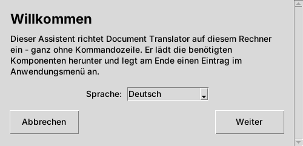
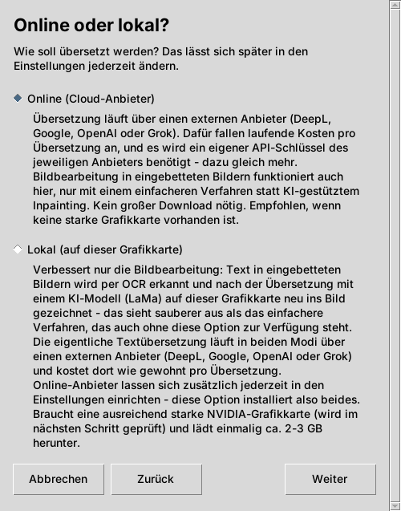
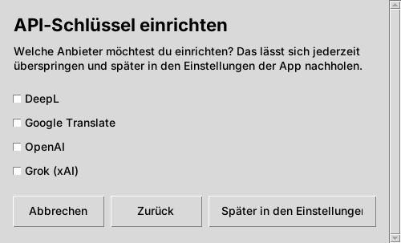
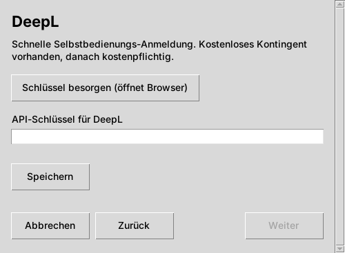
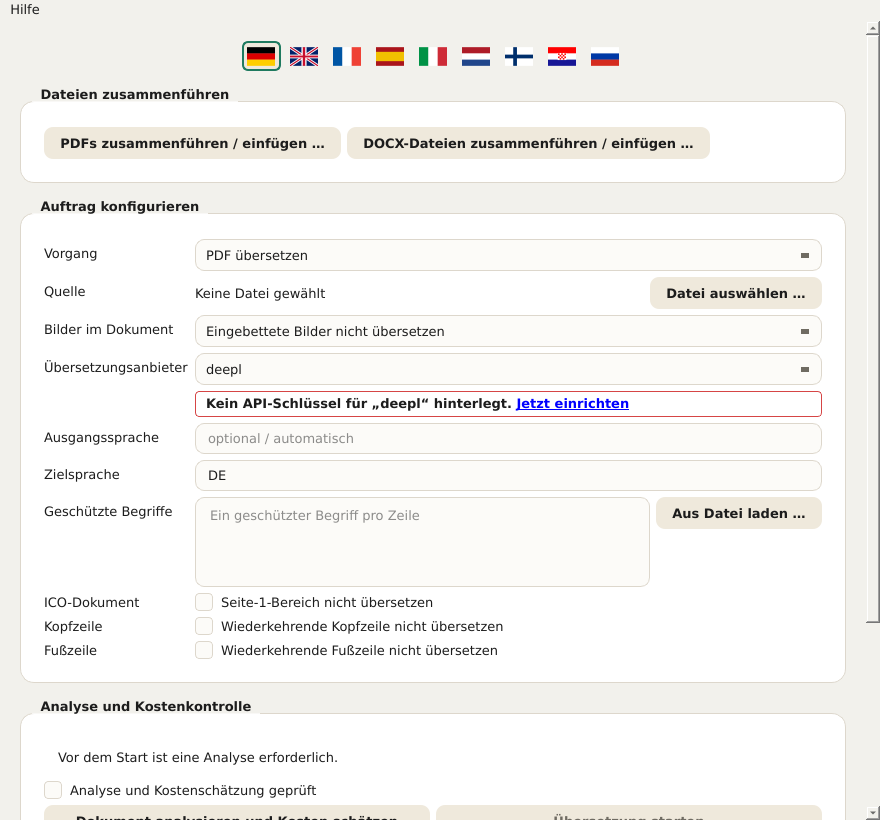
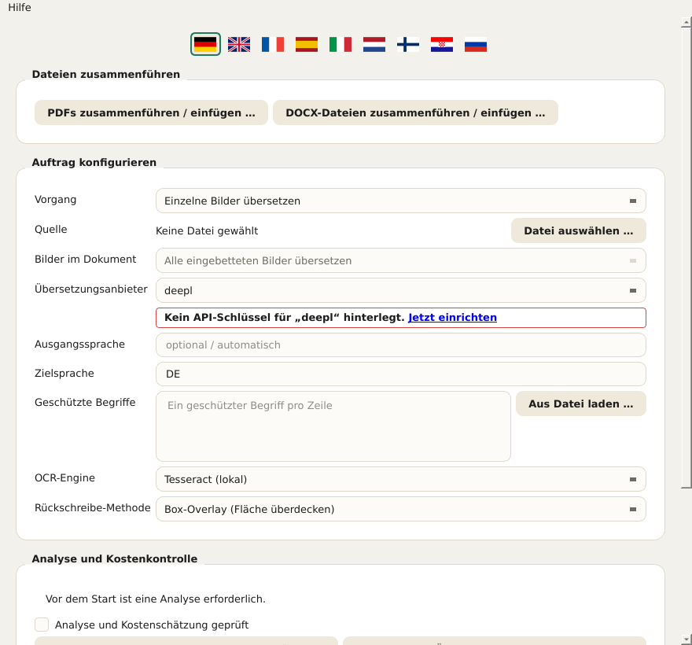
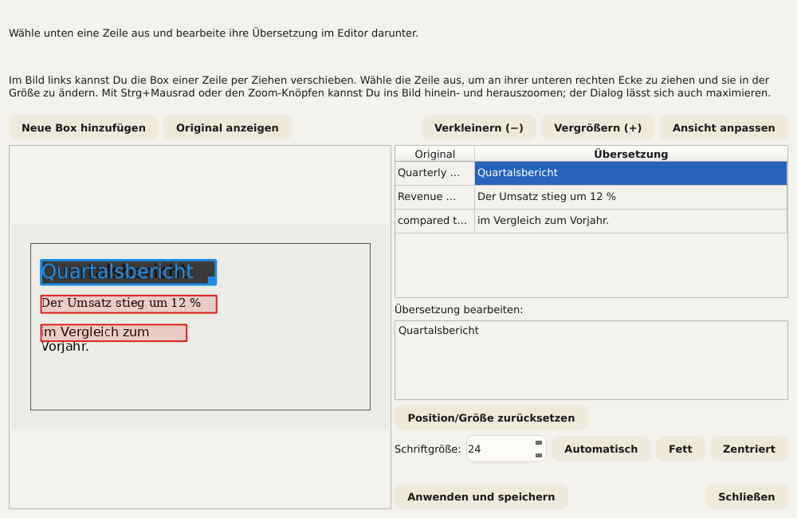
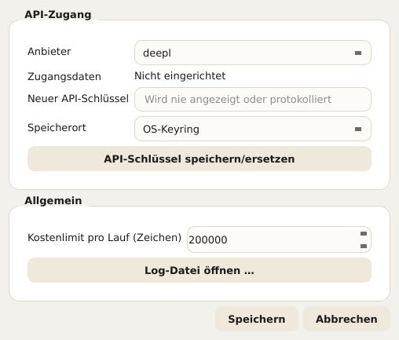
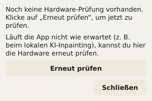

# Document Translator – Benutzerhandbuch

Dieses Handbuch beschreibt alle Bedienelemente von Document Translator: den
Einrichtungsassistenten (Installer) und die eigentliche App. Es basiert auf
denselben Hilfetexten, die auch direkt in der Anwendung angezeigt werden
(Tooltip beim Überfahren mit der Maus, ausführlicher Text über
Hilfe → Direkthilfe bzw. Umschalt+F1 und anschließenden Klick auf ein
Element). Wer die App bereits kennt, kann dieses Dokument also auch einfach
als Nachschlagewerk nutzen.

In der App lässt sich dieses Handbuch jederzeit über
**Hilfe → Benutzerhandbuch …** öffnen – automatisch in der gerade
eingestellten Sprache der Bedienoberfläche. Hinweise, die direkt unter einem
Feld erscheinen (z. B. „PaddleOCR ist nicht installiert“), verlinken
ebenfalls hierher.

## Inhalt

1. Einrichtungsassistent (Installation)
2. Die App im Überblick
3. Dokument auswählen und Grundeinstellungen
4. Umgang mit Bildern im Dokument
5. Geschützte Begriffe
6. Kopf- und Fußzeilen ausschließen
7. Kosten schätzen und Übersetzung starten
8. Während und nach dem Lauf
9. Übersetzungen manuell korrigieren
10. Mehrere Dateien zusammenführen
11. Einstellungen
12. Sprache der Bedienoberfläche
13. Hardware-Test (GPU)
14. Updates und Versionsinfo

---

## 1. Einrichtungsassistent (Installation)

Der Einrichtungsassistent richtet Document Translator einmalig auf diesem Rechner
ein. Er benötigt keine Administrator-/Root-Rechte, da alles in einem
persönlichen, benutzereigenen Ordner installiert wird.

**Sprache.** Die Sprachauswahl auf dem ersten Bildschirm wirkt sofort auf alle
weiteren Bildschirme des Assistenten. Sie ist unabhängig von der Sprache der
späteren App, die eine eigene Sprachauswahl hat (siehe Kapitel 12).

**Online oder lokal?** Hier wird gewählt, wie Bilder in Dokumenten bearbeitet
werden:

- **Online (Cloud-Anbieter):** Die Übersetzung läuft über einen
  Cloud-Anbieter (DeepL, Google, OpenAI oder Grok). Für die Bildbearbeitung
  wird ein einfacheres, lokales Verfahren verwendet. Das ist die schnellste
  und einfachste Installation und funktioniert auf jedem Rechner. Es wird ein
  eigener API-Schlüssel des gewählten Anbieters sowie eine
  Internetverbindung während der Übersetzung benötigt.
- **Lokal (auf dieser Grafikkarte):** Zusätzlich zur Online-Variante wird
  eine bessere, KI-gestützte Bildbearbeitung (LaMa) auf der eigenen
  Grafikkarte installiert. Dafür bleibt die Bildbearbeitung vollständig auf
  diesem Rechner. Benötigt wird eine unterstützte NVIDIA-Grafikkarte mit
  ausreichend Videospeicher (wird im nächsten Schritt geprüft); es lädt
  einmalig ca. 2–3 GB herunter. Die eigentliche Textübersetzung läuft in
  beiden Modi immer über einen externen Anbieter und kostet dort wie gewohnt
  pro Übersetzung.

  Was diese Option konkret bringt, ist in Kapitel 4 („Umgang mit Bildern im
  Dokument“) genauer beschrieben – kurz gesagt: eine deutlich bessere
  Bildqualität, wenn übersetzte Dokumente Fotos oder andere komplexe
  Hintergründe enthalten, sonst nicht zwingend nötig.

Fällt die GPU-Prüfung negativ aus (keine unterstützte Karte gefunden oder
Treiber veraltet), bietet der Assistent zwei Wege an: **„Trotzdem lokal
fortfahren“** (sinnvoll, wenn die Prüfung fälschlich fehlschlug oder ein
Treiber-Update noch aussteht – der Hardware-Test lässt sich später jederzeit
in der App wiederholen, siehe Kapitel 13) oder **„Zu Online wechseln“**.
Online-Anbieter lassen sich unabhängig davon jederzeit über die
Einstellungen der App ergänzen.

**API-Schlüssel einrichten.** Für jeden gewünschten Anbieter lässt sich hier
direkt ein API-Schlüssel hinterlegen. Nicht angehakte Anbieter können jederzeit
später in den Einstellungen der App ergänzt werden (Button **„Später in den
Einstellungen“**). Für jeden angehakten Anbieter öffnet sich ein eigener
Bildschirm mit einem Eingabefeld (die Eingabe erscheint als Punkte) und dem
Button **„Schlüssel besorgen (öffnet Browser)“**, der die
Registrierungsseite des jeweiligen Anbieters im Browser öffnet – dort wird
der Schlüssel erzeugt, der anschließend hier eingefügt wird. Erst der Button
**„Speichern“** übernimmt die Eingabe tatsächlich. Ohne Schlüssel lässt sich
der Assistent ebenfalls abschließen; ohne mindestens einen hinterlegten
Schlüssel funktioniert danach allerdings noch keine Übersetzung.

*Sicherheitshinweis beim Öffnen des Browsers:* Bevor der Assistent einen Link
im Standardbrowser öffnet, wird die Ziel-Adresse noch einmal im Klartext
angezeigt und muss bestätigt werden. So lässt sich vor dem Öffnen prüfen, ob es
wirklich die erwartete Adresse ist.

**Zurück, Weiter, Abbrechen.** Jeder Bildschirm hat unten dieselbe Leiste mit
**„Zurück“** (bereits gemachte Eingaben bleiben dabei erhalten),
**„Weiter“** und **„Abbrechen“**. Beim Abbrechen wird noch einmal
nachgefragt; wird bestätigt, entfernt der Assistent automatisch alle bis
dahin bereits angelegten Dateien wieder – die Einrichtung lässt sich
jederzeit erneut starten. Läuft gerade die eigentliche Installation, kann in
seltenen Fällen eine gerade verwendete Datei zurückbleiben; auch dann wird
aber versucht, so viel wie möglich automatisch zu entfernen.

**Fertigstellung.** Am Ende lässt sich der Assistent entweder mit
**„Schließen“** beenden, ohne die App zu starten, oder mit **„Jetzt
starten“** direkt mit dem Start der App kombinieren.

---

## 2. Die App im Überblick

Nach der Installation öffnet sich die eigentliche Document-Translator-App mit einem
Formular für den Übersetzungslauf. Die folgenden Kapitel gehen die Bedienung
von oben nach unten durch, so wie sie im Fenster angeordnet ist. Die
aktuelle Versionsnummer steht in der Titelleiste des Fensters.

---

## 3. Dokument auswählen und Grundeinstellungen

**Feld „Vorgang“ – bestimmt, welcher Übersetzungsablauf verwendet wird.** Je
nach Auswahl blenden sich weiter unten nur die dafür relevanten Felder ein –
die OCR-Einstellungen zum Beispiel nur im Modus „Einzelne Bilder
übersetzen“. Vier Optionen stehen zur Wahl:

- **PDF übersetzen** – ein einzelnes PDF-Dokument.
- **Präsentation (PowerPoint/Impress) übersetzen** – eine einzelne
  PPTX-Datei.
- **Word/Writer übersetzen** – eine einzelne DOCX-Datei.
- **Einzelne Bilder übersetzen** – eine oder mehrere Bilddateien; blendet
  zusätzlich die Felder „OCR-Engine“ und „Rückschreibe-Methode“ ein (siehe
  Kapitel 4).

**Feld „Quelle“ – wählt die zu übersetzende Datei.** Der Button **„Datei
auswählen …“** öffnet den Dateiauswahl-Dialog (im Bilder-Modus lassen sich
auch mehrere Dateien gleichzeitig wählen). Der gewählte Dateiname erscheint
anschließend daneben. Steht dort „Keine Datei gewählt“, muss zuerst eine
Datei gewählt werden, bevor eine Kostenanalyse möglich ist.

**Felder „Ausgangssprache“ und „Zielsprache“ – die beiden
Übersetzungssprachen dieses Laufs.** Beide werden als zweibuchstabiger
Sprachcode nach ISO 639-1 angegeben, z. B. EN für Englisch oder DE für
Deutsch. Die Ausgangssprache muss zur tatsächlichen Sprache des Dokuments
passen, sonst liefert der Übersetzungsanbieter falsche oder gar keine
Ergebnisse.

**Feld „Übersetzungsanbieter“ – welcher Cloud-Dienst die eigentliche
Textübersetzung durchführt.** Vier Anbieter stehen zur Wahl, jeder mit einem
eigenen, in den Einstellungen verwalteten API-Schlüssel (Kapitel 11):

- **DeepL**
- **Google**
- **OpenAI**
- **Grok**

Fehlt für den gewählten Anbieter ein Schlüssel, erscheint direkt darunter ein
rot umrandeter Hinweis mit einem Link zu den Einstellungen.

---

## 4. Umgang mit Bildern im Dokument

Im Formular gibt es dafür das Feld **„Bilder im Dokument“**, mit drei
Auswahlmöglichkeiten:

- **Eingebettete Bilder nicht übersetzen** – eingebettete Bilder bleiben
  unverändert.
- **Bilder später einzeln auswählen** – soll künftig nach der
  Kostenanalyse eine Liste zeigen, aus der gezielt Bilder ausgewählt werden.
- **Alle eingebetteten Bilder übersetzen** – soll künftig jedes eingebettete
  Bild automatisch mitverarbeiten.

Wichtig, damit hier keine falschen Erwartungen entstehen:

> **Aktueller Stand: Dieses Feld hat bei PDF, PowerPoint/Impress und
> Word/Writer derzeit noch KEINE Wirkung auf das Ergebnis.** Eingebettete
> Bilder in diesen drei Dokumenttypen werden beim jetzigen Stand IMMER
> unverändert übernommen – unabhängig davon, welche der drei Optionen oben
> ausgewählt ist. Das ist keine Fehlfunktion, sondern ein noch nicht
> umgesetzter Programmpunkt: Auch die oben beschriebene Auswahlliste für
> „Bilder später einzeln auswählen“ existiert noch nicht. Die App weist
> während der Kostenanalyse ausdrücklich selbst darauf hin, sobald ein
> Dokument eingebettete Bilder enthält und nicht „Eingebettete Bilder nicht
> übersetzen“ gewählt ist. Nur reine Bilddateien im eigenen Modus
> **„Einzelne Bilder übersetzen“** (siehe unten) werden schon jetzt
> vollständig übersetzt – das ist ein komplett eigener, ausgereifter Ablauf
> und von dieser Einschränkung nicht betroffen.

Im Bilder-Modus selbst ist das Feld deshalb auch gesperrt (fest auf „Alle
eingebetteten Bilder übersetzen“) und hat dort keine praktische Bedeutung –
die eigentliche Steuerung findet für diesen Modus über die beiden Felder
„OCR-Engine“ und „Rückschreibe-Methode“ weiter unten statt.

Nur im Modus „Einzelne Bilder übersetzen“ (Kapitel 3) sichtbar sind
zusätzlich zwei weitere Felder, **„OCR-Engine“** und
**„Rückschreibe-Methode“**, im Screenshot unten mit ihren Vorgabewerten
(Tesseract bzw. Box-Overlay) zu sehen – beide werden im Anschluss einzeln
erklärt:

**Feld „OCR-Engine“ – Texterkennung.** Erkennt Text in den Bildern, bevor er
übersetzt und zurückgeschrieben wird. Drei Engines stehen zur Auswahl (im
Screenshot oben steht gerade die erste):

- **Tesseract (lokal)** (Vorgabe). Läuft komplett lokal, ohne
  Cloud-Anbieter oder eigenen API-Schlüssel – braucht dafür die
  Tesseract-Software selbst installiert auf diesem Rechner (siehe
  README.md). Erkennt Text zeilenweise; Document Translator gruppiert die Zeilen
  danach selbst zu Absätzen.
- **Google Cloud Vision (Cloud, Absatzerkennung)**. Läuft über Googles
  Cloud-Dienst und nutzt denselben API-Schlüssel wie der
  Übersetzungsanbieter „Google“ (Kapitel 3/11) – erkennt Absätze bereits als
  solche, statt sie erst aus einzelnen Zeilen zusammenzusetzen, was bei
  dicht beschriebenen Bildern spürbar bessere Ergebnisse liefert als das
  zeilenweise Vorgehen von Tesseract.
- **PaddleOCR (lokal, Absatzerkennung)**. Läuft ebenfalls komplett lokal,
  ohne Cloud-Anbieter, erkennt aber wie Google Cloud Vision Absätze direkt
  über ein eigenes, trainiertes Layout-Modell statt über eine geometrische
  Annäherung. **PaddleOCR wird vom Einrichtungsassistenten nicht
  mitinstalliert** – das zusätzliche, optionale Paket muss nachträglich in
  die Python-Umgebung der App installiert werden (Paketliste:
  requirements-paddleocr.txt im App-Ordner). Wer das nicht möchte, nutzt
  stattdessen Tesseract oder Google Cloud Vision.

Steht die in diesem Feld gewählte Engine auf diesem Rechner nicht zur
Verfügung (Tesseract-Programm nicht gefunden, kein Google-API-Schlüssel
hinterlegt bzw. PaddleOCR nicht installiert), erscheint direkt darunter ein
rot umrandeter Hinweis mit einem Link auf dieses Kapitel, und ein Lauf mit
dieser Engine lässt sich nicht starten.

**Feld „Rückschreibe-Methode“ – wie der übersetzte Text ins Bild
zurückgeschrieben wird.** Nachdem der Originaltext erkannt und übersetzt
wurde, muss die Übersetzung an seiner Stelle ins Bild zurückgeschrieben
werden – vorher muss aber der darunterliegende Hintergrund wiederhergestellt
werden, damit der alte Text nicht einfach durchscheint. Dieses eine Feld
bietet dafür drei Verfahren mit unterschiedlicher Qualität und
unterschiedlichen Voraussetzungen zur Auswahl (im Screenshot oben steht
gerade das erste):

- **Box-Overlay (Fläche überdecken)** (Vorgabe). Füllt die Fläche mit einer
  einfarbigen Fläche (oder einem einfachen Verlauf, wenn die Umgebung
  eindeutig danach aussieht) und schreibt den übersetzten Text darüber.
  Läuft immer, ohne besondere Hardware oder Zusatzsoftware, und ist deshalb
  die Voreinstellung. Auf einfarbigen oder gleichmäßigen Hintergründen
  (z. B. Tabellen, Diagramme, Infokästen) fällt das kaum auf; auf echten
  Fotos oder texturierten Hintergründen ist die Fläche als sichtbarer
  „Flicken“ zu erkennen.
- **Klassisches CPU-Inpainting (Hintergrund rekonstruieren)**. Nutzt ein
  klassisches Bildbearbeitungsverfahren (kein KI-Modell) aus der freien
  Bildbearbeitungs-Bibliothek OpenCV, um die Umgebung um die Textstelle
  herum fortzusetzen, statt sie nur einfarbig zu füllen – einfache Muster
  oder Verläufe gehen dadurch glaubwürdig bis an (und leicht über) die Kante
  der Textbox weiter. Läuft ebenfalls immer lokal ohne GPU, ist aber wie
  Box-Overlay kein Ersatz für die KI-gestützte Variante bei wirklich
  komplexen, fotografischen Hintergründen.
- **KI-Inpainting lokal (GPU, LaMa)**. Nutzt ein spezielles, auf genau diese
  Aufgabe trainiertes KI-Modell namens LaMa auf der lokalen Grafikkarte, um
  auch komplexe, fotografische Hintergründe glaubwürdig zu rekonstruieren –
  die mit Abstand beste Qualität der drei Verfahren. Dafür wird eine
  unterstützte NVIDIA-Grafikkarte mit CUDA-Unterstützung benötigt (nur
  installiert, wenn beim Einrichten „Lokal“ gewählt wurde, siehe Kapitel 1)
  und beim allerersten Einsatz ein mehrere hundert MB großes Modell
  heruntergeladen (danach dauerhaft zwischengespeichert). Ist PyTorch mit
  CUDA-Unterstützung nicht installiert, erscheint unter dem Feld ein rot
  umrandeter Hinweis. Hat die Grafikkarte weniger Videospeicher als
  empfohlen, erscheint stattdessen ein gelb umrandeter Hinweis – das
  Verfahren lässt sich dann trotzdem nutzen, aber ohne Gewähr. Der
  Hardware-Status lässt sich jederzeit über den Hardware-Test prüfen
  (Kapitel 13).

Als Faustregel: Für Dokumente mit einfachen, flächigen Hintergründen (die
meisten Tabellen, Diagramme, Präsentationsfolien) reichen Box-Overlay oder
klassisches CPU-Inpainting völlig aus – ohne GPU, ohne Wartezeit. Bei Fotos
oder detailreichen Hintergründen lohnt sich das KI-Inpainting deutlich
sichtbar. Nachträglich korrigierte Übersetzungen (Kapitel 9) lassen sich
übrigens mit jedem der drei Verfahren neu rendern, unabhängig davon, mit
welchem Verfahren der ursprüngliche Lauf gemacht wurde.

**Weitere Optionen für bestimmte Dokumenttypen:**

- **Feld „ICO-Dokument“** (Checkbox „Seite-1-Bereich nicht übersetzen“)
  betrifft ausschließlich den internen Dokumententyp ICO und schließt den
  Metadatenbereich auf Seite 1 von der Übersetzung aus (bei Word den Bereich
  vor der Trennlinie, bei PDF anhand von Ankerbegriffen wie „Issuer
  Address“/„Asset Matrix“ erkannt) – unabhängig davon, ob dieser Bereich
  tatsächlich gefunden wird. Für alle anderen Dokumente deaktiviert lassen.
- **Feld „Nebeneinander anzeigen“** (Checkbox „Original und Übersetzung
  nebeneinander“, nur Word) baut den Haupttext statt des normalen,
  layoutgetreuen Ergebnisses als zweispaltige Vergleichstabelle
  (Original | Übersetzung) im Querformat auf. Kopf- und Fußzeile bleiben
  unverändert; eingebettete Tabellen im Haupttext erscheinen in dieser Ansicht
  nicht.

---

## 5. Geschützte Begriffe

Im Feld **„Geschützte Begriffe“** lassen sich Begriffe eintragen, die
unübersetzt bleiben sollen – ein Begriff pro Zeile, zum Beispiel Firmen- oder
Produktnamen. Der Übersetzungsanbieter lässt diese Begriffe unangetastet.
Über den Button **„Aus Datei laden …“** lässt sich zusätzlich eine Liste aus
einer CSV- oder Textdatei nachladen (ein Begriff pro Zeile, bei CSV zählt die
erste Spalte); vorhandene Einträge bleiben dabei erhalten, Duplikate werden
übersprungen.

**Wichtig: geschützt wird nur die GROSSGESCHRIEBENE Fundstelle.** Ein
eingetragener Begriff selbst darf beliebig geschrieben werden (klein, groß,
gemischt – die Schreibweise in diesem Feld spielt keine Rolle). Entscheidend
ist, wie der Begriff später im zu übersetzenden Dokument tatsächlich
geschrieben ist: Nur Fundstellen, die dort komplett in GROSSBUCHSTABEN
stehen, werden von der Übersetzung ausgenommen. Kommt derselbe Begriff an
anderer Stelle im Dokument klein- oder gemischtgeschrieben vor, wird er dort
ganz normal mitübersetzt.

Der Grund dafür: Manche geschützten Begriffe (etwa Produkt- oder Projektnamen,
die eigentlich immer in Großbuchstaben geschrieben werden) sind zufällig auch
ganz gewöhnliche Wörter der Ausgangssprache. Würde jede Fundstelle unabhängig
von ihrer Schreibweise geschützt, bliebe auch das gewöhnliche Wort an jeder
anderen Stelle im Dokument unübersetzt – und müsste von Hand nachkorrigiert
werden. Wer sichergehen will, dass ein Begriff im Dokument tatsächlich
geschützt wird, sollte deshalb prüfen, ob er dort auch wirklich in
Großbuchstaben geschrieben ist – sonst wird versehentlich zu wenig geschützt
(ein klein geschriebenes Vorkommen bleibt ungeschützt und wird übersetzt) oder,
bei unbeabsichtigten Großschreibungen an anderer Stelle im Dokument, zu viel.

---

## 6. Kopf- und Fußzeilen ausschließen

Zwei Felder (nur bei PDF) erkennen automatisch wiederkehrenden Text und
schließen ihn von der Übersetzung aus:

- **Feld „Kopfzeile“** (Checkbox „Wiederkehrende Kopfzeile nicht
  übersetzen“) – Text, der nahe oben auf den meisten Seiten identisch (oder
  nur mit unterschiedlicher Seitenzahl) wiederkehrt.
- **Feld „Fußzeile“** (Checkbox „Wiederkehrende Fußzeile nicht übersetzen“)
  – dasselbe für wiederkehrenden Text nahe unten auf der Seite (z. B.
  Copyright-Zeile, Seitenzahl).

Wird nichts Passendes gefunden, ändert sich einfach nichts.

---

## 7. Kosten schätzen und Übersetzung starten

Bevor eine Übersetzung startet, muss im Bereich **„Analyse und
Kostenkontrolle“** zunächst geschätzt werden, was sie ungefähr kostet:

1. **„Dokument analysieren und Kosten schätzen“** zählt die zu
   übersetzenden Zeichen und schätzt anhand des gewählten Anbieters die
   ungefähren Kosten, ohne bereits etwas zu übersetzen.
2. Erst danach lässt sich der Haken **„Analyse und Kostenschätzung
   geprüft“** setzen – eine bewusste Sicherheitsstufe, damit kein Lauf
   versehentlich ohne vorherigen Blick auf die geschätzten Kosten gestartet
   wird.
3. Erst mit gesetztem Haken wird **„Übersetzung starten“** klickbar.

Wird danach etwas am Formular geändert (z. B. eine andere Datei oder ein
anderer Anbieter), muss die Analyse erneut ausgeführt werden.

---

## 8. Während und nach dem Lauf

Der Fortschritt eines laufenden Übersetzungslaufs erscheint im Bereich
**„Lauf und Ergebnis“**. Ein laufender Lauf lässt sich über
**„Abbrechen“** so schnell wie möglich stoppen (nach dem gerade laufenden
Aufruf beim Übersetzungsanbieter); bereits verarbeitete Teile bleiben dabei
nicht automatisch als vollständige Datei erhalten – je nach Format kann eine
unvollständige Datei zurückbleiben.

Nach Abschluss eines Laufs stehen zur Verfügung:

- **„Ordner öffnen“** – öffnet den Datei-Explorer im Zielordner des gerade
  abgeschlossenen Laufs.
- **„QA-Bericht öffnen“** – zeigt Auffälligkeiten aus der automatischen
  Qualitätsprüfung des Laufs, z. B. Textstellen, die möglicherweise überprüft
  werden sollten.
- **„Übersetzung korrigieren“** – bei PDF- und Bilder-Läufen mit
  korrigierbaren Textstellen sichtbar; ermöglicht es, einzelne übersetzte
  Textstellen gezielt nachzubearbeiten, ohne den ganzen Lauf zu wiederholen
  (Details dazu in Kapitel 9).

---

## 9. Übersetzungen manuell korrigieren

Nach einem abgeschlossenen Lauf erscheint – sofern es überhaupt korrigierbare
Textstellen gibt – der Button **„Übersetzung korrigieren“** (siehe Kapitel 8).
Je nach Dokumenttyp öffnet sich dabei einer von zwei unterschiedlich
aufwendigen Dialogen:

- Bei **PDF-Läufen** der Dialog „PDF-Übersetzung korrigieren“ mit einer
  Tabelle aus Original- und Übersetzungstext je Textblock, in der sich
  einzelne Übersetzungen direkt überschreiben lassen.
- Bei **Bilder-Läufen** der deutlich umfangreichere Dialog
  **„Bildübersetzung korrigieren“**, weil hier nicht nur der Text, sondern
  auch seine Position und Größe im Bild stimmen müssen. Wurden in einem
  Bilder-Lauf mehrere Dateien auf einmal übersetzt, fragt die App zunächst,
  welche der Dateien korrigiert werden soll.

Der Bildkorrektur-Dialog zeigt links das Bild mit einer farbigen Box je
erkannter Textstelle, rechts eine Tabelle mit Original- und Übersetzungstext.
Auswahl einer Zeile in der Tabelle lädt ihre Übersetzung unten in den Editor
zum Bearbeiten:

- **Text bearbeiten.** Die Übersetzung der ausgewählten Zeile lässt sich frei
  im Editor unten überschreiben.
- **Position und Größe.** Im Bild links lässt sich die Box der ausgewählten
  Zeile per Ziehen verschieben; an ihrer unteren rechten Ecke lässt sie sich
  in der Größe ändern. Über **„Position/Größe zurücksetzen“** geht es zur
  ursprünglich erkannten Position zurück.
- **„Neue Box hinzufügen“.** Wurde eine Textstelle von der OCR-Erkennung gar
  nicht gefunden, lässt sich im Bild ein neuer Bereich aufziehen und dort von
  Hand ein eigener Text hinterlegen – ohne erneuten OCR-Lauf.
- **Schriftgröße, Fett, Zentriert.** Je Textstelle lässt sich die
  automatisch ermittelte Schriftgröße überschreiben (oder über
  „Automatisch“ wieder freigeben), sowie Fettdruck und Zentrierung
  einschalten.
- **Zoom und „Original anzeigen“.** Mit Strg+Mausrad oder den Zoom-Knöpfen
  lässt sich ins Bild hinein- und herauszoomen; „Original anzeigen“ blendet
  kurzzeitig das unbearbeitete Ausgangsbild ein, um zu vergleichen. Der
  Dialog selbst lässt sich auch maximieren, um mehr Platz zu haben.
- **Live-Vorschau.** Während der Bearbeitung wird laufend mit dem tatsächlich
  verwendeten Rückschreibe-Verfahren neu gerendert – was hier zu sehen ist,
  entspricht also weitgehend dem späteren Ergebnis, nicht nur einer groben
  Annäherung.

Über **„Anwenden und speichern“** wird das Bild mit allen Änderungen neu
erzeugt und überschreibt die vorher übersetzte Ausgabedatei – ohne erneuten
OCR-Lauf und ohne erneuten Aufruf des Übersetzungsanbieters, also ohne
zusätzliche Kosten. Der Dialog lässt sich danach beliebig oft erneut öffnen,
um weiter nachzubessern; jede weitere Runde baut auf dem letzten
gespeicherten Stand auf, nicht wieder auf der ursprünglichen
Maschinenübersetzung. **„Schließen“** verwirft nicht gespeicherte Änderungen
der aktuellen Sitzung.

> **Hinweis zum Testfortschritt.** Die Korrektur-Funktion – vor allem der
> Bildkorrektur-Dialog mit Positionierung, neuen Boxen und Live-Vorschau –
> ist noch nicht zu 100 % durchgetestet und kann in einzelnen Fällen noch
> Fehler enthalten. Vor dem „Anwenden und speichern“ lohnt sich daher ein
> Blick in die Live-Vorschau, und bei mehreren Korrekturrunden empfiehlt es
> sich, das Ergebnis zwischendurch zu prüfen.

---

## 10. Mehrere Dateien zusammenführen

Unabhängig vom Übersetzungsformular gibt es im Bereich **„Dateien
zusammenführen“** zwei eigene Dialoge zum Zusammenführen mehrerer Dateien in
eine gemeinsame Datei – **„PDFs zusammenführen / einfügen …“** für
PDF-Dateien und **„DOCX-Dateien zusammenführen / einfügen …“** für
Word-Dateien. Dabei wird nichts übersetzt, es wird nur neu kombiniert. Beide
Dialoge sind bis auf einen Unterschied bei den Seitenzahlen (siehe unten)
identisch aufgebaut.

**Tabelle mit den Quelldateien.** Enthält bei PDF zwei Spalten:

- **Datei** – die Quelldatei.
- **Seiten** – optionale Seitenauswahl für diese Datei (leer = ganze Datei,
  sonst z. B. „1-3,5“ oder „6-“ für Seite 6 bis zum Ende oder „-4“ für
  Anfang bis Seite 4; „5-3“ fügt die Seiten 5, 4, 3 in dieser umgekehrten
  Reihenfolge ein). Dieselbe Datei mehrfach mit unterschiedlicher
  Seitenauswahl hinzuzufügen, fügt sie an einer bestimmten Stelle in eine
  andere Datei ein.

Bei Word/DOCX entfällt die Spalte „Seiten“ – DOCX kennt anders als PDF keine
feste Seitenzahl im Dateiformat selbst, es werden deshalb immer ganze
Dateien zusammengeführt. Dieselbe Datei lässt sich aber auch hier mehrfach
hinzufügen, um sie an mehreren Stellen einzufügen. Ab mehr als 100
DOCX-Dateien wird automatisch in Gruppen zusammengeführt (steht danach in
der Statuszeile).

Die Reihenfolge der Tabelle bestimmt die Reihenfolge im Ergebnis. Dafür
stehen folgende Buttons zur Verfügung:

- **„Dateien hinzufügen …“** – öffnet den normalen Dateiauswahl-Dialog für
  eine oder mehrere Dateien.
- **„Ordner durchsuchen …“** – öffnet einen eigenen Such-Dialog, um aus einem
  Ordner mit vielen Dateien gezielt einzelne auszuwählen (siehe unten).
- **„Entfernen“** – entfernt die markierte(n) Zeile(n) wieder aus der Tabelle
  (die Dateien selbst bleiben unangetastet).
- **„Nach oben“** / **„Nach unten“** – verschiebt die markierte Zeile in der
  Reihenfolge.
- **„Nach Name sortieren“** / **„Nach Datum sortieren“** – sortiert die
  gesamte Tabelle nach Dateiname bzw. nach dem Änderungsdatum der Datei auf
  der Festplatte (letzte Änderung, nicht das Erstellungsdatum). Jeder Klick
  wechselt zwischen auf- und absteigend; die Beschriftung des Buttons zeigt
  dabei immer, welche Richtung der nächste Klick anwenden würde.

**Feld „Zieldatei“.** Über **„Speichern unter …“** wird festgelegt, wohin die
zusammengeführte Datei geschrieben wird.

**„Zusammenführen starten“ / „Abbrechen“.** Startet bzw. stoppt den Lauf;
bei „Abbrechen“ bleibt ein bereits geschriebenes Teilergebnis erhalten.

### Ordner durchsuchen

Der Such-Dialog („PDFs im Ordner suchen“ bzw. „DOCX-Dateien im Ordner
suchen“) dient dazu, aus einem Ordner mit vielen Dateien (z. B. 1000 oder
mehr PDFs) gezielt nur bestimmte auszuwählen, statt alle einzeln von Hand zu
suchen. Treffer lassen sich anschließend mit **„Ausgewählte übernehmen“**
übernehmen und landen in der Tabelle oben.

- **Quelle: „Lokaler Ordner“ oder „Google Drive“** – statt eines Ordners
  auf diesem Rechner lässt sich auch ein freigegebener Google-Drive-Ordner
  durchsuchen; Treffer werden dann in einen wählbaren Cache-Ordner
  heruntergeladen. Die einmalige Einrichtung des Google-Zugangs beschreibt
  die Datei docs/google_drive_setup.md im App-Ordner.
- **Feld „Ordner“** – der zu durchsuchende Ordner, über „Ordner wählen …“
  gesetzt.
- **Checkbox „Inkl. Unterordner“** – bezieht auch alle Unterordner in die
  Suche mit ein.
- **Feld „Suchtext“** – ein oder mehrere Suchbegriffe, verknüpfbar mit UND/
  ODER (auch als && / ||) und Klammern, z. B. „Acme UND Vertrag“ (nur
  Dateien mit beiden Begriffen) oder „Acme ODER Zenith“ (Dateien mit
  mindestens einem der beiden). Leer lassen findet alle Dateien im Ordner.
- **Wo gesucht wird** – drei Checkboxen, unabhängig voneinander und frei
  kombinierbar (mindestens eine muss angehakt sein):
  - **ICO Format (Kopfbereich Seite 1)** – durchsucht bei PDF/Word nur den
    ICO-Metadatenblock auf Seite 1 (Developer, QSI ICO, Ausstellungsdatum
    usw.; bei DOCX: die Absätze vor dem Trennelement, nicht an eine feste
    Seite gebunden).
  - **Header (alle Seiten)** – durchsucht nur den auf jeder Seite
    wiederkehrenden oberen Bereich (z. B. Firmenname/Logo-Zeile) – eine
    eigene Textregion, unabhängig von „ICO Format“.
  - **Volltext** – durchsucht den gesamten Text auf allen Seiten,
    einschließlich der beiden Bereiche oben.
- **Gruppe „Nach Datum filtern“** – optional, engt die Treffer zusätzlich
  auf einen Datumsbereich ein:
  - **Dateidatum** oder **Datum im Dokument** – ob das Datum von der Datei
    selbst (Änderungsdatum) oder aus einem erkannten Datum im Dokumenttext
    stammen soll. Bei „Datum im Dokument“ lässt sich zusätzlich der Bereich
    eingrenzen: **ICO Feld (Seite 1)**, **Header (alle Seiten)** oder
    **Footer (alle Seiten)**.
  - **Datumsformat** – eines oder mehrere der vorgegebenen Formate
    **ISO (JJJJ-MM-TT)**, **Deutsch (TT.MM.JJJJ)**, **Englisch
    (Monatsname, z. B. September 4, 2026)** oder **Schrägstrich
    (TT/MM/JJJJ)**, oder ein **Eigenes Format** über Platzhalter wie
    YYYY/MM/DD/MMMM (der Tooltip am Feld zeigt alle Platzhalter mit
    Beispielen).
  - **Exaktes Datum** – schaltet zwischen einem einzelnen Datum (Feld
    „Datum“) und einem Zeitraum (Felder „Von“/„Bis“) um.

Der Ergebnisbereich zeigt anschließend die Anzahl gefundener Treffer sowie
die Anzahl durchsuchter Dateien; nicht lesbare Dateien werden getrennt
ausgewiesen.

---

## 11. Einstellungen

Über den Button **„Einstellungen …“** erreichbar sind:

**API-Zugang.** Zunächst wird im Feld **„Anbieter“** gewählt (DeepL, Google,
OpenAI, Grok), für welchen Anbieter Status, neuer Schlüssel und Speicherort
unten gelten – jeder Anbieter hat einen eigenen, getrennt gespeicherten
Schlüssel. Der Status zeigt, ob für den gewählten Anbieter gerade ein
Schlüssel aus dem OS-Keyring, aus einer Umgebungsvariable oder gar keiner
(„Nicht eingerichtet“) gefunden wird; eine Umgebungsvariable hat dabei immer
Vorrang vor dem Keyring – in diesem Fall erscheint im Dialog ein
entsprechender Warnhinweis. Ein neuer Schlüssel wird im Feld **„Neuer
API-Schlüssel“** eingefügt (die Eingabe erscheint beim Tippen als Punkte)
und erst mit **„API-Schlüssel speichern/ersetzen“** tatsächlich übernommen;
danach wird das Eingabefeld geleert und der Status aktualisiert sich. Als
**„Speicherort“** lässt sich wählen:

- **OS-Keyring** – die empfohlene, dauerhafte Wahl.
- **Umgebungsvariable (nur diese Sitzung)** – gilt nur für die laufende
  Sitzung und ist hauptsächlich für Sonderfälle/Fehlersuche gedacht.
- **Beides** – speichert im Keyring und schreibt zusätzlich eine solche
  Sitzungsvariable.

**„Kostenlimit pro Lauf (Zeichen)“.** Ein Lauf, der mehr Zeichen enthält als
hier eingestellt, wird mit einem Hinweis abgebrochen, statt unerwartet hohe
Kosten zu verursachen. Bei Bedarf lässt sich der Wert hier erhöhen.

**„Log-Datei öffnen …“.** Öffnet die aktuelle Logdatei im Standardprogramm
des Systems – hilfreich, um Fehlermeldungen für einen Bugreport zu kopieren,
ohne einen Screenshot machen zu müssen.

Mit **„Speichern“** werden die Einstellungen übernommen, **„Abbrechen“**
verwirft sie.

---

## 12. Sprache der Bedienoberfläche

Über die Flaggen-Leiste im Hauptfenster lässt sich die Sprache der
Bedienoberfläche selbst sofort und dauerhaft wechseln – nicht zu verwechseln
mit den Übersetzungssprachen im Formular (Kapitel 3). Die Auswahl wird sofort
gespeichert. Neun Sprachen stehen zur Wahl: Deutsch, English, Français,
Español, Italiano, Nederlands, Suomi, Hrvatski und Русский. Dieses Handbuch
liegt in denselben neun Sprachen vor; Hilfe → Benutzerhandbuch … öffnet
immer die Fassung in der gerade eingestellten Sprache.

---

## 13. Hardware-Test (GPU)

Über **Hilfe → Hardware-Test anzeigen/wiederholen …** lässt sich jederzeit
prüfen, ob eine unterstützte NVIDIA-GPU mit ausreichend Videospeicher
gefunden wurde, wann zuletzt geprüft wurde, und ob der installierte Treiber
(CUDA-Version) lokales GPU-Inpainting unterstützt. Ohne passende GPU/Treiber
funktioniert lokales Inpainting trotzdem – nur langsamer, auf der CPU. Über
**„Erneut prüfen“** lässt sich dieselbe Prüfung wiederholen, die auch der
Installer durchgeführt hat – sinnvoll nach einem Treiber-Update oder
Grafikkarten-Wechsel, ohne die App neu installieren zu müssen.

---

## 14. Updates und Versionsinfo

Wird beim Start eine neuere Version von Document Translator gefunden, erscheint
automatisch ein Hinweis („Update verfügbar: …“). Anklicken bietet die
Installation der neuen Version an. Über **Hilfe → Nach Updates suchen …**
lässt sich die Prüfung auch jederzeit von Hand anstoßen.

**Hilfe → Über …** zeigt die installierte Version, die Lizenz (GNU GPL v3)
und einen Link zum Quellcode auf GitHub.
