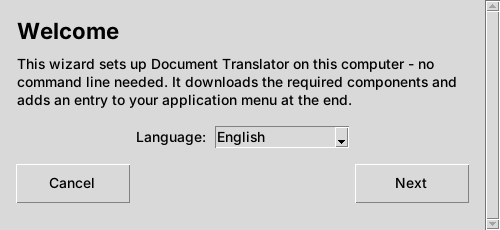
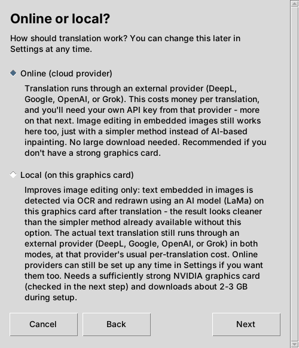
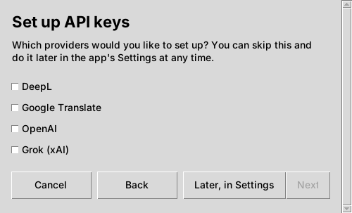
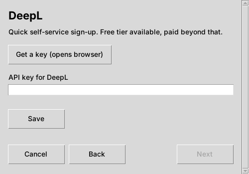
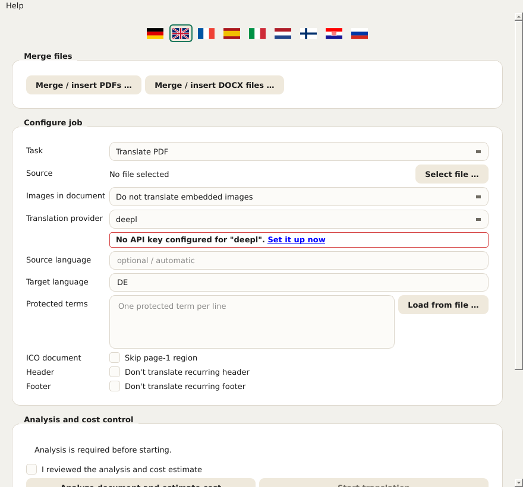
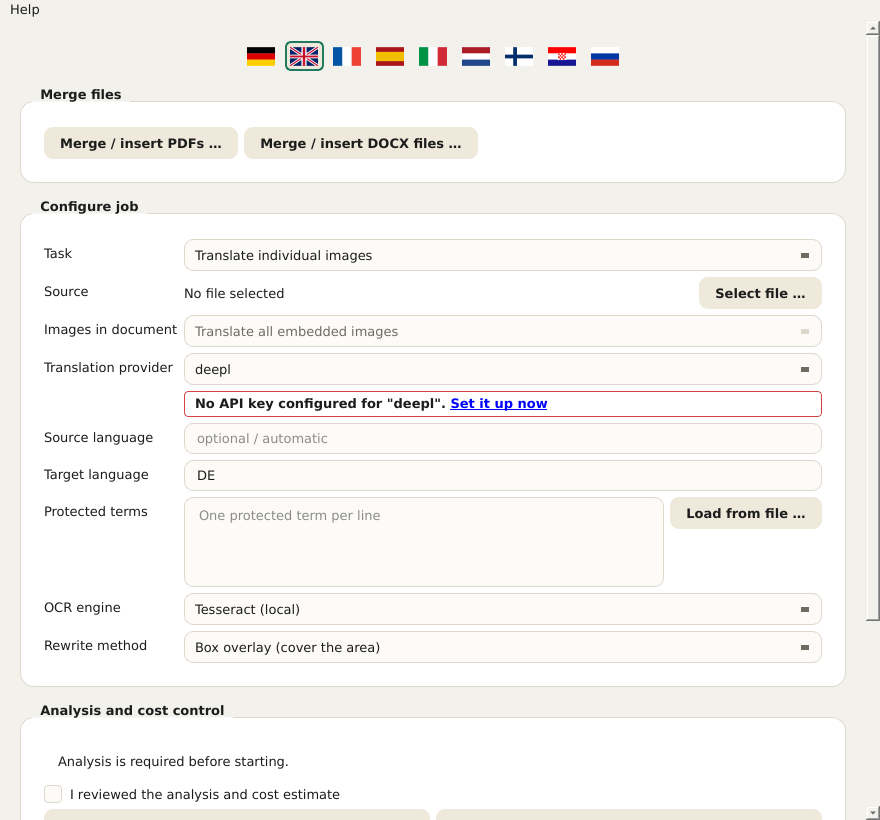
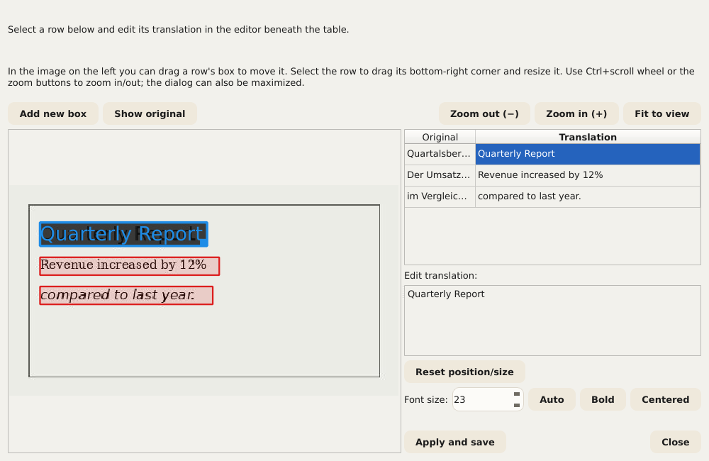
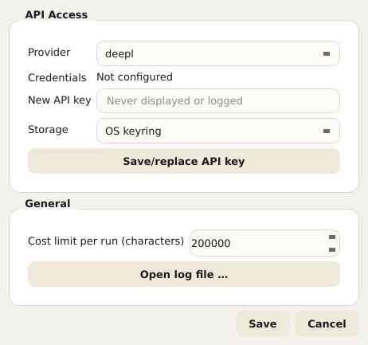
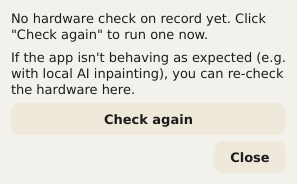

# Document Translator – User Manual

This manual describes every control in Document Translator: the setup wizard
(installer) and the app itself. It is based on the same help texts that the
application shows directly (a tooltip when hovering with the mouse, and a
longer text via Help → What's This? or Shift+F1 followed by a click on an
element). If you already know the app, you can simply use this document as a
reference.

Inside the app, this manual can be opened at any time via
**Help → User manual …** – automatically in the interface language currently
selected. Notices that appear directly below a field (e.g. "PaddleOCR is not
installed") also link here.

## Contents

1. Setup wizard (installation)
2. The app at a glance
3. Choosing a document and basic settings
4. Handling images in documents
5. Protected terms
6. Excluding headers and footers
7. Estimating cost and starting the translation
8. During and after the run
9. Correcting translations manually
10. Merging several files
11. Settings
12. Interface language
13. Hardware test (GPU)
14. Updates and version information

---

## 1. Setup wizard (installation)

The setup wizard installs Document Translator once on this computer. It does not
need administrator/root rights, because everything is installed into a
personal folder owned by the user.

**Language.** The language chosen on the first screen applies immediately to
all further screens of the wizard. It is independent of the language of the
app itself, which has its own language selection (see chapter 12).

**Online or local?** This decides how images in documents are processed:

- **Online (cloud provider):** Translation runs through a cloud provider
  (DeepL, Google, OpenAI or Grok). A simpler, local method is used for image
  processing. This is the fastest and simplest installation and works on any
  computer. You need your own API key for the chosen provider and an internet
  connection while translating.
- **Local (on this graphics card):** In addition to the online variant, a
  better, AI-based image processing method (LaMa) is installed on your own
  graphics card. Image processing then stays entirely on this computer. A
  supported NVIDIA graphics card with enough video memory is required (this
  is checked in the next step); about 2–3 GB are downloaded once. In both
  modes, the actual text translation always runs through an external provider
  and is charged there per translation as usual.

  What this option brings in practice is described in more detail in
  chapter 4 ("Handling images in documents") – in short: noticeably better
  image quality when translated documents contain photos or other complex
  backgrounds; otherwise it is not strictly needed.

If the GPU check fails (no supported card found or driver outdated), the
wizard offers two options: **"Continue with local anyway"** (useful if the
check failed wrongly or a driver update is still pending – the hardware test
can be repeated in the app at any time, see chapter 13) or **"Switch to
Online"**. Independently of that, online providers can be added at any time
in the app's settings.

**Setting up API keys.** An API key can be stored here directly for each
provider you want. Providers that are not ticked can be added later in the
app's settings at any time (button **"Later, in Settings"**). For each ticked
provider, a separate screen opens with an input field (the input is shown as
dots) and the button **"Get a key (opens browser)"**, which opens the
provider's registration page in the browser – that is where the key is
created and then pasted here. Only the **"Save"** button actually stores the
input. The wizard can also be completed without a key; however, no
translation will work until at least one key has been stored.

*Security note when opening the browser:* Before the wizard opens a link in
the default browser, the target address is shown once more in plain text and
must be confirmed. This lets you check that it really is the expected address
before it opens.

**Back, Next, Cancel.** Every screen has the same bar at the bottom with
**"Back"** (entries already made are kept), **"Next"** and **"Cancel"**. When
cancelling, the wizard asks once more; if confirmed, it automatically removes
all files created up to that point – setup can be started again at any time.
If the actual installation is in progress, a file that is currently in use
may in rare cases remain; even then, the wizard tries to remove as much as
possible automatically.

**Finishing.** At the end, the wizard can either be closed with **"Close"**
without starting the app, or combined directly with starting the app via
**"Launch now"**.

---

## 2. The app at a glance

After installation, the Document Translator app opens with a form for the
translation run. The following chapters go through it from top to bottom, in
the order in which it is laid out in the window. The current version number
is shown in the window's title bar.

---

## 3. Choosing a document and basic settings

**Field "Task" – determines which translation workflow is used.** Depending
on the selection, only the fields relevant to it are shown further down – the
OCR settings, for example, only in the "Translate individual images" mode.
There are four options:

- **Translate PDF** – a single PDF document.
- **Translate presentation (PowerPoint/Impress)** – a single PPTX file.
- **Translate Word/Writer document** – a single DOCX file.
- **Translate individual images** – one or more image files; additionally
  shows the fields "OCR engine" and "Rewrite method" (see chapter 4).

**Field "Source" – selects the file to translate.** The **"Select file …"**
button opens the file dialog (in image mode, several files can be selected at
once). The chosen file name then appears next to it. If it says "No file
selected", a file must be chosen first before a cost analysis is possible.

**Fields "Source language" and "Target language" – the two languages of this
run.** Both are entered as a two-letter ISO 639-1 language code, e.g. EN for
English or DE for German. The source language must match the actual language
of the document, otherwise the translation provider returns wrong results or
none at all.

**Field "Translation provider" – which cloud service performs the actual text
translation.** Four providers are available, each with its own API key
managed in the settings (chapter 11):

- **DeepL**
- **Google**
- **OpenAI**
- **Grok**

If there is no key for the selected provider, a notice with a red border and
a link to the settings appears directly below.

---

## 4. Handling images in documents

The form has the field **"Images in document"** for this, with three options:

- **Do not translate embedded images** – embedded images stay unchanged.
- **Select images individually later** – is intended to show a list after the
  cost analysis from which specific images can be selected.
- **Translate all embedded images** – is intended to process every embedded
  image automatically.

Important, so that no false expectations arise:

> **Current state: for PDF, PowerPoint/Impress and Word/Writer this field
> currently has NO effect on the result.** Embedded images in these three
> document types are, as things stand, ALWAYS carried over unchanged –
> regardless of which of the three options above is selected. This is not a
> malfunction but a feature not yet implemented: the selection list for
> "Select images individually later" described above does not exist yet
> either. The app itself points this out explicitly during the cost analysis
> as soon as a document contains embedded images and "Do not translate
> embedded images" is not selected. Only plain image files in the separate
> mode **"Translate individual images"** (see below) are already fully
> translated – that is a completely separate, mature workflow and is not
> affected by this limitation.

In image mode itself, the field is therefore locked (fixed to "Translate all
embedded images") and has no practical meaning there – for this mode, the
actual control happens through the two fields "OCR engine" and "Rewrite
method" further down.

Only visible in the "Translate individual images" mode (chapter 3) are two
additional fields, **"OCR engine"** and **"Rewrite method"**, shown in the
screenshot below with their default values (Tesseract and box overlay) –
both are explained one by one afterwards:

**Field "OCR engine" – text recognition.** Recognises the text in the images
before it is translated and written back. Three engines are available (the
screenshot above shows the first one):

- **Tesseract (local)** (default). Runs completely locally, without a cloud
  provider or API key of its own – but needs the Tesseract software itself
  installed on this computer (see README.md). Recognises text line by line;
  Document Translator then groups the lines into paragraphs itself.
- **Google Cloud Vision (cloud, paragraph detection)**. Runs through Google's
  cloud service and uses the same API key as the "Google" translation
  provider (chapters 3/11) – it recognises paragraphs as such instead of
  assembling them from individual lines, which gives noticeably better
  results on densely written images than Tesseract's line-by-line approach.
- **PaddleOCR (local, paragraph detection)**. Also runs completely locally
  without a cloud provider, but, like Google Cloud Vision, recognises
  paragraphs directly through its own trained layout model instead of a
  geometric approximation. **PaddleOCR is not installed by the setup
  wizard** – the additional, optional package must be installed afterwards
  into the app's Python environment (package list:
  requirements-paddleocr.txt in the app folder). If you do not want to do
  that, use Tesseract or Google Cloud Vision instead.

If the engine selected in this field is not available on this computer
(Tesseract program not found, no Google API key stored, or PaddleOCR not
installed), a notice with a red border and a link to this chapter appears
directly below, and a run with this engine cannot be started.

**Field "Rewrite method" – how the translated text is written back into the
image.** After the original text has been recognised and translated, the
translation has to be written back into the image in its place – but first
the background underneath has to be restored so that the old text does not
simply show through. This one field offers three methods with different
quality and different requirements (the screenshot above shows the first
one):

- **Box overlay (cover the area)** (default). Fills the area with a solid
  colour (or a simple gradient if the surroundings clearly suggest one) and
  writes the translated text on top. Always works, without special hardware
  or extra software, and is therefore the default. On solid or uniform
  backgrounds (e.g. tables, charts, info boxes) this is barely noticeable; on
  real photos or textured backgrounds the area is visible as a "patch".
- **Classic CPU inpainting (reconstruct background)**. Uses a classic image
  processing method (not an AI model) from the free image processing library
  OpenCV to continue the surroundings of the text area instead of just
  filling it with one colour – simple patterns or gradients therefore
  continue convincingly up to (and slightly beyond) the edge of the text
  box. Also always runs locally without a GPU but, like box overlay, is no
  substitute for the AI-based variant on truly complex, photographic
  backgrounds.
- **AI inpainting, local (GPU, LaMa)**. Uses a special AI model named LaMa,
  trained for exactly this task, on the local graphics card to reconstruct
  even complex, photographic backgrounds convincingly – by far the best
  quality of the three methods. This requires a supported NVIDIA graphics
  card with CUDA support (only installed if "Local" was chosen during setup,
  see chapter 1), and a model of several hundred MB is downloaded on the
  very first use (then cached permanently). If PyTorch with CUDA support is
  not installed, a notice with a red border appears below the field. If the
  graphics card has less video memory than recommended, a notice with a
  yellow border appears instead – the method can still be used, but without
  guarantee. The hardware status can be checked at any time with the
  hardware test (chapter 13).

As a rule of thumb: for documents with simple, flat backgrounds (most tables,
charts, presentation slides), box overlay or classic CPU inpainting is
entirely sufficient – no GPU, no waiting. For photos or detailed backgrounds,
AI inpainting is clearly worth it. Translations corrected afterwards
(chapter 9) can be re-rendered with any of the three methods, regardless of
which method the original run used.

**Further options for specific document types:**

- **Field "ICO document"** (checkbox "Skip page-1 region") only concerns the
  internal ICO document type and excludes the metadata area on page 1 from
  translation (for Word the area before the separator line, for PDF detected
  by anchor terms such as "Issuer Address"/"Asset Matrix") – regardless of
  whether this area is actually found. Leave it unchecked for all other
  documents.
- **Field "Side-by-side view"** (checkbox "Original and translation side by
  side", Word only) builds the main text as a two-column comparison table
  (Original | Translation) in landscape format instead of the normal,
  layout-preserving result. Header and footer stay unchanged; tables embedded
  in the main text do not appear in this view.

---

## 5. Protected terms

In the field **"Protected terms"** you can enter terms that should stay
untranslated – one term per line, for example company or product names. The
translation provider leaves these terms untouched. The **"Load from file …"**
button additionally loads a list from a CSV or text file (one term per line;
for CSV the first column counts); existing entries are kept and duplicates
are skipped.

**Important: only occurrences written in CAPITALS are protected.** The term
you enter may be written in any way (lower case, upper case, mixed – the
spelling in this field does not matter). What matters is how the term is
actually written in the document to be translated: only occurrences that
appear there entirely in CAPITAL LETTERS are excluded from translation. If
the same term appears elsewhere in the document in lower or mixed case, it is
translated normally there.

The reason: some protected terms (such as product or project names that are
normally always written in capitals) happen to also be quite ordinary words
of the source language. If every occurrence were protected regardless of its
spelling, the ordinary word would also stay untranslated everywhere else in
the document – and would have to be corrected by hand. If you want to make
sure a term is actually protected in the document, check whether it really is
written in capitals there – otherwise too little is protected by accident (a
lower-case occurrence stays unprotected and is translated) or, with
unintended capitalisation elsewhere in the document, too much.

---

## 6. Excluding headers and footers

Two fields (PDF only) automatically detect recurring text and exclude it from
translation:

- **Field "Header"** (checkbox "Don't translate recurring header") – text
  that recurs near the top of most pages, identical (or differing only in the
  page number).
- **Field "Footer"** (checkbox "Don't translate recurring footer") – the same
  for recurring text near the bottom of the page (e.g. copyright line, page
  number).

If nothing suitable is found, nothing changes.

---

## 7. Estimating cost and starting the translation

Before a translation starts, its approximate cost must first be estimated in
the **"Analysis and cost control"** section:

1. **"Analyze document and estimate cost"** counts the characters to be
   translated and estimates the approximate cost based on the chosen
   provider, without translating anything yet.
2. Only then can the checkbox **"I reviewed the analysis and cost
   estimate"** be ticked – a deliberate safety step so that no run is
   started by accident without first looking at the estimated cost.
3. Only with the checkbox ticked does **"Start translation"** become
   clickable.

If anything in the form is changed afterwards (e.g. a different file or a
different provider), the analysis has to be run again.

---

## 8. During and after the run

The progress of a running translation appears in the **"Run and result"**
section. A running job can be stopped as quickly as possible with
**"Cancel"** (after the call to the translation provider currently in
progress); parts already processed are not automatically kept as a complete
file – depending on the format, an incomplete file may remain.

After a run has finished, the following are available:

- **"Open folder"** – opens the file manager in the output folder of the run
  that just finished.
- **"Open QA report"** – shows issues found by the automatic quality check of
  the run, e.g. passages that may need to be reviewed.
- **"Correct translation"** – visible for PDF and image runs with correctable
  passages; lets you rework individual translated passages specifically
  without repeating the whole run (details in chapter 9).

---

## 9. Correcting translations manually

After a run has finished – provided there are correctable passages at all –
the **"Correct translation"** button appears (see chapter 8). Depending on the
document type, one of two dialogs of different complexity opens:

- For **PDF runs**, the dialog "Correct PDF translation" with a table of
  original and translated text per text block, in which individual
  translations can be overwritten directly.
- For **image runs**, the considerably more extensive dialog **"Correct image
  translation"**, because here not only the text but also its position and
  size in the image have to be right. If several files were translated at
  once in an image run, the app first asks which of the files should be
  corrected.

The image correction dialog shows the image on the left with a coloured box
for each recognised text passage, and on the right a table with original and
translated text. Selecting a row in the table loads its translation into the
editor below for editing:

- **Editing text.** The translation of the selected row can be freely
  overwritten in the editor below.
- **Position and size.** In the image on the left, the box of the selected row
  can be moved by dragging; it can be resized at its lower right corner.
  **"Reset position/size"** returns it to the originally recognised position.
- **"Add new box".** If a text passage was not found by OCR at all, you can
  drag out a new area in the image and enter your own text there by hand –
  without a new OCR run.
- **Font size, Bold, Centered.** For each text passage, the automatically
  determined font size can be overridden (or released again with "Auto"),
  and bold and centring can be switched on.
- **Zoom and "Show original".** Ctrl+mouse wheel or the zoom buttons zoom in
  and out of the image; "Show original" briefly displays the unedited source
  image for comparison. The dialog itself can also be maximised for more
  space.
- **Live preview.** While editing, the image is continuously re-rendered with
  the rewrite method actually used – what you see here therefore largely
  matches the final result, not just a rough approximation.

**"Apply and save"** regenerates the image with all changes and overwrites
the previously translated output file – without a new OCR run and without
calling the translation provider again, so at no extra cost. The dialog can
then be reopened as often as you like to improve further; each further round
builds on the last saved state, not on the original machine translation
again. **"Close"** discards unsaved changes of the current session.

> **Note on testing status.** The correction feature – especially the image
> correction dialog with positioning, new boxes and live preview – has not
> yet been tested 100 % and may still contain errors in individual cases.
> Before "Apply and save" it is therefore worth looking at the live preview,
> and with several correction rounds it is advisable to check the result in
> between.

---

## 10. Merging several files

Independently of the translation form, the **"Merge files"** section offers
two dialogs of their own for combining several files into one –
**"Merge / insert PDFs …"** for PDF files and **"Merge / insert DOCX files
…"** for Word files. Nothing is translated here; files are only recombined.
Both dialogs are built identically except for one difference regarding page
numbers (see below).

**Table of source files.** For PDF it has two columns:

- **File** – the source file.
- **Pages** – optional page selection for this file (empty = whole file,
  otherwise e.g. "1-3,5" or "6-" for page 6 to the end or "-4" for the start
  up to page 4; "5-3" inserts pages 5, 4, 3 in this reversed order). Adding
  the same file several times with different page selections inserts it at
  a specific position in another file.

For Word/DOCX the "Pages" column is omitted – unlike PDF, DOCX has no fixed
page numbers in the file format itself, so whole files are always merged.
The same file can still be added several times here to insert it at several
positions. With more than 100 DOCX files, merging is done in groups
automatically (shown in the status line afterwards).

The order of the table determines the order in the result. The following
buttons are available:

- **"Add files …"** – opens the normal file dialog for one or more files.
- **"Search a folder …"** – opens a separate search dialog to pick specific
  files from a folder containing many files (see below).
- **"Remove"** – removes the selected row(s) from the table again (the files
  themselves are not touched).
- **"Move up"** / **"Move down"** – moves the selected row in the order.
- **"Sort by name"** / **"Sort by date"** – sorts the whole table by file
  name or by the file's modification date on disk (last change, not the
  creation date). Each click toggles between ascending and descending; the
  button label always shows which direction the next click would apply.

**Field "Output file".** **"Save as …"** sets where the merged file is
written.

**"Start merging" / "Cancel".** Starts or stops the run; with "Cancel", any
partial result already written is kept.

### Search a folder

The search dialog ("Search PDFs in a folder" or the DOCX equivalent) is used
to pick only certain files from a folder with many files (e.g. 1,000 or more
PDFs) instead of searching for each one by hand. Matches can then be taken
over with **"Add selected"** and end up in the table above.

- **Source: "Local folder" or "Google Drive"** – instead of a folder on this
  computer, a shared Google Drive folder can also be searched; matches are
  then downloaded into a cache folder of your choice. The one-time setup of
  Google access is described in the file docs/google_drive_setup.md in the
  app folder.
- **Field "Folder"** – the folder to search, set via "Choose folder …".
- **Checkbox "Include subfolders"** – includes all subfolders in the search.
- **Field "Search text"** – one or more search terms, combinable with AND/OR
  (also as && / ||) and parentheses, e.g. "Acme AND contract" (only files
  containing both terms) or "Acme OR Zenith" (files containing at least one
  of the two). Leaving it empty finds all files in the folder.
- **Where to search** – three checkboxes, independent of each other and freely
  combinable (at least one must be ticked):
  - **ICO format (page 1 header area)** – for PDF/Word only searches the ICO
    metadata block on page 1 (Developer, QSI ICO, issue date etc.; for DOCX:
    the paragraphs before the separator element, not tied to a fixed page).
  - **Header (all pages)** – only searches the top area recurring on every
    page (e.g. company name/logo line) – a separate text region, independent
    of "ICO format".
  - **Full text** – searches the entire text on all pages, including the two
    areas above.
- **Group "Filter by date"** – optional, additionally narrows the matches to a
  date range:
  - **File date** or **Date in document** – whether the date comes from the
    file itself (modification date) or from a date recognised in the document
    text. With "Date in document", the area can additionally be restricted:
    **ICO field (page 1)**, **Header (all pages)** or **Footer (all
    pages)**.
  - **Date format** – one or more of the predefined formats **ISO
    (YYYY-MM-DD)**, **German (DD.MM.YYYY)**, **English (month name, e.g.
    September 4, 2026)** or **Slash (DD/MM/YYYY)**, or a **Custom format**
    using placeholders such as YYYY/MM/DD/MMMM (the tooltip on the field
    shows all placeholders with examples).
  - **Exact date** – switches between a single date (field "Date") and a
    date range (fields "From"/"To").

The results area then shows the number of matches found and the number of
files searched; unreadable files are listed separately.

---

## 11. Settings

The **"Settings …"** button gives access to:

**API Access.** First, the field **"Provider"** selects (DeepL, Google,
OpenAI, Grok) which provider the status, new key and storage below apply to –
each provider has its own, separately stored key. The status shows whether a
key for the selected provider is currently found in the OS keyring, in an
environment variable, or not at all ("Not configured"); an environment
variable always takes precedence over the keyring – in that case the dialog
shows a corresponding warning. A new key is pasted into the field **"New API
key"** (the input is shown as dots while typing) and is only actually stored
with **"Save/replace API key"**; afterwards the input field is cleared and the
status updates. As **"Storage"** you can choose:

- **OS keyring** – the recommended, permanent choice.
- **Environment variable (this session only)** – only valid for the current
  session and mainly intended for special cases/troubleshooting.
- **Both** – stores the key in the keyring and additionally writes such a
  session variable.

**"Cost limit per run (characters)".** A run containing more characters than
set here is aborted with a notice instead of causing unexpectedly high costs.
The value can be increased here if needed.

**"Open log file …".** Opens the current log file in the system's default
program – helpful for copying error messages into a bug report without having
to take a screenshot.

**"Save"** applies the settings, **"Cancel"** discards them.

---

## 12. Interface language

The flag bar in the main window switches the language of the interface itself
immediately and permanently – not to be confused with the translation
languages in the form (chapter 3). The choice is saved immediately. Nine
languages are available: Deutsch, English, Français, Español, Italiano,
Nederlands, Suomi, Hrvatski and Русский. This manual is available in the same
nine languages; Help → User manual … always opens the version in the language
currently selected.

---

## 13. Hardware test (GPU)

**Help → Show/repeat hardware test …** checks at any time whether a supported
NVIDIA GPU with enough video memory was found, when it was last checked, and
whether the installed driver (CUDA version) supports local GPU inpainting.
Without a suitable GPU/driver, local inpainting still works – just more
slowly, on the CPU. **"Check again"** repeats the same check that the
installer performed – useful after a driver update or a change of graphics
card, without having to reinstall the app.

---

## 14. Updates and version information

If a newer version of Document Translator is found at start-up, a notice appears
automatically ("Update available: …"). Clicking it offers to install the new
version. **Help → Check for updates …** triggers the check manually at any
time.

**Help → About …** shows the installed version, the licence (GNU GPL v3) and
a link to the source code on GitHub.
