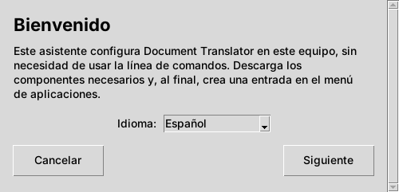
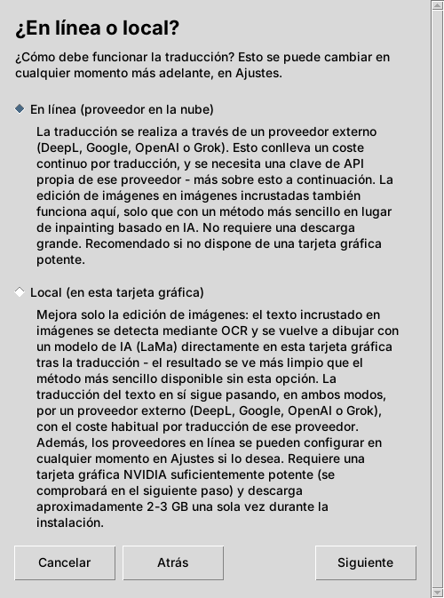
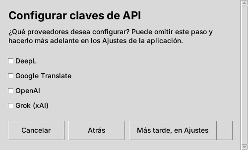
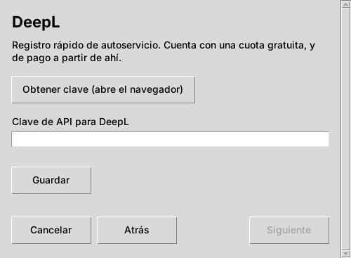
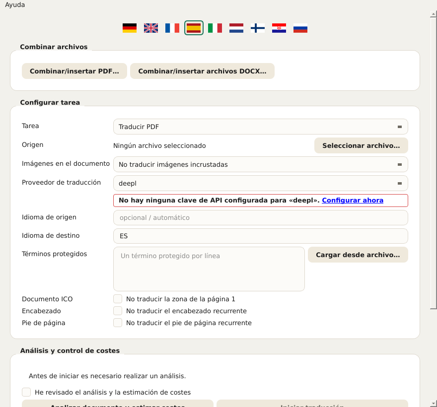
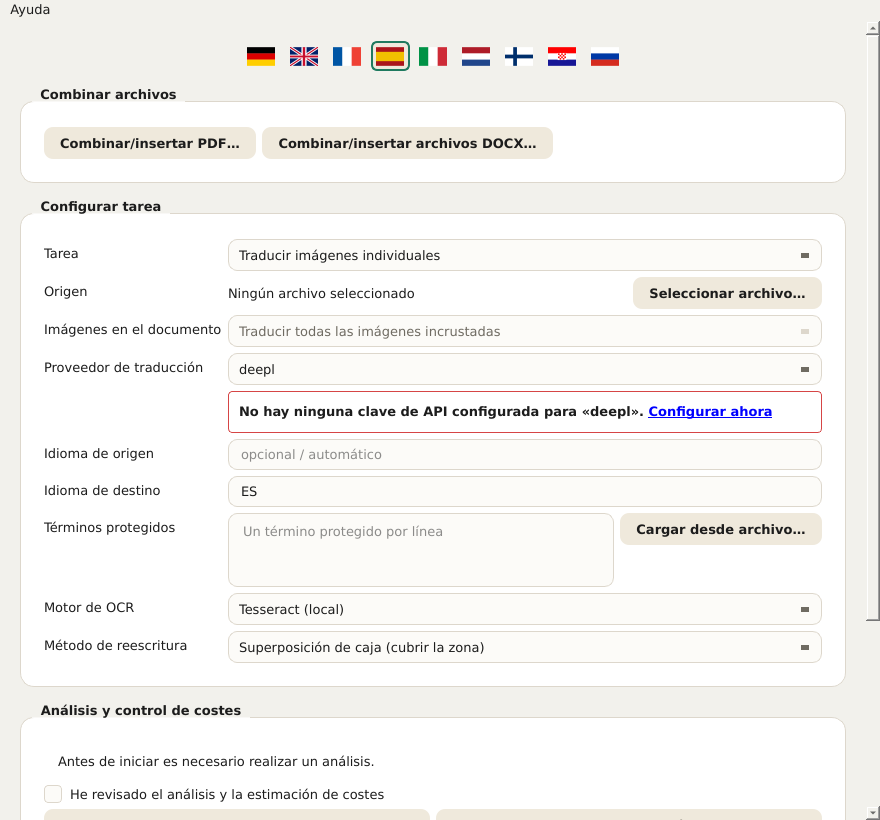
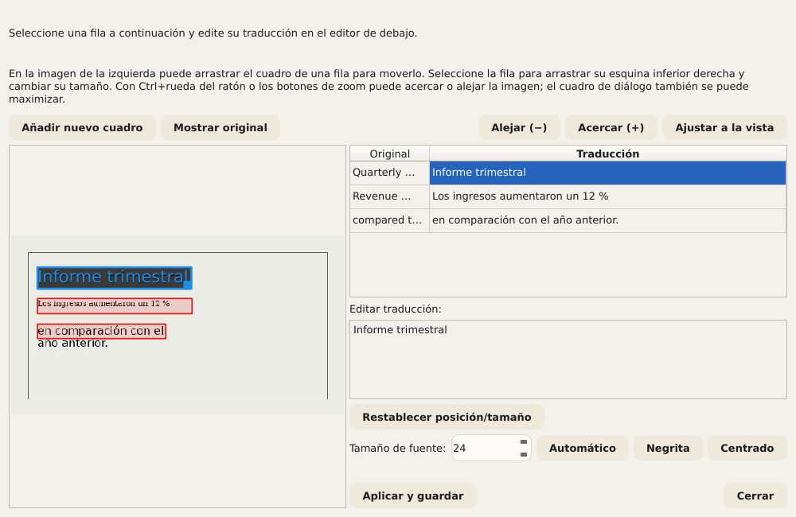
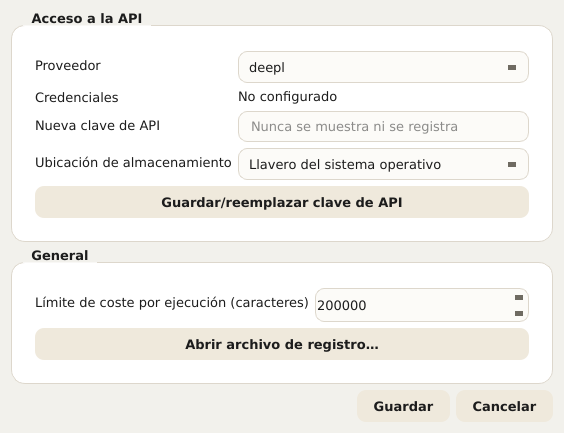
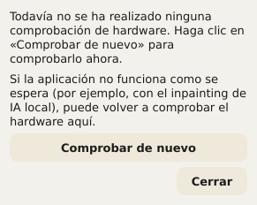

# Document Translator – Manual de usuario

Este manual describe todos los controles de Document Translator: el asistente de
configuración (instalador) y la aplicación propiamente dicha. Se basa en los
mismos textos de ayuda que la aplicación muestra directamente (información
emergente al pasar el ratón y un texto más detallado mediante Ayuda → ¿Qué
es esto? o Mayús+F1 y un clic posterior sobre un elemento). Si ya conoce la
aplicación, puede usar este documento simplemente como obra de consulta.

Dentro de la aplicación, este manual puede abrirse en cualquier momento
mediante **Ayuda → Manual de usuario…** – automáticamente en el idioma de la
interfaz seleccionado en ese momento. Los avisos que aparecen directamente
debajo de un campo (p. ej. «PaddleOCR no está instalado») también enlazan
aquí.

## Índice

1. Asistente de configuración (instalación)
2. La aplicación de un vistazo
3. Elegir un documento y ajustes básicos
4. Tratamiento de imágenes en documentos
5. Términos protegidos
6. Excluir encabezados y pies de página
7. Estimar costes e iniciar la traducción
8. Durante y después de la ejecución
9. Corregir traducciones manualmente
10. Combinar varios archivos
11. Ajustes
12. Idioma de la interfaz
13. Prueba de hardware (GPU)
14. Actualizaciones e información de versión

---

## 1. Asistente de configuración (instalación)

El asistente de configuración instala Document Translator una sola vez en este
ordenador. No necesita derechos de administrador/root, ya que todo se
instala en una carpeta personal propiedad del usuario.

**Idioma.** El idioma elegido en la primera pantalla se aplica de inmediato a
todas las demás pantallas del asistente. Es independiente del idioma de la
aplicación posterior, que tiene su propia selección de idioma (véase el
capítulo 12).

**¿En línea o local?** Aquí se elige cómo se procesan las imágenes de los
documentos:

- **En línea (proveedor en la nube):** la traducción se realiza a través de
  un proveedor en la nube (DeepL, Google, OpenAI o Grok). Para el
  procesamiento de imágenes se usa un procedimiento local más sencillo. Es
  la instalación más rápida y sencilla y funciona en cualquier ordenador. Se
  necesita una clave de API propia del proveedor elegido y conexión a
  Internet durante la traducción.
- **Local (en esta tarjeta gráfica):** además de la variante en línea, se
  instala en la propia tarjeta gráfica un procesamiento de imágenes mejor,
  basado en IA (LaMa). Así, el procesamiento de imágenes permanece
  completamente en este ordenador. Se necesita una tarjeta gráfica NVIDIA
  compatible con suficiente memoria de vídeo (se comprueba en el siguiente
  paso); se descargan una sola vez unos 2–3 GB. En ambos modos, la
  traducción del texto propiamente dicha siempre se realiza a través de un
  proveedor externo y se cobra allí por traducción, como de costumbre.

  Lo que aporta esta opción en concreto se describe con más detalle en el
  capítulo 4 («Tratamiento de imágenes en documentos»); en resumen: una
  calidad de imagen claramente mejor cuando los documentos traducidos
  contienen fotos u otros fondos complejos; de lo contrario, no es
  imprescindible.

Si la comprobación de la GPU da un resultado negativo (no se encontró una
tarjeta compatible o el controlador está desactualizado), el asistente
ofrece dos caminos: **«Continuar en local de todos modos»** (útil si la
comprobación falló por error o si aún está pendiente una actualización del
controlador; la prueba de hardware puede repetirse en la aplicación en
cualquier momento, véase el capítulo 13) o **«Cambiar a Online»**. Con
independencia de ello, los proveedores en línea pueden añadirse en cualquier
momento en los ajustes de la aplicación.

**Configurar claves de API.** Aquí puede guardarse directamente una clave de
API para cada proveedor deseado. Los proveedores no marcados pueden añadirse
más tarde en cualquier momento en los ajustes de la aplicación (botón **«Más
tarde, en Ajustes»**). Para cada proveedor marcado se abre una pantalla
propia con un campo de entrada (lo introducido aparece como puntos) y el
botón **«Obtener clave (abre el navegador)»**, que abre en el navegador la
página de registro del proveedor correspondiente; allí se genera la clave,
que luego se pega aquí. Solo el botón **«Guardar»** guarda realmente lo
introducido. El asistente también puede completarse sin clave; sin embargo,
hasta que no se haya guardado al menos una clave, ninguna traducción
funcionará.

*Aviso de seguridad al abrir el navegador:* antes de que el asistente abra un
enlace en el navegador predeterminado, la dirección de destino se muestra de
nuevo en texto claro y debe confirmarse. Así puede comprobarse antes de
abrirla que es realmente la dirección esperada.

**Atrás, Siguiente, Cancelar.** Cada pantalla tiene abajo la misma barra con
**«Atrás»** (los datos ya introducidos se conservan), **«Siguiente»** y
**«Cancelar»**. Al cancelar, el asistente pide confirmación; si se confirma,
elimina automáticamente todos los archivos creados hasta ese momento; la
configuración puede volver a iniciarse en cualquier momento. Si la
instalación propiamente dicha está en curso, en casos excepcionales puede
quedar un archivo que se estaba usando; aun así, se intenta eliminar
automáticamente todo lo posible.

**Finalización.** Al final, el asistente puede cerrarse con **«Cerrar»** sin
iniciar la aplicación, o combinarse directamente con el inicio de la
aplicación mediante **«Iniciar ahora»**.

---

## 2. La aplicación de un vistazo

Tras la instalación se abre la aplicación Document Translator con un formulario
para la ejecución de la traducción. Los capítulos siguientes recorren su
manejo de arriba abajo, en el orden en que está dispuesto en la ventana. El
número de versión actual aparece en la barra de título de la ventana.

---

## 3. Elegir un documento y ajustes básicos

**Campo «Tarea»: determina qué flujo de traducción se usa.** Según la
selección, más abajo solo se muestran los campos pertinentes; los ajustes de
OCR, por ejemplo, solo en el modo «Traducir imágenes individuales». Hay
cuatro opciones:

- **Traducir PDF**: un único documento PDF.
- **Traducir presentación (PowerPoint/Impress)**: un único archivo PPTX.
- **Traducir documento de Word/Writer**: un único archivo DOCX.
- **Traducir imágenes individuales**: uno o varios archivos de imagen;
  muestra además los campos «Motor de OCR» y «Método de reescritura» (véase
  el capítulo 4).

**Campo «Origen»: selecciona el archivo que se va a traducir.** El botón
**«Seleccionar archivo…»** abre el diálogo de selección de archivos (en el
modo de imágenes pueden elegirse varios archivos a la vez). El nombre del
archivo elegido aparece después a su lado. Si pone «Ningún archivo
seleccionado», primero hay que elegir un archivo antes de poder realizar un
análisis de costes.

**Campos «Idioma de origen» e «Idioma de destino»: los dos idiomas de esta
ejecución.** Ambos se indican como código de idioma de dos letras según ISO
639-1, p. ej. EN para inglés o DE para alemán. El idioma de origen debe
coincidir con el idioma real del documento; de lo contrario, el proveedor de
traducción devuelve resultados erróneos o ninguno.

**Campo «Proveedor de traducción»: qué servicio en la nube realiza la
traducción del texto propiamente dicha.** Hay cuatro proveedores, cada uno
con su propia clave de API gestionada en los ajustes (capítulo 11):

- **DeepL**
- **Google**
- **OpenAI**
- **Grok**

Si falta la clave del proveedor elegido, aparece justo debajo un aviso con
borde rojo y un enlace a los ajustes.

---

## 4. Tratamiento de imágenes en documentos

El formulario dispone para ello del campo **«Imágenes en el documento»**, con
tres opciones:

- **No traducir imágenes incrustadas**: las imágenes incrustadas no se
  modifican.
- **Seleccionar imágenes individualmente más tarde**: en el futuro mostrará,
  tras el análisis de costes, una lista para elegir imágenes concretas.
- **Traducir todas las imágenes incrustadas**: en el futuro procesará
  automáticamente cada imagen incrustada.

Importante, para no crear falsas expectativas:

> **Estado actual: en PDF, PowerPoint/Impress y Word/Writer este campo
> todavía NO tiene ningún efecto en el resultado.** Las imágenes incrustadas
> en estos tres tipos de documento se conservan, por ahora, SIEMPRE sin
> cambios, independientemente de cuál de las tres opciones esté
> seleccionada. No es un fallo, sino una función aún no implementada: la
> lista de selección descrita para «Seleccionar imágenes individualmente más
> tarde» tampoco existe todavía. La propia aplicación lo indica
> expresamente durante el análisis de costes en cuanto un documento contiene
> imágenes incrustadas y no está seleccionado «No traducir imágenes
> incrustadas». Solo los archivos de imagen puros en el modo propio
> **«Traducir imágenes individuales»** (véase más abajo) se traducen ya por
> completo; se trata de un flujo totalmente independiente y maduro, no
> afectado por esta limitación.

Por eso, en el modo de imágenes el campo está bloqueado (fijado en «Traducir
todas las imágenes incrustadas») y allí no tiene utilidad práctica; para este
modo, el control se realiza mediante los dos campos «Motor de OCR» y «Método
de reescritura» situados más abajo.

Solo en el modo «Traducir imágenes individuales» (capítulo 3) son visibles
dos campos adicionales, **«Motor de OCR»** y **«Método de reescritura»**,
que se ven en la captura siguiente con sus valores predeterminados
(Tesseract y superposición de caja); ambos se explican a continuación uno por
uno:

**Campo «Motor de OCR»: reconocimiento de texto.** Reconoce el texto de las
imágenes antes de traducirlo y reescribirlo. Hay tres motores disponibles (la
captura anterior muestra el primero):

- **Tesseract (local)** (predeterminado). Funciona completamente en local,
  sin proveedor en la nube ni clave de API propia, pero necesita que el
  propio software Tesseract esté instalado en este ordenador (véase
  README.md). Reconoce el texto línea por línea; después, Document Translator
  agrupa las líneas en párrafos por sí mismo.
- **Google Cloud Vision (nube, detección de párrafos)**. Funciona a través
  del servicio en la nube de Google y usa la misma clave de API que el
  proveedor de traducción «Google» (capítulos 3/11); reconoce los párrafos
  directamente como tales en lugar de reconstruirlos a partir de líneas
  sueltas, lo que en imágenes con mucho texto da resultados notablemente
  mejores que el enfoque línea por línea de Tesseract.
- **PaddleOCR (local, detección de párrafos)**. También funciona
  completamente en local, sin proveedor en la nube, pero, como Google Cloud
  Vision, reconoce los párrafos directamente mediante su propio modelo de
  diseño entrenado en lugar de una aproximación geométrica. **El asistente
  de configuración no instala PaddleOCR**: el paquete opcional adicional
  debe instalarse posteriormente en el entorno de Python de la aplicación
  (lista de paquetes: requirements-paddleocr.txt en la carpeta de la
  aplicación). Si no desea hacerlo, use en su lugar Tesseract o Google Cloud
  Vision.

Si el motor elegido en este campo no está disponible en este ordenador
(programa Tesseract no encontrado, sin clave de API de Google guardada o
PaddleOCR no instalado), aparece justo debajo un aviso con borde rojo y un
enlace a este capítulo, y no es posible iniciar una ejecución con este motor.

**Campo «Método de reescritura»: cómo se reescribe el texto traducido en la
imagen.** Una vez reconocido y traducido el texto original, la traducción
debe reescribirse en su lugar en la imagen; pero antes hay que restaurar el
fondo subyacente para que el texto antiguo no se transparente. Este campo
ofrece para ello tres procedimientos de distinta calidad y con distintos
requisitos (la captura anterior muestra el primero):

- **Superposición de caja (cubrir la zona)** (predeterminado). Rellena la
  zona con un color uniforme (o con un degradado sencillo si el entorno lo
  sugiere claramente) y escribe encima el texto traducido. Funciona siempre,
  sin hardware especial ni software adicional, y por eso es el ajuste
  predeterminado. En fondos uniformes o regulares (p. ej. tablas, gráficos,
  recuadros informativos) apenas se nota; en fotos reales o fondos con
  textura, la zona se reconoce como un «parche» visible.
- **Inpainting clásico por CPU (reconstruir el fondo)**. Usa un
  procedimiento clásico de procesamiento de imágenes (no un modelo de IA) de
  la biblioteca libre OpenCV para continuar el entorno alrededor del texto en
  lugar de rellenarlo con un solo color; así, los patrones o degradados
  sencillos continúan de forma creíble hasta el borde (y un poco más allá)
  del cuadro de texto. También funciona siempre en local sin GPU, pero, como
  la superposición de caja, no sustituye a la variante basada en IA en fondos
  fotográficos realmente complejos.
- **Inpainting con IA local (GPU, LaMa)**. Usa en la tarjeta gráfica local
  un modelo de IA especial llamado LaMa, entrenado exactamente para esta
  tarea, para reconstruir de forma creíble incluso fondos fotográficos
  complejos; con diferencia, la mejor calidad de los tres procedimientos.
  Para ello se necesita una tarjeta gráfica NVIDIA compatible con soporte
  CUDA (solo se instala si se eligió «Local» durante la configuración,
  véase el capítulo 1), y en el primer uso se descarga un modelo de varios
  cientos de MB (que después queda almacenado de forma permanente). Si
  PyTorch con soporte CUDA no está instalado, aparece debajo del campo un
  aviso con borde rojo. Si la tarjeta gráfica tiene menos memoria de vídeo
  de la recomendada, aparece en su lugar un aviso con borde amarillo; el
  procedimiento puede usarse igualmente, pero sin garantía. El estado del
  hardware puede comprobarse en cualquier momento con la prueba de hardware
  (capítulo 13).

Como regla general: para documentos con fondos sencillos y planos (la
mayoría de tablas, gráficos y diapositivas), la superposición de caja o el
inpainting clásico por CPU son totalmente suficientes, sin GPU ni esperas.
Con fotos o fondos detallados, el inpainting con IA merece claramente la
pena. Por cierto, las traducciones corregidas posteriormente (capítulo 9)
pueden volver a renderizarse con cualquiera de los tres procedimientos,
independientemente del que se usara en la ejecución original.

**Otras opciones para determinados tipos de documento:**

- **Campo «Documento ICO»** (casilla «No traducir la zona de la página 1»)
  afecta exclusivamente al tipo de documento interno ICO y excluye de la
  traducción la zona de metadatos de la página 1 (en Word, la zona anterior a
  la línea separadora; en PDF, detectada mediante términos de anclaje como
  «Issuer Address»/«Asset Matrix»), independientemente de que esa zona se
  encuentre realmente. Para todos los demás documentos, déjela desactivada.
- **Campo «Vista en paralelo»** (casilla «Original y traducción en
  paralelo», solo Word) construye el texto principal, en lugar del resultado
  normal fiel al diseño, como tabla comparativa de dos columnas (Original |
  Traducción) en formato horizontal. El encabezado y el pie de página no se
  modifican; las tablas incrustadas en el texto principal no aparecen en esta
  vista.

---

## 5. Términos protegidos

En el campo **«Términos protegidos»** pueden introducirse términos que deben
quedar sin traducir, uno por línea, por ejemplo nombres de empresas o de
productos. El proveedor de traducción deja estos términos intactos. Con el
botón **«Cargar desde archivo…»** puede cargarse además una lista desde un
archivo CSV o de texto (un término por línea; en CSV cuenta la primera
columna); las entradas existentes se conservan y los duplicados se omiten.

**Importante: solo se protege la aparición escrita en MAYÚSCULAS.** El
término introducido puede escribirse de cualquier forma (minúsculas,
mayúsculas, mixto; la grafía en este campo no importa). Lo decisivo es cómo
está escrito realmente el término en el documento que se va a traducir: solo
se excluyen de la traducción las apariciones escritas allí completamente en
MAYÚSCULAS. Si el mismo término aparece en otro lugar del documento en
minúsculas o en forma mixta, allí se traduce con normalidad.

El motivo: algunos términos protegidos (como nombres de productos o
proyectos que normalmente se escriben siempre en mayúsculas) son por
casualidad también palabras corrientes del idioma de origen. Si se
protegiera cada aparición sin importar su grafía, la palabra corriente
también quedaría sin traducir en el resto del documento y habría que
corregirla a mano. Por tanto, para asegurarse de que un término queda
realmente protegido, conviene comprobar que en el documento está escrito de
verdad en mayúsculas; de lo contrario se protege demasiado poco por descuido
(una aparición en minúsculas queda sin proteger y se traduce) o, si hay
mayúsculas involuntarias en otros lugares del documento, demasiado.

---

## 6. Excluir encabezados y pies de página

Dos campos (solo PDF) detectan automáticamente el texto recurrente y lo
excluyen de la traducción:

- **Campo «Encabezado»** (casilla «No traducir el encabezado recurrente»):
  texto que se repite cerca de la parte superior de la mayoría de las
  páginas, idéntico (o solo con distinto número de página).
- **Campo «Pie de página»** (casilla «No traducir el pie de página
  recurrente»): lo mismo para el texto recurrente cerca de la parte inferior
  de la página (p. ej. línea de copyright, número de página).

Si no se encuentra nada adecuado, simplemente no cambia nada.

---

## 7. Estimar costes e iniciar la traducción

Antes de iniciar una traducción, primero hay que estimar en la sección
**«Análisis y control de costes»** lo que costará aproximadamente:

1. **«Analizar documento y estimar costes»** cuenta los caracteres que se van
   a traducir y estima el coste aproximado según el proveedor elegido, sin
   traducir nada todavía.
2. Solo entonces puede marcarse la casilla **«He revisado el análisis y la
   estimación de costes»**, un paso de seguridad deliberado para que ninguna
   ejecución se inicie por descuido sin haber visto antes los costes
   estimados.
3. Solo con la casilla marcada se puede pulsar **«Iniciar traducción»**.

Si después se modifica algo en el formulario (p. ej. otro archivo u otro
proveedor), hay que volver a realizar el análisis.

---

## 8. Durante y después de la ejecución

El progreso de una traducción en curso aparece en la sección **«Ejecución y
resultado»**. Una ejecución en curso puede detenerse lo antes posible con
**«Cancelar»** (tras la llamada al proveedor de traducción que esté en curso);
las partes ya procesadas no se conservan automáticamente como archivo
completo; según el formato, puede quedar un archivo incompleto.

Al finalizar una ejecución se dispone de:

- **«Abrir carpeta»**: abre el explorador de archivos en la carpeta de destino
  de la ejecución recién terminada.
- **«Abrir informe de control de calidad»**: muestra las incidencias del
  control de calidad automático de la ejecución, p. ej. pasajes que podría
  convenir revisar.
- **«Corregir traducción»**: visible en ejecuciones de PDF y de imágenes con
  pasajes corregibles; permite retocar de forma específica pasajes traducidos
  sin repetir toda la ejecución (detalles en el capítulo 9).

---

## 9. Corregir traducciones manualmente

Tras una ejecución finalizada, siempre que haya pasajes corregibles, aparece
el botón **«Corregir traducción»** (véase el capítulo 8). Según el tipo de
documento se abre uno de dos diálogos de distinta complejidad:

- En las **ejecuciones de PDF**, el diálogo «Corregir traducción del PDF»,
  con una tabla de texto original y traducido por bloque de texto, en la que
  las traducciones pueden sobrescribirse directamente.
- En las **ejecuciones de imágenes**, el diálogo bastante más completo
  **«Corregir traducción de la imagen»**, porque aquí no solo el texto, sino
  también su posición y tamaño en la imagen deben ser correctos. Si en una
  ejecución se tradujeron varias imágenes a la vez, la aplicación pregunta
  primero cuál de ellas debe corregirse.

El diálogo de corrección de imágenes muestra a la izquierda la imagen con un
cuadro de color por cada pasaje de texto reconocido y a la derecha una tabla
con el texto original y el traducido. Al seleccionar una fila de la tabla, su
traducción se carga abajo en el editor para modificarla:

- **Editar el texto.** La traducción de la fila seleccionada puede
  sobrescribirse libremente en el editor inferior.
- **Posición y tamaño.** En la imagen de la izquierda, el cuadro de la fila
  seleccionada puede moverse arrastrándolo; desde su esquina inferior derecha
  puede cambiarse su tamaño. **«Restablecer posición/tamaño»** devuelve la
  posición reconocida originalmente.
- **«Añadir nuevo cuadro».** Si el OCR no encontró en absoluto un pasaje de
  texto, puede trazarse una nueva zona en la imagen e introducir allí un texto
  propio a mano, sin una nueva pasada de OCR.
- **Tamaño de fuente, Negrita, Centrado.** Para cada pasaje puede
  sobrescribirse el tamaño de fuente determinado automáticamente (o volver a
  liberarlo con «Automático»), así como activar la negrita y el centrado.
- **Zoom y «Mostrar original».** Con Ctrl+rueda del ratón o los botones de
  zoom puede ampliarse y reducirse la imagen; «Mostrar original» muestra
  brevemente la imagen de partida sin editar para comparar. El propio
  diálogo también puede maximizarse para tener más espacio.
- **Vista previa en directo.** Durante la edición, la imagen se vuelve a
  renderizar continuamente con el método de reescritura realmente utilizado;
  lo que se ve aquí corresponde, por tanto, en gran medida al resultado
  final, y no solo a una aproximación aproximada.

**«Aplicar y guardar»** genera de nuevo la imagen con todos los cambios y
sobrescribe el archivo traducido anteriormente, sin una nueva pasada de OCR
ni una nueva llamada al proveedor de traducción, es decir, sin costes
adicionales. Después, el diálogo puede volver a abrirse tantas veces como se
desee para seguir mejorando; cada ronda posterior parte del último estado
guardado, no de la traducción automática original. **«Cerrar»** descarta los
cambios no guardados de la sesión actual.

> **Nota sobre el estado de las pruebas.** La función de corrección, sobre
> todo el diálogo de corrección de imágenes con posicionamiento, nuevos
> cuadros y vista previa en directo, aún no se ha probado al 100 % y en
> casos concretos todavía puede contener errores. Por ello, antes de
> «Aplicar y guardar» merece la pena revisar la vista previa en directo, y
> con varias rondas de corrección se recomienda comprobar el resultado entre
> medias.

---

## 10. Combinar varios archivos

Independientemente del formulario de traducción, la sección **«Combinar
archivos»** ofrece dos diálogos propios para combinar varios archivos en uno
solo: **«Combinar/insertar PDF…»** para archivos PDF y **«Combinar/insertar
archivos DOCX…»** para archivos de Word. Aquí no se traduce nada, solo se
recombina. Ambos diálogos están construidos de forma idéntica salvo una
diferencia en los números de página (véase más abajo).

**Tabla con los archivos de origen.** En PDF tiene dos columnas:

- **Archivo**: el archivo de origen.
- **Páginas**: selección de páginas opcional para este archivo (vacío =
  archivo completo; si no, p. ej. «1-3,5» o «6-» para desde la página 6 hasta
  el final o «-4» para desde el principio hasta la página 4; «5-3» inserta
  las páginas 5, 4, 3 en este orden inverso). Añadir el mismo archivo varias
  veces con distinta selección de páginas permite insertarlo en un punto
  concreto de otro archivo.

En Word/DOCX no existe la columna «Páginas»: a diferencia de PDF, el formato
DOCX no tiene números de página fijos, por lo que siempre se combinan
archivos completos. Aun así, el mismo archivo puede añadirse varias veces
para insertarlo en varios puntos. A partir de más de 100 archivos DOCX, la
combinación se hace automáticamente por grupos (se indica después en la
línea de estado).

El orden de la tabla determina el orden en el resultado. Para ello hay los
siguientes botones:

- **«Añadir archivos…»**: abre el diálogo normal de selección para uno o
  varios archivos.
- **«Buscar en carpeta…»**: abre un diálogo de búsqueda propio para elegir
  archivos concretos de una carpeta que contiene muchos (véase más abajo).
- **«Quitar»**: elimina de la tabla la fila o filas seleccionadas (los
  archivos en sí no se modifican).
- **«Subir»** / **«Bajar»**: mueve la fila seleccionada en el orden.
- **«Ordenar por nombre»** / **«Ordenar por fecha»**: ordena toda la tabla
  por nombre de archivo o por la fecha de modificación del archivo en el
  disco (última modificación, no la fecha de creación). Cada clic alterna
  entre orden ascendente y descendente; el texto del botón muestra siempre
  qué sentido aplicaría el siguiente clic.

**Campo «Archivo de destino».** Con **«Guardar como…»** se define dónde se
escribe el archivo combinado.

**«Iniciar combinación» / «Cancelar».** Inicia o detiene la ejecución; con
«Cancelar» se conserva un resultado parcial ya escrito.

### Buscar en carpeta

El diálogo de búsqueda («Buscar PDF en una carpeta» o su equivalente para
DOCX) sirve para elegir solo determinados archivos de una carpeta con muchos
(p. ej. 1000 o más PDF), en lugar de buscarlos uno a uno a mano. Los
resultados pueden adoptarse después con **«Añadir seleccionados»** y pasan a
la tabla anterior.

- **Origen: «Carpeta local» o «Google Drive»**: en lugar de una carpeta de
  este ordenador, también puede buscarse en una carpeta compartida de Google
  Drive; los resultados se descargan entonces en una carpeta de caché a
  elegir. La configuración única del acceso a Google se describe en el
  archivo docs/google_drive_setup.md de la carpeta de la aplicación.
- **Campo «Carpeta»**: la carpeta en la que se busca, definida mediante
  «Elegir carpeta…».
- **Casilla «Incl. subcarpetas»**: incluye también todas las subcarpetas en
  la búsqueda.
- **Campo «Texto de búsqueda»**: uno o varios términos, combinables con
  AND/OR (también como && / ||) y paréntesis, p. ej. «Acme AND contrato»
  (solo archivos con ambos términos) o «Acme OR Zenith» (archivos con al
  menos uno de los dos). Si se deja vacío, encuentra todos los archivos de la
  carpeta.
- **Dónde se busca**: tres casillas, independientes entre sí y combinables
  libremente (debe marcarse al menos una):
  - **Formato ICO (zona superior de la página 1)**: en PDF/Word solo busca
    en el bloque de metadatos ICO de la página 1 (Developer, QSI ICO, fecha
    de emisión, etc.; en DOCX: los párrafos anteriores al elemento separador,
    sin estar ligados a una página fija).
  - **Encabezado (todas las páginas)**: solo busca en la zona superior que se
    repite en cada página (p. ej. línea con nombre de empresa/logotipo); es
    una región de texto propia, independiente de «Formato ICO».
  - **Texto completo**: busca en todo el texto de todas las páginas,
    incluidas las dos zonas anteriores.
- **Grupo «Filtrar por fecha»**: opcional, limita además los resultados a un
  intervalo de fechas:
  - **Fecha del archivo** o **Fecha en el documento**: si la fecha procede
    del propio archivo (fecha de modificación) o de una fecha reconocida en
    el texto del documento. Con «Fecha en el documento» puede limitarse
    además la zona: **Campo ICO (página 1)**, **Encabezado (todas las
    páginas)** o **Pie de página (todas las páginas)**.
  - **Formato de fecha**: uno o varios de los formatos predefinidos **ISO
    (AAAA-MM-DD)**, **Alemán (DD.MM.AAAA)**, **Inglés (nombre del mes, p.
    ej., September 4, 2026)** o **Barra (DD/MM/AAAA)**, o un **Formato
    personalizado** mediante marcadores como YYYY/MM/DD/MMMM (la información
    emergente del campo muestra todos los marcadores con ejemplos).
  - **Fecha exacta**: alterna entre una fecha única (campo «Fecha») y un
    intervalo (campos «Desde»/«Hasta»).

A continuación, la zona de resultados muestra el número de coincidencias
encontradas y el número de archivos examinados; los archivos ilegibles se
indican por separado.

---

## 11. Ajustes

Con el botón **«Ajustes…»** se accede a:

**Acceso a la API.** Primero se elige en el campo **«Proveedor»** (DeepL,
Google, OpenAI, Grok) a qué proveedor se refieren el estado, la nueva clave y
la ubicación de almacenamiento de abajo; cada proveedor tiene su propia
clave, guardada por separado. El estado indica si para el proveedor elegido
se encuentra actualmente una clave en el llavero del sistema operativo, en
una variable de entorno o en ningún sitio («No configurado»); una variable de
entorno siempre tiene prioridad sobre el llavero, y en ese caso el diálogo
muestra el aviso correspondiente. Una clave nueva se pega en el campo
**«Nueva clave de API»** (lo introducido aparece como puntos) y solo se
guarda realmente con **«Guardar/reemplazar clave de API»**; después se vacía
el campo de entrada y se actualiza el estado. Como **«Ubicación de
almacenamiento»** puede elegirse:

- **Llavero del sistema operativo**: la opción recomendada y permanente.
- **Variable de entorno (solo esta sesión)**: válida solo para la sesión en
  curso y pensada principalmente para casos especiales o diagnóstico de
  errores.
- **Ambos**: guarda en el llavero y escribe además una variable de sesión de
  ese tipo.

**«Límite de coste por ejecución (caracteres)».** Una ejecución que contenga
más caracteres de los aquí configurados se interrumpe con un aviso, en lugar
de causar costes inesperadamente altos. Si es necesario, el valor puede
aumentarse aquí.

**«Abrir archivo de registro…».** Abre el archivo de registro actual con el
programa predeterminado del sistema; útil para copiar mensajes de error en un
informe de fallos sin tener que hacer una captura de pantalla.

**«Guardar»** aplica los ajustes y **«Cancelar»** los descarta.

---

## 12. Idioma de la interfaz

Con la barra de banderas de la ventana principal puede cambiarse de inmediato
y de forma permanente el idioma de la propia interfaz; no debe confundirse
con los idiomas de traducción del formulario (capítulo 3). La selección se
guarda de inmediato. Hay nueve idiomas disponibles: Deutsch, English,
Français, Español, Italiano, Nederlands, Suomi, Hrvatski y Русский. Este
manual está disponible en los mismos nueve idiomas; Ayuda → Manual de
usuario… abre siempre la versión en el idioma seleccionado en ese momento.

---

## 13. Prueba de hardware (GPU)

Con **Ayuda → Mostrar/repetir prueba de hardware…** puede comprobarse en
cualquier momento si se encontró una GPU NVIDIA compatible con suficiente
memoria de vídeo, cuándo se comprobó por última vez y si el controlador
instalado (versión de CUDA) admite el inpainting local por GPU. Sin una
GPU/controlador adecuados, el inpainting local funciona igualmente, solo que
más despacio, en la CPU. Con **«Comprobar de nuevo»** puede repetirse la
misma comprobación que realizó el instalador; útil tras una actualización del
controlador o un cambio de tarjeta gráfica, sin tener que reinstalar la
aplicación.

---

## 14. Actualizaciones e información de versión

Si al iniciar se encuentra una versión más reciente de Document Translator, aparece
automáticamente un aviso («Actualización disponible: …»). Al hacer clic se
ofrece instalar la nueva versión. Con **Ayuda → Buscar actualizaciones…**
puede iniciarse la comprobación manualmente en cualquier momento.

**Ayuda → Acerca de…** muestra la versión instalada, la licencia (GNU GPL v3)
y un enlace al código fuente en GitHub.
