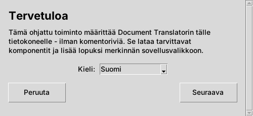
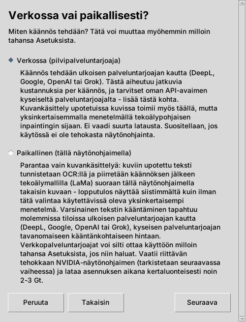
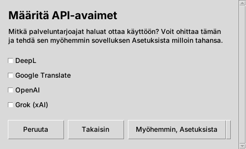
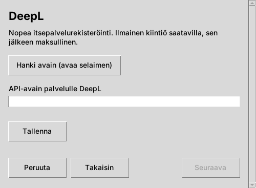
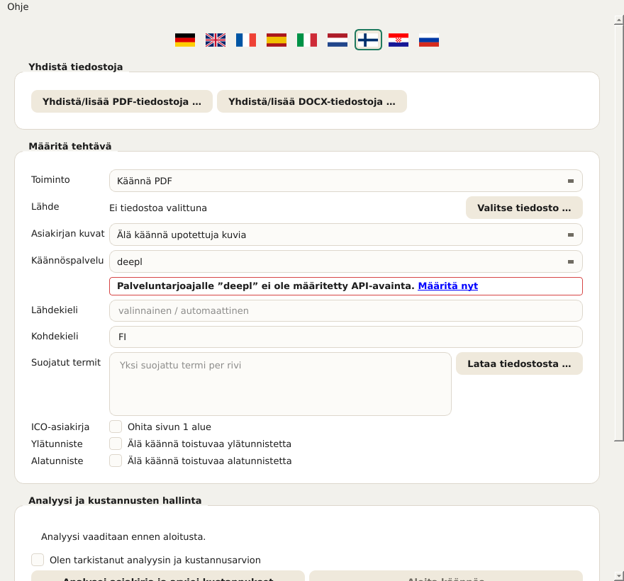
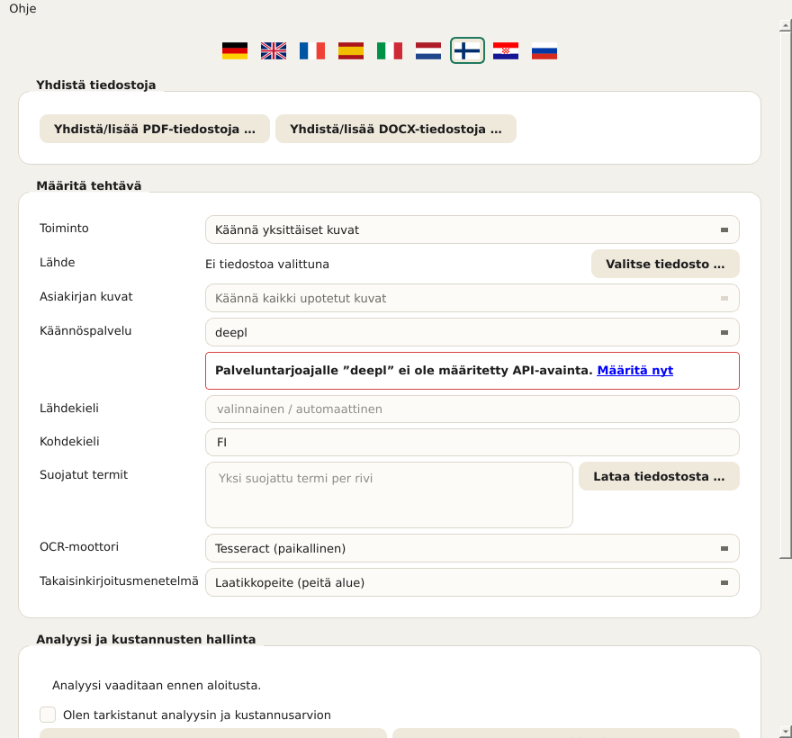
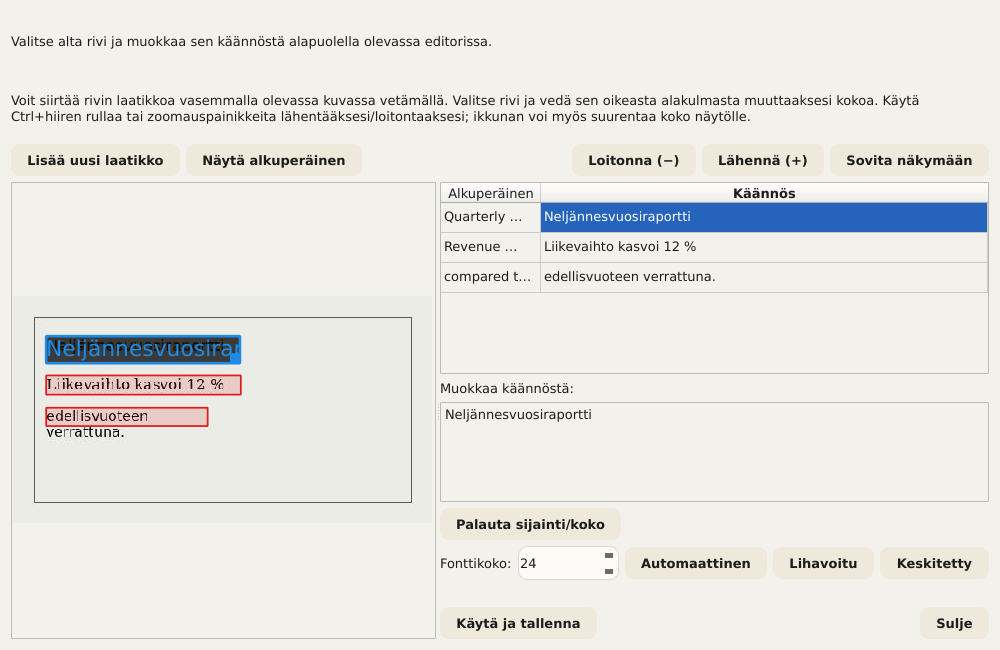
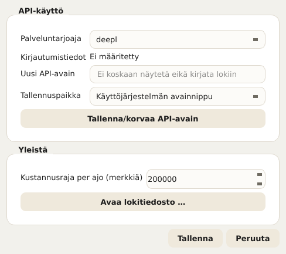
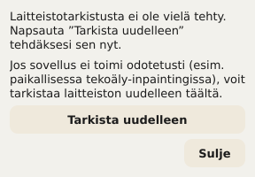

# Document Translator – Käyttöohje

Tämä ohje kuvaa kaikki Document Translatorin käyttöelementit: asennusohjelman
(ohjattu asennus) ja varsinaisen sovelluksen. Se perustuu samoihin
ohjeteksteihin, jotka sovellus näyttää suoraan (työkaluvihje hiiren ollessa
elementin päällä sekä pidempi teksti kohdasta Ohje → Mikä tämä on? tai
painamalla Vaihto+F1 ja napsauttamalla sitten elementtiä). Sovellukseen jo
tutustunut voi siis käyttää tätä asiakirjaa myös pelkkänä hakuteoksena.

Sovelluksessa tämän ohjeen voi avata milloin tahansa kohdasta
**Ohje → Käyttöohje …** – automaattisesti sillä käyttöliittymän kielellä,
joka on kulloinkin valittuna. Myös suoraan kentän alle tulevat ilmoitukset
(esim. ”PaddleOCR ei ole asennettu”) linkittävät tänne.

## Sisällys

1. Ohjattu asennus
2. Sovellus lyhyesti
3. Asiakirjan valinta ja perusasetukset
4. Asiakirjojen kuvien käsittely
5. Suojatut termit
6. Ylä- ja alatunnisteiden ohittaminen
7. Kustannusten arviointi ja käännöksen aloittaminen
8. Ajon aikana ja sen jälkeen
9. Käännösten korjaaminen käsin
10. Useiden tiedostojen yhdistäminen
11. Asetukset
12. Käyttöliittymän kieli
13. Laitteistotesti (GPU)
14. Päivitykset ja versiotiedot

---

## 1. Ohjattu asennus

Ohjattu asennus asentaa Document Translatorin kerran tälle tietokoneelle. Se ei
tarvitse järjestelmänvalvojan/root-oikeuksia, koska kaikki asennetaan
käyttäjän omaan, henkilökohtaiseen kansioon.

**Kieli.** Ensimmäisessä näytössä valittu kieli koskee heti kaikkia
ohjatun asennuksen seuraavia näyttöjä. Se on riippumaton itse sovelluksen
kielestä, jolla on oma kielivalintansa (ks. luku 12).

**Verkossa vai paikallisesti?** Tässä valitaan, miten asiakirjojen kuvia
käsitellään:

- **Verkossa (pilvipalveluntarjoaja):** käännös tehdään
  pilvipalveluntarjoajan kautta (DeepL, Google, OpenAI tai Grok). Kuvien
  käsittelyyn käytetään yksinkertaisempaa, paikallista menetelmää. Tämä on
  nopein ja yksinkertaisin asennus, ja se toimii millä tahansa tietokoneella.
  Tarvitaan oma API-avain valitulta palveluntarjoajalta sekä
  internetyhteys käännöksen aikana.
- **Paikallinen (tällä näytönohjaimella):** verkkovaihtoehdon lisäksi omalle
  näytönohjaimelle asennetaan parempi, tekoälypohjainen kuvankäsittely
  (LaMa). Kuvankäsittely pysyy tällöin kokonaan tällä tietokoneella.
  Tarvitaan tuettu NVIDIA-näytönohjain, jossa on riittävästi näyttömuistia
  (tarkistetaan seuraavassa vaiheessa); kertaluonteisesti ladataan noin
  2–3 Gt. Varsinainen tekstin käännös tehdään molemmissa tiloissa aina
  ulkoisen palveluntarjoajan kautta, ja siitä veloitetaan siellä tavalliseen
  tapaan käännöskohtaisesti.

  Mitä tämä vaihtoehto käytännössä tuo, kuvataan tarkemmin luvussa 4
  (”Asiakirjojen kuvien käsittely”) – lyhyesti: selvästi parempi
  kuvanlaatu, kun käännetyissä asiakirjoissa on valokuvia tai muita
  monimutkaisia taustoja; muuten se ei ole välttämätön.

Jos GPU-tarkistus epäonnistuu (tuettua korttia ei löytynyt tai ajuri on
vanhentunut), ohjattu asennus tarjoaa kaksi vaihtoehtoa: **”Jatka silti
paikallisesti”** (järkevää, jos tarkistus epäonnistui aiheetta tai
ajuripäivitys on vielä tekemättä – laitteistotestin voi toistaa sovelluksessa
milloin tahansa, ks. luku 13) tai **”Vaihda verkkoon”**. Tästä riippumatta
verkkopalveluntarjoajia voi lisätä sovelluksen asetuksissa milloin tahansa.

**API-avainten määrittäminen.** Tässä voi tallentaa suoraan API-avaimen
jokaiselle halutulle palveluntarjoajalle. Valitsematta jätetyt
palveluntarjoajat voi lisätä myöhemmin milloin tahansa sovelluksen
asetuksissa (painike **”Myöhemmin, Asetuksista”**). Jokaiselle valitulle
palveluntarjoajalle avautuu oma näyttö, jossa on syöttökenttä (syöte näkyy
pisteinä) sekä painike **”Hanki avain (avaa selaimen)”**, joka avaa
palveluntarjoajan rekisteröitymissivun selaimessa – siellä avain luodaan, ja
se liitetään sitten tähän. Vasta **”Tallenna”**-painike tallentaa syötteen
todella. Ohjatun asennuksen voi viedä loppuun myös ilman avainta; ennen kuin
vähintään yksi avain on tallennettu, mikään käännös ei kuitenkaan toimi.

*Turvallisuushuomautus selainta avattaessa:* ennen kuin ohjattu asennus
avaa linkin oletusselaimessa, kohdeosoite näytetään vielä kerran
selväkielisenä, ja se on vahvistettava. Näin voi ennen avaamista tarkistaa,
että kyseessä on todella odotettu osoite.

**Takaisin, Seuraava, Peruuta.** Jokaisen näytön alareunassa on sama palkki,
jossa on **”Takaisin”** (jo tehdyt syötteet säilyvät), **”Seuraava”** ja
**”Peruuta”**. Peruutettaessa kysytään vielä vahvistus; jos se annetaan,
ohjattu asennus poistaa automaattisesti kaikki siihen mennessä luodut
tiedostot – asennuksen voi aloittaa uudelleen milloin tahansa. Jos
varsinainen asennus on käynnissä, harvinaisissa tapauksissa käytössä oleva
tiedosto voi jäädä jäljelle; silloinkin yritetään poistaa automaattisesti
mahdollisimman paljon.

**Viimeistely.** Lopuksi ohjatun asennuksen voi joko sulkea painikkeella
**”Sulje”** käynnistämättä sovellusta tai yhdistää suoraan sovelluksen
käynnistykseen painikkeella **”Käynnistä nyt”**.

---

## 2. Sovellus lyhyesti

Asennuksen jälkeen avautuu varsinainen Document Translator -sovellus, jossa on
lomake käännösajoa varten. Seuraavat luvut käyvät käytön läpi ylhäältä alas
siinä järjestyksessä, jossa elementit ovat ikkunassa. Nykyinen versionumero
näkyy ikkunan otsikkorivillä.

---

## 3. Asiakirjan valinta ja perusasetukset

**Kenttä ”Toiminto” – määrittää, mitä käännösprosessia käytetään.** Valinnan
mukaan alempana näytetään vain siihen liittyvät kentät – esimerkiksi
OCR-asetukset vain tilassa ”Käännä yksittäiset kuvat”. Vaihtoehtoja on
neljä:

- **Käännä PDF** – yksi PDF-asiakirja.
- **Käännä esitys (PowerPoint/Impress)** – yksi PPTX-tiedosto.
- **Käännä Word/Writer-asiakirja** – yksi DOCX-tiedosto.
- **Käännä yksittäiset kuvat** – yksi tai useampi kuvatiedosto; näyttää
  lisäksi kentät ”OCR-moottori” ja ”Takaisinkirjoitusmenetelmä” (ks.
  luku 4).

**Kenttä ”Lähde” – valitsee käännettävän tiedoston.** Painike **”Valitse
tiedosto …”** avaa tiedostonvalintaikkunan (kuvatilassa voi valita myös
useita tiedostoja kerralla). Valitun tiedoston nimi näkyy sen jälkeen
vieressä. Jos siinä lukee ”Ei tiedostoa valittuna”, on ensin valittava
tiedosto, ennen kuin kustannusanalyysi on mahdollinen.

**Kentät ”Lähdekieli” ja ”Kohdekieli” – tämän ajon kaksi kieltä.**
Molemmat annetaan ISO 639-1 -standardin mukaisena kaksikirjaimisena
kielikoodina, esim. EN englannille tai DE saksalle. Lähdekielen on vastattava
asiakirjan todellista kieltä, muuten käännöspalvelu palauttaa vääriä tuloksia
tai ei tuloksia lainkaan.

**Kenttä ”Käännöspalvelu” – mikä pilvipalvelu tekee varsinaisen tekstin
käännöksen.** Valittavana on neljä palvelua, joista jokaisella on oma,
asetuksissa hallittava API-avain (luku 11):

- **DeepL**
- **Google**
- **OpenAI**
- **Grok**

Jos valitulta palvelulta puuttuu avain, suoraan sen alle tulee punaisella
reunuksella korostettu ilmoitus, jossa on linkki asetuksiin.

---

## 4. Asiakirjojen kuvien käsittely

Lomakkeessa on tätä varten kenttä **”Asiakirjan kuvat”**, jossa on kolme
vaihtoehtoa:

- **Älä käännä upotettuja kuvia** – upotetut kuvat pysyvät ennallaan.
- **Valitse kuvat yksitellen myöhemmin** – on tarkoitus näyttää
  tulevaisuudessa kustannusanalyysin jälkeen luettelo, josta voi valita
  tietyt kuvat.
- **Käännä kaikki upotetut kuvat** – on tarkoitus käsitellä tulevaisuudessa
  jokainen upotettu kuva automaattisesti.

Tärkeää, jotta vääriä odotuksia ei synny:

> **Nykytila: PDF-, PowerPoint/Impress- ja Word/Writer-asiakirjoissa tällä
> kentällä EI tällä hetkellä ole mitään vaikutusta tulokseen.** Näiden
> kolmen asiakirjatyypin upotetut kuvat siirretään nykyisellään AINA
> muuttamattomina – riippumatta siitä, mikä yllä olevista kolmesta
> vaihtoehdosta on valittu. Kyse ei ole virheestä vaan vielä
> toteuttamattomasta ominaisuudesta: myöskään yllä kuvattua valintaluetteloa
> vaihtoehdolle ”Valitse kuvat yksitellen myöhemmin” ei vielä ole.
> Sovellus huomauttaa tästä itse nimenomaisesti kustannusanalyysin aikana
> heti, kun asiakirjassa on upotettuja kuvia eikä ”Älä käännä upotettuja
> kuvia” ole valittuna. Vain pelkät kuvatiedostot omassa tilassaan
> **”Käännä yksittäiset kuvat”** (ks. alla) käännetään jo nyt kokonaan –
> se on täysin erillinen, valmis prosessi, jota tämä rajoitus ei koske.

Kuvatilassa kenttä on siksi lukittu (kiinteästi arvoon ”Käännä kaikki
upotetut kuvat”), eikä sillä ole siellä käytännön merkitystä – tässä tilassa
varsinainen ohjaus tapahtuu alempana olevilla kentillä ”OCR-moottori” ja
”Takaisinkirjoitusmenetelmä”.

Vain tilassa ”Käännä yksittäiset kuvat” (luku 3) näkyvät lisäksi kaksi
kenttää, **”OCR-moottori”** ja **”Takaisinkirjoitusmenetelmä”**, jotka
näkyvät alla olevassa kuvakaappauksessa oletusarvoineen (Tesseract ja
laatikkopeite) – molemmat selitetään seuraavaksi yksitellen:

**Kenttä ”OCR-moottori” – tekstintunnistus.** Tunnistaa kuvien tekstin
ennen kuin se käännetään ja kirjoitetaan takaisin. Valittavana on kolme
moottoria (yllä olevassa kuvakaappauksessa on valittuna ensimmäinen):

- **Tesseract (paikallinen)** (oletus). Toimii kokonaan paikallisesti, ilman
  pilvipalvelua tai omaa API-avainta – mutta vaatii, että itse
  Tesseract-ohjelmisto on asennettu tälle tietokoneelle (ks. README.md).
  Tunnistaa tekstin rivi kerrallaan; Document Translator ryhmittelee rivit sen
  jälkeen itse kappaleiksi.
- **Google Cloud Vision (pilvi, kappaleentunnistus)**. Toimii Googlen
  pilvipalvelun kautta ja käyttää samaa API-avainta kuin käännöspalvelu
  ”Google” (luvut 3/11) – tunnistaa kappaleet suoraan kappaleina sen sijaan,
  että kokoaisi ne yksittäisistä riveistä, mikä antaa tiheästi tekstitetyissä
  kuvissa selvästi parempia tuloksia kuin Tesseractin rivikohtainen
  menetelmä.
- **PaddleOCR (paikallinen, kappaleentunnistus)**. Toimii myös kokonaan
  paikallisesti ilman pilvipalvelua, mutta tunnistaa Google Cloud Visionin
  tavoin kappaleet suoraan omalla, koulutetulla asettelumallillaan
  geometrisen arvion sijaan. **Ohjattu asennus ei asenna PaddleOCR:ää** –
  lisäpaketti on asennettava jälkikäteen sovelluksen Python-ympäristöön
  (pakettiluettelo: requirements-paddleocr.txt sovelluskansiossa). Jos et
  halua tehdä sitä, käytä sen sijaan Tesseractia tai Google Cloud Visionia.

Jos tässä kentässä valittu moottori ei ole käytettävissä tällä
tietokoneella (Tesseract-ohjelmaa ei löydy, Googlen API-avainta ei ole
tallennettu tai PaddleOCR:ää ei ole asennettu), suoraan kentän alle tulee
punaisella reunuksella korostettu ilmoitus, jossa on linkki tähän lukuun,
eikä ajoa tällä moottorilla voi aloittaa.

**Kenttä ”Takaisinkirjoitusmenetelmä” – miten käännetty teksti kirjoitetaan
takaisin kuvaan.** Kun alkuperäinen teksti on tunnistettu ja käännetty,
käännös on kirjoitettava sen paikalle kuvaan – mutta ensin on palautettava
alla oleva tausta, jotta vanha teksti ei yksinkertaisesti kuulu läpi. Tämä
kenttä tarjoaa siihen kolme menetelmää, joiden laatu ja vaatimukset
eroavat (yllä olevassa kuvakaappauksessa on valittuna ensimmäinen):

- **Laatikkopeite (peitä alue)** (oletus). Täyttää alueen yhdellä värillä
  (tai yksinkertaisella liukuvärillä, jos ympäristö selvästi viittaa
  sellaiseen) ja kirjoittaa käännetyn tekstin päälle. Toimii aina, ilman
  erityistä laitteistoa tai lisäohjelmistoja, ja on siksi oletusasetus.
  Yksivärisillä tai tasaisilla taustoilla (esim. taulukot, kaaviot,
  tietolaatikot) se tuskin erottuu; oikeissa valokuvissa tai teksturoiduilla
  taustoilla alue erottuu näkyvänä ”paikkana”.
- **Klassinen CPU-inpainting (rekonstruoi tausta)**. Käyttää vapaan
  OpenCV-kuvankäsittelykirjaston klassista kuvankäsittelymenetelmää (ei
  tekoälymallia) jatkamaan tekstikohdan ympäristöä sen sijaan, että alue
  vain täytettäisiin yhdellä värillä – yksinkertaiset kuviot tai liukuvärit
  jatkuvat näin uskottavasti tekstilaatikon reunaan asti (ja hieman yli).
  Toimii myös aina paikallisesti ilman GPU:ta, mutta ei laatikkopeitteen
  tavoin korvaa tekoälypohjaista vaihtoehtoa todella monimutkaisissa,
  valokuvamaisissa taustoissa.
- **Tekoäly-inpainting paikallisesti (GPU, LaMa)**. Käyttää paikallisella
  näytönohjaimella erityistä, juuri tähän tehtävään koulutettua LaMa-nimistä
  tekoälymallia rekonstruoimaan uskottavasti myös monimutkaiset,
  valokuvamaiset taustat – ylivoimaisesti paras laatu kolmesta
  menetelmästä. Tähän tarvitaan tuettu NVIDIA-näytönohjain, jossa on
  CUDA-tuki (asennetaan vain, jos asennuksessa valittiin ”Paikallinen”, ks.
  luku 1), ja aivan ensimmäisellä käyttökerralla ladataan useiden satojen
  megatavujen kokoinen malli (joka tallennetaan sen jälkeen pysyvästi
  välimuistiin). Jos PyTorchia CUDA-tuella ei ole asennettu, kentän alle
  tulee punaisella reunuksella korostettu ilmoitus. Jos näytönohjaimessa on
  vähemmän näyttömuistia kuin suositellaan, tulee sen sijaan keltaisella
  reunuksella korostettu ilmoitus – menetelmää voi silloin käyttää, mutta
  ilman takuuta. Laitteiston tilan voi tarkistaa milloin tahansa
  laitteistotestillä (luku 13).

Nyrkkisääntö: asiakirjoille, joissa on yksinkertaiset, tasaiset taustat
(useimmat taulukot, kaaviot ja esitysdiat), laatikkopeite tai klassinen
CPU-inpainting riittää hyvin – ilman GPU:ta ja ilman odottelua.
Valokuvissa tai yksityiskohtaisissa taustoissa tekoäly-inpainting kannattaa
selvästi. Jälkikäteen korjatut käännökset (luku 9) voi muuten piirtää
uudelleen millä tahansa kolmesta menetelmästä riippumatta siitä, millä
menetelmällä alkuperäinen ajo tehtiin.

**Muita vaihtoehtoja tietyille asiakirjatyypeille:**

- **Kenttä ”ICO-asiakirja”** (valintaruutu ”Ohita sivun 1 alue”) koskee
  ainoastaan sisäistä ICO-asiakirjatyyppiä ja jättää sivun 1
  metatietoalueen kääntämättä (Wordissa erotusviivaa edeltävä alue,
  PDF:ssä ankkuritermien kuten ”Issuer Address”/”Asset Matrix” avulla
  tunnistettu) – riippumatta siitä, löytyykö alue todella. Pidä se pois
  päältä kaikissa muissa asiakirjoissa.
- **Kenttä ”Rinnakkaisnäkymä”** (valintaruutu ”Alkuperäinen ja käännös
  rinnakkain”, vain Word) rakentaa leipätekstin tavallisen, asettelun
  säilyttävän tuloksen sijaan kaksisarakkeiseksi vertailutaulukoksi
  (Alkuperäinen | Käännös) vaakasuuntaan. Ylä- ja alatunniste pysyvät
  ennallaan; leipätekstiin upotetut taulukot eivät näy tässä näkymässä.

---

## 5. Suojatut termit

Kenttään **”Suojatut termit”** voi kirjoittaa termejä, joiden on jäätävä
kääntämättä – yksi termi riviä kohden, esimerkiksi yritys- tai tuotenimiä.
Käännöspalvelu jättää nämä termit koskematta. Painikkeella **”Lataa
tiedostosta …”** voi lisäksi ladata luettelon CSV- tai tekstitiedostosta
(yksi termi riviä kohden; CSV:ssä huomioidaan ensimmäinen sarake);
olemassa olevat merkinnät säilyvät ja kaksoiskappaleet ohitetaan.

**Tärkeää: vain ISOILLA KIRJAIMILLA kirjoitettu esiintymä suojataan.**
Syötetyn termin voi kirjoittaa miten tahansa (pienillä, isoilla tai
sekaisin – kirjoitusasulla tässä kentässä ei ole merkitystä). Ratkaisevaa on,
miten termi on todella kirjoitettu käännettävässä asiakirjassa: vain siellä
kokonaan ISOILLA KIRJAIMILLA kirjoitetut esiintymät jätetään kääntämättä. Jos
sama termi esiintyy muualla asiakirjassa pienillä tai sekakirjaimilla, se
käännetään siellä normaalisti.

Syy: jotkin suojatut termit (kuten tuote- tai projektinimet, jotka
kirjoitetaan yleensä aina isoilla kirjaimilla) ovat sattumalta myös aivan
tavallisia lähdekielen sanoja. Jos jokainen esiintymä suojattaisiin
kirjoitusasusta riippumatta, myös tavallinen sana jäisi kääntämättä kaikkialla
muualla asiakirjassa – ja se pitäisi korjata käsin. Jos haluat varmistaa,
että termi todella suojataan asiakirjassa, tarkista siis, että se on siellä
todella kirjoitettu isoilla kirjaimilla – muuten suojataan vahingossa liian
vähän (pienillä kirjoitettu esiintymä jää suojaamatta ja käännetään) tai,
jos muualla asiakirjassa on tahattomia isoja kirjaimia, liian paljon.

---

## 6. Ylä- ja alatunnisteiden ohittaminen

Kaksi kenttää (vain PDF) tunnistaa toistuvan tekstin automaattisesti ja
jättää sen kääntämättä:

- **Kenttä ”Ylätunniste”** (valintaruutu ”Älä käännä toistuvaa
  ylätunnistetta”) – teksti, joka toistuu useimpien sivujen yläosassa
  samanlaisena (tai vain sivunumeroltaan erilaisena).
- **Kenttä ”Alatunniste”** (valintaruutu ”Älä käännä toistuvaa
  alatunnistetta”) – sama sivun alaosassa toistuvalle tekstille (esim.
  tekijänoikeusrivi, sivunumero).

Jos mitään sopivaa ei löydy, mikään ei muutu.

---

## 7. Kustannusten arviointi ja käännöksen aloittaminen

Ennen kuin käännös alkaa, sen likimääräiset kustannukset on ensin
arvioitava osiossa **”Analyysi ja kustannusten hallinta”**:

1. **”Analysoi asiakirja ja arvioi kustannukset”** laskee käännettävät
   merkit ja arvioi valitun palvelun perusteella likimääräiset kustannukset
   kääntämättä vielä mitään.
2. Vasta sen jälkeen voi rastittaa valintaruudun **”Olen tarkistanut
   analyysin ja kustannusarvion”** – tietoinen turvavaihe, jotta mitään ajoa
   ei käynnistetä vahingossa katsomatta ensin arvioituja kustannuksia.
3. Vasta kun valintaruutu on rastitettu, **”Aloita käännös”** on
   napsautettavissa.

Jos lomakkeessa muutetaan sen jälkeen jotain (esim. eri tiedosto tai eri
palvelu), analyysi on tehtävä uudelleen.

---

## 8. Ajon aikana ja sen jälkeen

Käynnissä olevan käännöksen edistyminen näkyy osiossa **”Ajo ja tulos”**.
Käynnissä olevan ajon voi pysäyttää mahdollisimman nopeasti painikkeella
**”Peruuta”** (käynnissä olevan käännöspalvelukutsun jälkeen); jo käsitellyt
osat eivät säily automaattisesti kokonaisena tiedostona – muodosta riippuen
jäljelle voi jäädä keskeneräinen tiedosto.

Kun ajo on valmis, käytettävissä ovat:

- **”Avaa kansio”** – avaa tiedostonhallinnan juuri päättyneen ajon
  kohdekansiossa.
- **”Avaa QA-raportti”** – näyttää ajon automaattisen laaduntarkistuksen
  havainnot, esim. tekstikohdat, jotka kannattaa ehkä tarkistaa.
- **”Korjaa käännös”** – näkyy PDF- ja kuva-ajoissa, joissa on korjattavia
  tekstikohtia; mahdollistaa yksittäisten käännettyjen kohtien kohdennetun
  muokkaamisen ilman koko ajon toistamista (tarkemmin luvussa 9).

---

## 9. Käännösten korjaaminen käsin

Päättyneen ajon jälkeen – jos korjattavia tekstikohtia ylipäätään on –
näkyviin tulee painike **”Korjaa käännös”** (ks. luku 8). Asiakirjatyypin
mukaan avautuu toinen kahdesta eri laajuisesta valintaikkunasta:

- **PDF-ajoissa** valintaikkuna ”Korjaa PDF-käännös”, jossa on taulukko
  alkuperäisestä ja käännetystä tekstistä tekstilohkoittain ja jossa
  yksittäisiä käännöksiä voi kirjoittaa suoraan uudelleen.
- **Kuva-ajoissa** selvästi laajempi valintaikkuna **”Korjaa kuvan
  käännös”**, koska tässä tekstin lisäksi myös sen sijainnin ja koon kuvassa
  on oltava oikein. Jos kuva-ajossa käännettiin useita tiedostoja kerralla,
  sovellus kysyy ensin, mikä tiedostoista korjataan.

Kuvan korjausikkuna näyttää vasemmalla kuvan, jossa on värillinen laatikko
jokaisen tunnistetun tekstikohdan kohdalla, ja oikealla taulukon
alkuperäisestä ja käännetystä tekstistä. Kun taulukosta valitaan rivi, sen
käännös latautuu alla olevaan editoriin muokattavaksi:

- **Tekstin muokkaus.** Valitun rivin käännöksen voi kirjoittaa vapaasti
  uudelleen alla olevassa editorissa.
- **Sijainti ja koko.** Vasemmalla olevassa kuvassa valitun rivin laatikkoa
  voi siirtää vetämällä; sen oikeasta alakulmasta voi muuttaa kokoa.
  **”Palauta sijainti/koko”** palauttaa alun perin tunnistetun sijainnin.
- **”Lisää uusi laatikko”.** Jos OCR ei löytänyt tekstikohtaa lainkaan,
  kuvaan voi vetää uuden alueen ja kirjoittaa siihen käsin oman tekstin –
  ilman uutta OCR-ajoa.
- **Fonttikoko, Lihavoitu, Keskitetty.** Jokaiselle tekstikohdalle voi
  ohittaa automaattisesti määritetyn fonttikoon (tai palauttaa sen
  valinnalla ”Automaattinen”) sekä ottaa lihavoinnin ja keskityksen käyttöön.
- **Zoomaus ja ”Näytä alkuperäinen”.** Ctrl+hiiren rullalla tai
  zoomauspainikkeilla kuvaa voi lähentää ja loitontaa; ”Näytä alkuperäinen”
  näyttää hetkeksi muokkaamattoman lähtökuvan vertailua varten. Itse
  valintaikkunan voi myös suurentaa, jotta tilaa on enemmän.
- **Reaaliaikainen esikatselu.** Muokkauksen aikana kuva piirretään
  jatkuvasti uudelleen todellisuudessa käytetyllä
  takaisinkirjoitusmenetelmällä – se, mitä tässä näkyy, vastaa siis pitkälti
  lopullista tulosta eikä vain karkeaa arviota.

**”Käytä ja tallenna”** luo kuvan uudelleen kaikkine muutoksineen ja
korvaa aiemmin käännetyn tulostiedoston – ilman uutta OCR-ajoa ja ilman
uutta kutsua käännöspalveluun, siis ilman lisäkustannuksia. Valintaikkunan
voi sen jälkeen avata uudelleen niin monta kertaa kuin haluaa jatkaakseen
parantamista; jokainen uusi kierros perustuu viimeksi tallennettuun tilaan
eikä taas alkuperäiseen konekäännökseen. **”Sulje”** hylkää nykyisen
istunnon tallentamattomat muutokset.

> **Huomautus testauksen tilasta.** Korjaustoimintoa – erityisesti kuvan
> korjausikkunaa sijoittelun, uusien laatikoiden ja reaaliaikaisen
> esikatselun osalta – ei ole vielä testattu sataprosenttisesti, ja siinä
> voi yksittäistapauksissa vielä olla virheitä. Ennen kohtaa ”Käytä ja
> tallenna” kannattaa siksi katsoa reaaliaikaista esikatselua, ja useiden
> korjauskierrosten aikana tulos on suositeltavaa tarkistaa välillä.

---

## 10. Useiden tiedostojen yhdistäminen

Käännöslomakkeesta riippumatta osiossa **”Yhdistä tiedostoja”** on kaksi
omaa valintaikkunaa useiden tiedostojen yhdistämiseen yhdeksi tiedostoksi –
**”Yhdistä/lisää PDF-tiedostoja …”** PDF-tiedostoille ja **”Yhdistä/lisää
DOCX-tiedostoja …”** Word-tiedostoille. Mitään ei käännetä, tiedostot vain
yhdistetään uudelleen. Molemmat valintaikkunat on rakennettu samalla
tavalla yhtä sivunumeroihin liittyvää eroa lukuun ottamatta (ks. alla).

**Lähdetiedostojen taulukko.** PDF:ssä siinä on kaksi saraketta:

- **Tiedosto** – lähdetiedosto.
- **Sivut** – valinnainen sivuvalinta tälle tiedostolle (tyhjä = koko
  tiedosto, muuten esim. ”1-3,5” tai ”6-” sivulta 6 loppuun tai ”-4”
  alusta sivulle 4; ”5-3” lisää sivut 5, 4, 3 tässä käänteisessä
  järjestyksessä). Saman tiedoston lisääminen useita kertoja eri
  sivuvalinnoilla lisää sen tiettyyn kohtaan toiseen tiedostoon.

Word/DOCX:ssä saraketta ”Sivut” ei ole – toisin kuin PDF:ssä,
DOCX-tiedostomuodossa ei ole kiinteitä sivunumeroita, joten aina yhdistetään
kokonaisia tiedostoja. Saman tiedoston voi kuitenkin lisätä tässäkin useita
kertoja, jotta se lisätään useaan kohtaan. Kun DOCX-tiedostoja on yli 100,
yhdistäminen tehdään automaattisesti ryhmissä (näkyy sen jälkeen
tilarivillä).

Taulukon järjestys määrää järjestyksen tuloksessa. Käytettävissä ovat
seuraavat painikkeet:

- **”Lisää tiedostoja …”** – avaa tavallisen tiedostonvalintaikkunan
  yhdelle tai useammalle tiedostolle.
- **”Etsi kansiosta …”** – avaa oman hakuikkunan, jolla voi valita
  yksittäisiä tiedostoja kansiosta, jossa on paljon tiedostoja (ks. alla).
- **”Poista”** – poistaa merkityt rivit taulukosta (itse tiedostoihin ei
  kosketa).
- **”Siirrä ylös”** / **”Siirrä alas”** – siirtää merkittyä riviä
  järjestyksessä.
- **”Järjestä nimen mukaan”** / **”Järjestä päivämäärän mukaan”** –
  järjestää koko taulukon tiedostonimen tai tiedoston levyllä olevan
  muokkauspäivämäärän mukaan (viimeisin muutos, ei luontipäivämäärä).
  Jokainen napsautus vaihtaa nousevan ja laskevan järjestyksen välillä;
  painikkeen teksti näyttää aina, mihin suuntaan seuraava napsautus
  järjestäisi.

**Kenttä ”Kohdetiedosto”.** Painikkeella **”Tallenna nimellä …”**
määritetään, minne yhdistetty tiedosto kirjoitetaan.

**”Aloita yhdistäminen” / ”Peruuta”.** Aloittaa tai pysäyttää ajon;
peruutettaessa jo kirjoitettu osittainen tulos säilyy.

### Etsi kansiosta

Hakuikkuna (”Etsi PDF-tiedostoja kansiosta” tai ”Etsi DOCX-tiedostoja
kansiosta”) on tarkoitettu valitsemaan vain tietyt tiedostot kansiosta,
jossa on paljon tiedostoja (esim. 1000 tai enemmän PDF-tiedostoa), sen
sijaan että ne etsittäisiin kaikki käsin. Osumat voi sen jälkeen ottaa
mukaan painikkeella **”Lisää valitut”**, jolloin ne siirtyvät yllä olevaan
taulukkoon.

- **Lähde: ”Paikallinen kansio” tai ”Google Drive”** – tämän tietokoneen
  kansion sijaan voi hakea myös jaetusta Google Drive -kansiosta; osumat
  ladataan silloin valittavaan välimuistikansioon. Google-käyttöoikeuden
  kertaluonteinen määritys on kuvattu sovelluskansion tiedostossa
  docs/google_drive_setup.md.
- **Kenttä ”Kansio”** – haettava kansio, valitaan painikkeella ”Valitse
  kansio …”.
- **Valintaruutu ”Sisällytä alikansiot”** – ottaa hakuun mukaan myös kaikki
  alikansiot.
- **Kenttä ”Hakuteksti”** – yksi tai useampi hakusana, jotka voi yhdistää
  sanoilla AND/OR (myös && / ||) ja sulkeilla, esim. ”Acme AND sopimus”
  (vain tiedostot, joissa on molemmat termit) tai ”Acme OR Zenith”
  (tiedostot, joissa on vähintään toinen). Tyhjänä se löytää kaikki kansion
  tiedostot.
- **Mistä haetaan** – kolme valintaruutua, toisistaan riippumattomia ja
  vapaasti yhdisteltäviä (vähintään yksi on valittava):
  - **ICO-muoto (sivun 1 ylätunnistealue)** – hakee PDF/Word-tiedostoista
    vain sivun 1 ICO-metatietolohkosta (Developer, QSI ICO,
    julkaisupäivämäärä jne.; DOCX:ssä erotuselementtiä edeltävät kappaleet,
    ei sidottu tiettyyn sivuun).
  - **Ylätunniste (kaikki sivut)** – hakee vain jokaisella sivulla
    toistuvasta yläalueesta (esim. yrityksen nimi/logo-rivi) – oma
    tekstialueensa, riippumaton ”ICO-muodosta”.
  - **Koko teksti** – hakee kaikkien sivujen koko tekstistä, mukaan lukien
    kaksi yllä mainittua aluetta.
- **Ryhmä ”Suodata päivämäärän mukaan”** – valinnainen, rajaa osumat lisäksi
  päivämääräväliin:
  - **Tiedoston päivämäärä** tai **Asiakirjan päivämäärä** – tuleeko
    päivämäärä itse tiedostosta (muokkauspäivämäärä) vai asiakirjan
    tekstistä tunnistetusta päivämäärästä. Vaihtoehdossa ”Asiakirjan
    päivämäärä” aluetta voi lisäksi rajata: **ICO-kenttä (sivu 1)**,
    **Ylätunniste (kaikki sivut)** tai **Alatunniste (kaikki sivut)**.
  - **Päivämäärämuoto** – yksi tai useampi valmiista muodoista **ISO
    (VVVV-KK-PP)**, **Saksa (PP.KK.VVVV)**, **Englanti (kuukauden nimi,
    esim. September 4, 2026)** tai **Kauttaviiva (PP/KK/VVVV)**, tai **Oma
    muoto** paikkamerkkien kuten YYYY/MM/DD/MMMM avulla (kentän
    työkaluvihje näyttää kaikki paikkamerkit esimerkkeineen).
  - **Tarkka päivämäärä** – vaihtaa yksittäisen päivämäärän (kenttä
    ”Päivämäärä”) ja aikavälin (kentät ”Alkaen”/”Asti”) välillä.

Tulosalue näyttää sen jälkeen löydettyjen osumien määrän sekä haettujen
tiedostojen määrän; lukukelvottomat tiedostot ilmoitetaan erikseen.

---

## 11. Asetukset

Painikkeella **”Asetukset …”** pääsee seuraaviin:

**API-käyttö.** Ensin valitaan kentässä **”Palveluntarjoaja”** (DeepL,
Google, OpenAI, Grok), mitä palveluntarjoajaa alla oleva tila, uusi avain ja
tallennuspaikka koskevat – jokaisella palveluntarjoajalla on oma, erikseen
tallennettu avaimensa. Tila näyttää, löytyykö valitulle palveluntarjoajalle
tällä hetkellä avain käyttöjärjestelmän avainnipusta, ympäristömuuttujasta
vai ei mistään (”Ei määritetty”); ympäristömuuttuja menee aina avainnipun
edelle – silloin ikkunassa näkyy vastaava varoitus. Uusi avain liitetään
kenttään **”Uusi API-avain”** (syöte näkyy kirjoitettaessa pisteinä), ja se
tallennetaan todella vasta painikkeella **”Tallenna/korvaa API-avain”**;
sen jälkeen syöttökenttä tyhjennetään ja tila päivittyy.
**”Tallennuspaikaksi”** voi valita:

- **Käyttöjärjestelmän avainnippu** – suositeltu, pysyvä valinta.
- **Ympäristömuuttuja (vain tämä istunto)** – voimassa vain käynnissä
  olevassa istunnossa ja tarkoitettu lähinnä erikoistapauksiin/vianetsintään.
- **Molemmat** – tallentaa avainnippuun ja kirjoittaa lisäksi tällaisen
  istuntomuuttujan.

**”Kustannusraja per ajo (merkkiä)”.** Ajo, jossa on enemmän merkkejä kuin
tässä on asetettu, keskeytetään ilmoituksella sen sijaan, että se
aiheuttaisi odottamattoman suuria kustannuksia. Arvoa voi tarvittaessa
korottaa tässä.

**”Avaa lokitiedosto …”.** Avaa nykyisen lokitiedoston järjestelmän
oletusohjelmassa – hyödyllinen, kun virheilmoituksia halutaan kopioida
virheraporttiin ilman kuvakaappausta.

**”Tallenna”** ottaa asetukset käyttöön, **”Peruuta”** hylkää ne.

---

## 12. Käyttöliittymän kieli

Pääikkunan lippupalkista voi vaihtaa itse käyttöliittymän kielen heti ja
pysyvästi – ei pidä sekoittaa lomakkeen käännöskieliin (luku 3). Valinta
tallennetaan heti. Valittavana on yhdeksän kieltä: Deutsch, English,
Français, Español, Italiano, Nederlands, Suomi, Hrvatski ja Русский. Tämä
ohje on saatavilla samoilla yhdeksällä kielellä; Ohje → Käyttöohje … avaa
aina kulloinkin valitun kielen version.

---

## 13. Laitteistotesti (GPU)

Kohdasta **Ohje → Näytä/toista laitteistotesti …** voi milloin tahansa
tarkistaa, löytyikö tuettu NVIDIA-GPU, jossa on riittävästi näyttömuistia,
milloin tarkistus tehtiin viimeksi ja tukeeko asennettu ajuri (CUDA-versio)
paikallista GPU-inpaintingia. Ilman sopivaa GPU:ta/ajuria paikallinen
inpainting toimii silti – vain hitaammin, suorittimella. Painikkeella
**”Tarkista uudelleen”** voi toistaa saman tarkistuksen, jonka myös
asennusohjelma teki – hyödyllistä ajuripäivityksen tai näytönohjaimen
vaihdon jälkeen, ilman että sovellusta tarvitsee asentaa uudelleen.

---

## 14. Päivitykset ja versiotiedot

Jos käynnistyksen yhteydessä löytyy Document Translatorin uudempi versio,
näkyviin tulee automaattisesti ilmoitus (”Päivitys saatavilla: …”). Sen
napsauttaminen tarjoaa uuden version asentamista. Kohdasta **Ohje →
Tarkista päivitykset …** tarkistuksen voi käynnistää myös käsin milloin
tahansa.

**Ohje → Tietoja …** näyttää asennetun version, lisenssin (GNU GPL v3) ja
linkin lähdekoodiin GitHubissa.
