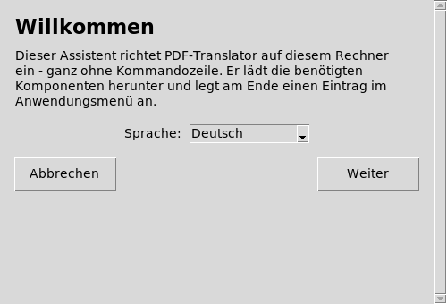
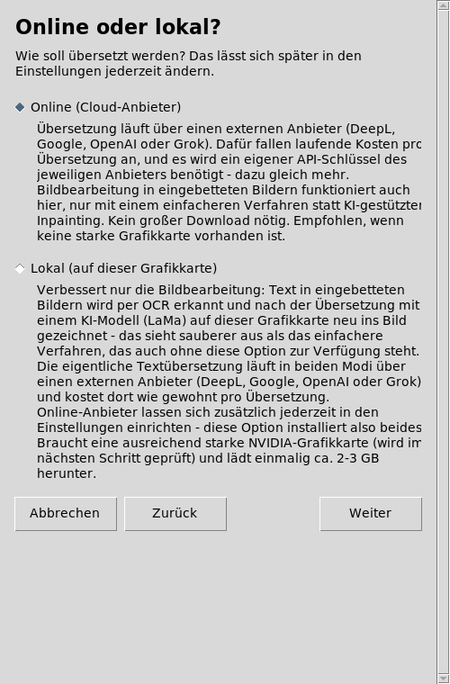
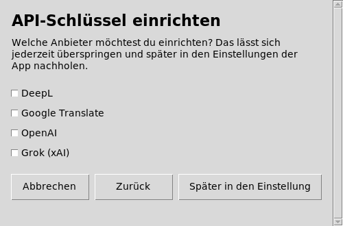
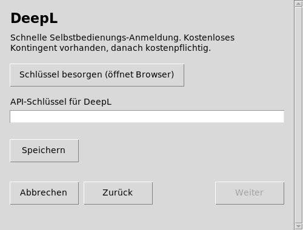
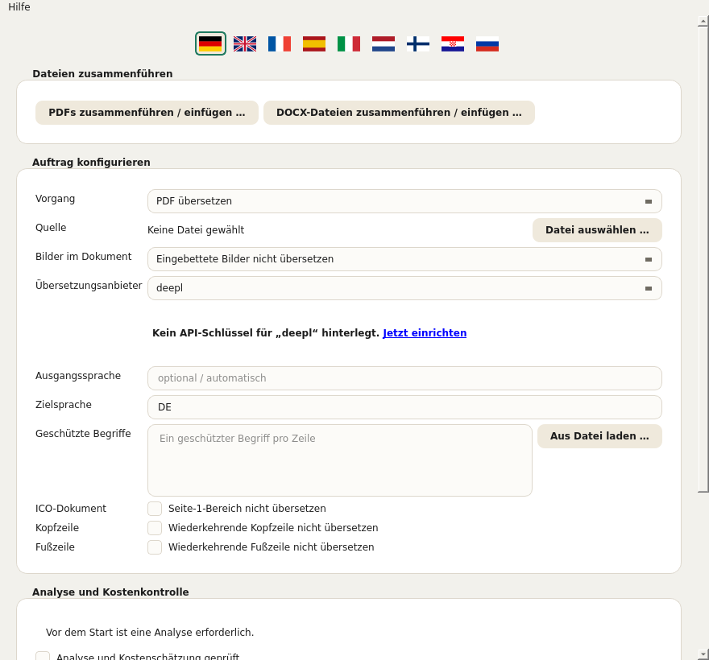
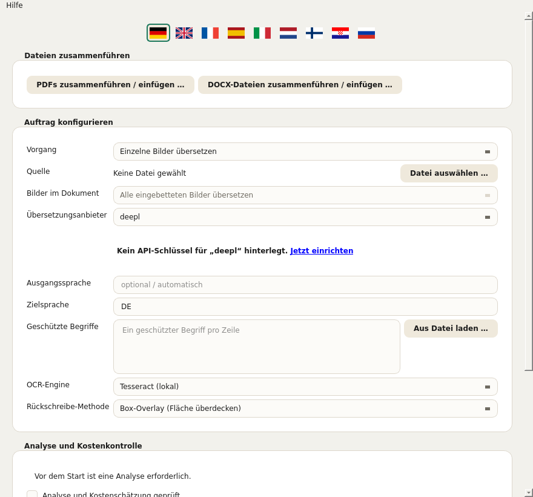
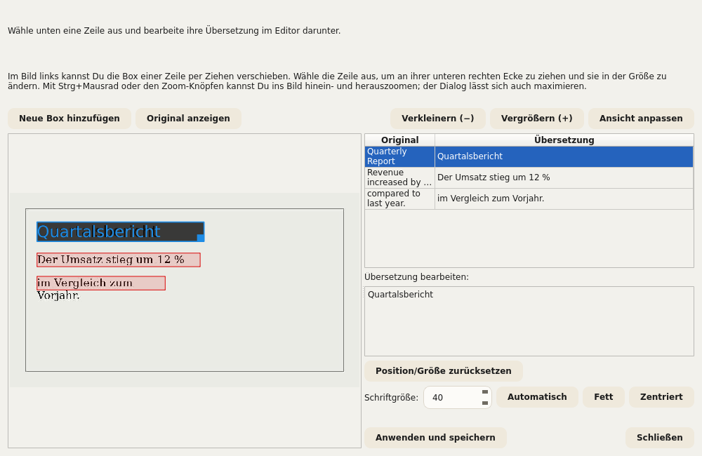
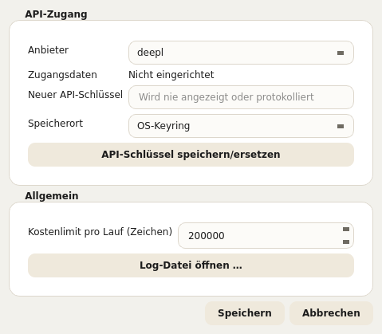
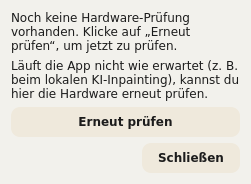

# PDF-Translator – Manuel d'utilisation

Ce manuel décrit toutes les commandes de PDF-Translator : l'assistant de
configuration (programme d'installation) et l'application elle-même. Il
s'appuie sur les mêmes textes d'aide que ceux affichés directement dans
l'application (info-bulle au survol de la souris, texte détaillé via Aide →
Qu'est-ce que c'est ? ou Maj+F1 suivi d'un clic sur un élément). Si vous
connaissez déjà l'application, vous pouvez donc simplement utiliser ce
document comme ouvrage de référence.

Dans l'application, ce manuel peut être ouvert à tout moment via
**Aide → Manuel d'utilisation …** – automatiquement dans la langue
d'interface actuellement choisie. Les avertissements qui apparaissent
directement sous un champ (p. ex. « PaddleOCR n'est pas installé ») renvoient
également ici.

*Remarque : les captures d'écran montrent l'interface allemande. Dans le
texte, les noms des champs sont indiqués exactement tels qu'ils apparaissent
dans l'interface française.*

## Sommaire

1. Assistant de configuration (installation)
2. Vue d'ensemble de l'application
3. Choisir un document et réglages de base
4. Traitement des images dans les documents
5. Termes protégés
6. Exclure les en-têtes et pieds de page
7. Estimer les coûts et lancer la traduction
8. Pendant et après le traitement
9. Corriger les traductions manuellement
10. Fusionner plusieurs fichiers
11. Paramètres
12. Langue de l'interface
13. Test matériel (GPU)
14. Mises à jour et informations de version

---

## 1. Assistant de configuration (installation)

L'assistant de configuration installe PDF-Translator une seule fois sur cet
ordinateur. Il ne nécessite pas de droits administrateur/root, car tout est
installé dans un dossier personnel appartenant à l'utilisateur.

**Langue.** La langue choisie sur le premier écran s'applique immédiatement à
tous les écrans suivants de l'assistant. Elle est indépendante de la langue de
l'application elle-même, qui dispose de son propre choix de langue (voir
chapitre 12).

**En ligne ou local ?** On choisit ici comment les images des documents sont
traitées :

- **En ligne (fournisseur cloud) :** la traduction passe par un fournisseur
  cloud (DeepL, Google, OpenAI ou Grok). Un procédé local plus simple est
  utilisé pour le traitement des images. C'est l'installation la plus rapide
  et la plus simple, et elle fonctionne sur tout ordinateur. Il faut une clé
  API personnelle du fournisseur choisi ainsi qu'une connexion Internet
  pendant la traduction.
- **Local (sur cette carte graphique) :** en plus de la variante en ligne, un
  traitement d'image plus performant, basé sur l'IA (LaMa), est installé sur
  votre propre carte graphique. Le traitement des images reste alors
  entièrement sur cet ordinateur. Il faut une carte graphique NVIDIA prise en
  charge avec suffisamment de mémoire vidéo (vérifiée à l'étape suivante) ;
  environ 2 à 3 Go sont téléchargés une seule fois. Dans les deux modes, la
  traduction du texte proprement dite passe toujours par un fournisseur
  externe et y est facturée comme d'habitude à chaque traduction.

  Ce que cette option apporte concrètement est décrit plus en détail au
  chapitre 4 (« Traitement des images dans les documents ») – en bref : une
  qualité d'image nettement meilleure lorsque les documents traduits
  contiennent des photos ou d'autres arrière-plans complexes ; sinon, elle
  n'est pas indispensable.

Si la vérification du GPU échoue (aucune carte prise en charge trouvée ou
pilote obsolète), l'assistant propose deux voies : **« Continuer en local
malgré tout »** (utile si la vérification a échoué à tort ou si une mise à
jour du pilote est encore en attente – le test matériel peut être relancé à
tout moment dans l'application, voir chapitre 13) ou **« Passer en
ligne »**. Indépendamment de cela, des fournisseurs en ligne peuvent être
ajoutés à tout moment dans les paramètres de l'application.

**Configurer les clés API.** Une clé API peut être enregistrée ici
directement pour chaque fournisseur souhaité. Les fournisseurs non cochés
peuvent être ajoutés plus tard à tout moment dans les paramètres de
l'application (bouton **« Plus tard, dans les paramètres »**). Pour chaque
fournisseur coché, un écran distinct s'ouvre avec un champ de saisie (la
saisie s'affiche sous forme de points) et le bouton **« Obtenir une clé
(ouvre le navigateur) »**, qui ouvre la page d'inscription du fournisseur
dans le navigateur – c'est là que la clé est créée, puis collée ici. Seul le
bouton **« Enregistrer »** enregistre réellement la saisie. L'assistant peut
aussi être terminé sans clé ; toutefois, aucune traduction ne fonctionnera
tant qu'au moins une clé n'aura pas été enregistrée.

*Consigne de sécurité à l'ouverture du navigateur :* avant que l'assistant
n'ouvre un lien dans le navigateur par défaut, l'adresse cible est affichée
une nouvelle fois en clair et doit être confirmée. Vous pouvez ainsi vérifier
avant l'ouverture qu'il s'agit bien de l'adresse attendue.

**Précédent, Suivant, Annuler.** Chaque écran comporte en bas la même barre
avec **« Précédent »** (les saisies déjà effectuées sont conservées),
**« Suivant »** et **« Annuler »**. En cas d'annulation, l'assistant demande
une confirmation ; si elle est donnée, il supprime automatiquement tous les
fichiers déjà créés jusque-là – la configuration peut être relancée à tout
moment. Si l'installation proprement dite est en cours, un fichier en cours
d'utilisation peut rester dans de rares cas ; même alors, l'assistant tente
d'en supprimer automatiquement le plus possible.

**Fin.** À la fin, l'assistant peut soit être fermé avec **« Fermer »** sans
démarrer l'application, soit enchaîner directement sur le démarrage de
l'application avec **« Lancer maintenant »**.

---

## 2. Vue d'ensemble de l'application

Après l'installation, l'application PDF-Translator s'ouvre avec un formulaire
pour le traitement de traduction. Les chapitres suivants le parcourent de
haut en bas, dans l'ordre où il est disposé dans la fenêtre. Le numéro de
version actuel figure dans la barre de titre de la fenêtre.

---

## 3. Choisir un document et réglages de base

**Champ « Opération » – détermine le déroulement de traduction utilisé.**
Selon la sélection, seuls les champs pertinents s'affichent plus bas – les
réglages OCR, par exemple, uniquement en mode « Traduire des images
individuelles ». Quatre options sont proposées :

- **Traduire un PDF** – un seul document PDF.
- **Traduire une présentation (PowerPoint/Impress)** – un seul fichier PPTX.
- **Traduire un document Word/Writer** – un seul fichier DOCX.
- **Traduire des images individuelles** – un ou plusieurs fichiers image ;
  affiche en plus les champs « Moteur OCR » et « Méthode de réécriture »
  (voir chapitre 4).

**Champ « Source » – sélectionne le fichier à traduire.** Le bouton
**« Sélectionner un fichier … »** ouvre la boîte de dialogue de sélection
(en mode images, plusieurs fichiers peuvent être choisis à la fois). Le nom
du fichier choisi apparaît ensuite à côté. S'il est indiqué « Aucun fichier
sélectionné », il faut d'abord choisir un fichier avant de pouvoir lancer une
analyse des coûts.

**Champs « Langue source » et « Langue cible » – les deux langues de ce
traitement.** Toutes deux sont indiquées sous forme de code de langue à deux
lettres selon ISO 639-1, p. ex. EN pour l'anglais ou DE pour l'allemand. La
langue source doit correspondre à la langue réelle du document, sinon le
fournisseur de traduction renvoie des résultats erronés, voire aucun.

**Champ « Fournisseur de traduction » – le service cloud qui effectue la
traduction du texte proprement dite.** Quatre fournisseurs sont proposés,
chacun avec sa propre clé API gérée dans les paramètres (chapitre 11) :

- **DeepL**
- **Google**
- **OpenAI**
- **Grok**

S'il manque une clé pour le fournisseur choisi, un avertissement encadré de
rouge avec un lien vers les paramètres apparaît directement en dessous.

---

## 4. Traitement des images dans les documents

Le formulaire comporte pour cela le champ **« Images du document »**, avec
trois possibilités :

- **Ne pas traduire les images intégrées** – les images intégrées restent
  inchangées.
- **Sélectionner les images individuellement plus tard** – doit à l'avenir
  afficher, après l'analyse des coûts, une liste permettant de choisir des
  images précises.
- **Traduire toutes les images intégrées** – doit à l'avenir traiter
  automatiquement chaque image intégrée.

Important, pour éviter de fausses attentes :

> **État actuel : pour PDF, PowerPoint/Impress et Word/Writer, ce champ n'a
> actuellement AUCUN effet sur le résultat.** Les images intégrées dans ces
> trois types de documents sont, en l'état, TOUJOURS reprises sans
> modification – quelle que soit l'option choisie ci-dessus. Ce n'est pas un
> dysfonctionnement, mais une fonctionnalité pas encore réalisée : la liste
> de sélection décrite plus haut pour « Sélectionner les images
> individuellement plus tard » n'existe pas encore non plus. L'application le
> signale elle-même explicitement lors de l'analyse des coûts dès qu'un
> document contient des images intégrées et que « Ne pas traduire les images
> intégrées » n'est pas choisi. Seuls les fichiers image purs, dans le mode
> distinct **« Traduire des images individuelles »** (voir ci-dessous), sont
> déjà entièrement traduits – il s'agit d'un déroulement totalement distinct
> et abouti, non concerné par cette limitation.

En mode images, le champ est donc verrouillé (fixé sur « Traduire toutes les
images intégrées ») et n'y a pas d'utilité pratique – pour ce mode, le
pilotage se fait via les deux champs « Moteur OCR » et « Méthode de
réécriture » plus bas.

Visibles uniquement en mode « Traduire des images individuelles »
(chapitre 3), deux champs supplémentaires, **« Moteur OCR »** et **« Méthode
de réécriture »**, apparaissent dans la capture ci-dessous avec leurs valeurs
par défaut (Tesseract et superposition de zone) – tous deux sont expliqués
ensuite un par un :

**Champ « Moteur OCR » – reconnaissance de texte.** Reconnaît le texte dans
les images avant qu'il ne soit traduit et réécrit. Trois moteurs sont
proposés (la capture ci-dessus montre le premier) :

- **Tesseract (local)** (par défaut). Fonctionne entièrement en local, sans
  fournisseur cloud ni clé API propre – mais nécessite que le logiciel
  Tesseract lui-même soit installé sur cet ordinateur (voir README.md).
  Reconnaît le texte ligne par ligne ; PDF-Translator regroupe ensuite
  lui-même les lignes en paragraphes.
- **Google Cloud Vision (cloud, détection des paragraphes)**. Passe par le
  service cloud de Google et utilise la même clé API que le fournisseur de
  traduction « Google » (chapitres 3/11) – reconnaît directement les
  paragraphes en tant que tels au lieu de les reconstituer à partir de
  lignes, ce qui donne des résultats nettement meilleurs sur des images
  denses en texte que l'approche ligne par ligne de Tesseract.
- **PaddleOCR (local, détection des paragraphes)**. Fonctionne également
  entièrement en local, sans fournisseur cloud, mais reconnaît, comme Google
  Cloud Vision, les paragraphes directement grâce à son propre modèle de mise
  en page entraîné plutôt que par une approximation géométrique.
  **PaddleOCR n'est pas installé par l'assistant de configuration** – le
  paquet optionnel supplémentaire doit être installé ultérieurement dans
  l'environnement Python de l'application (liste des paquets :
  requirements-paddleocr.txt dans le dossier de l'application). Si vous ne
  le souhaitez pas, utilisez plutôt Tesseract ou Google Cloud Vision.

Si le moteur choisi dans ce champ n'est pas disponible sur cet ordinateur
(programme Tesseract introuvable, aucune clé API Google enregistrée ou
PaddleOCR non installé), un avertissement encadré de rouge avec un lien vers
ce chapitre apparaît directement en dessous, et un traitement avec ce moteur
ne peut pas être lancé.

**Champ « Méthode de réécriture » – comment le texte traduit est réécrit dans
l'image.** Une fois le texte original reconnu et traduit, la traduction doit
être réécrite à sa place dans l'image – mais il faut d'abord restaurer
l'arrière-plan sous-jacent pour que l'ancien texte ne transparaisse pas. Ce
champ propose pour cela trois procédés de qualité et d'exigences différentes
(la capture ci-dessus montre le premier) :

- **Superposition de zone (recouvrir la surface)** (par défaut). Remplit la
  zone d'une couleur unie (ou d'un dégradé simple si l'environnement s'y
  prête clairement) et écrit le texte traduit par-dessus. Fonctionne
  toujours, sans matériel particulier ni logiciel supplémentaire, et c'est
  donc le réglage par défaut. Sur des arrière-plans unis ou homogènes (p. ex.
  tableaux, diagrammes, encadrés) cela se remarque à peine ; sur de vraies
  photos ou des arrière-plans texturés, la zone est visible comme une
  « pièce rapportée ».
- **Inpainting CPU classique (reconstruction de l'arrière-plan)**. Utilise
  un procédé classique de traitement d'image (pas un modèle d'IA) de la
  bibliothèque libre OpenCV pour prolonger l'environnement autour du texte au
  lieu de le remplir d'une seule couleur – les motifs ou dégradés simples se
  poursuivent ainsi de façon crédible jusqu'au bord (et légèrement au-delà)
  de la zone de texte. Fonctionne également toujours en local sans GPU mais,
  comme la superposition de zone, ne remplace pas la variante basée sur l'IA
  pour des arrière-plans photographiques vraiment complexes.
- **Inpainting IA local (GPU, LaMa)**. Utilise sur la carte graphique locale
  un modèle d'IA spécial nommé LaMa, entraîné précisément pour cette tâche,
  afin de reconstruire de façon crédible même des arrière-plans
  photographiques complexes – de loin la meilleure qualité des trois
  procédés. Il faut pour cela une carte graphique NVIDIA prise en charge avec
  support CUDA (installé uniquement si « Local » a été choisi lors de la
  configuration, voir chapitre 1), et un modèle de plusieurs centaines de Mo
  est téléchargé lors de la toute première utilisation (puis conservé en
  cache). Si PyTorch avec support CUDA n'est pas installé, un avertissement
  encadré de rouge apparaît sous le champ. Si la carte graphique dispose de
  moins de mémoire vidéo que recommandé, un avertissement encadré de jaune
  apparaît à la place – le procédé reste utilisable, mais sans garantie.
  L'état du matériel peut être vérifié à tout moment avec le test matériel
  (chapitre 13).

En règle générale : pour les documents à arrière-plans simples et unis (la
plupart des tableaux, diagrammes, diapositives), la superposition de zone ou
l'inpainting CPU classique suffisent largement – sans GPU, sans attente. Pour
des photos ou des arrière-plans détaillés, l'inpainting IA vaut nettement la
peine. Les traductions corrigées par la suite (chapitre 9) peuvent d'ailleurs
être recalculées avec n'importe lequel des trois procédés, quel que soit
celui utilisé pour le traitement initial.

**Autres options pour certains types de documents :**

- **Champ « Document ICO »** (case « Ne pas traduire la zone de la page 1 »)
  concerne uniquement le type de document interne ICO et exclut de la
  traduction la zone de métadonnées de la page 1 (pour Word la zone avant la
  ligne de séparation, pour PDF détectée à l'aide de termes d'ancrage comme
  « Issuer Address »/« Asset Matrix ») – que cette zone soit effectivement
  trouvée ou non. À laisser désactivé pour tous les autres documents.
- **Champ « Affichage côte à côte »** (case « Original et traduction côte à
  côte », Word uniquement) construit le texte principal, au lieu du résultat
  normal fidèle à la mise en page, sous forme de tableau comparatif à deux
  colonnes (Original | Traduction) au format paysage. L'en-tête et le pied de
  page restent inchangés ; les tableaux intégrés au texte principal
  n'apparaissent pas dans cette vue.

---

## 5. Termes protégés

Le champ **« Termes protégés »** permet de saisir des termes qui doivent
rester non traduits – un terme par ligne, par exemple des noms d'entreprise ou
de produit. Le fournisseur de traduction laisse ces termes intacts. Le bouton
**« Charger depuis un fichier … »** permet en plus de charger une liste à
partir d'un fichier CSV ou texte (un terme par ligne ; pour un CSV, c'est la
première colonne qui compte) ; les entrées existantes sont conservées et les
doublons ignorés.

**Important : seules les occurrences en MAJUSCULES sont protégées.** Le
terme saisi peut être écrit de n'importe quelle façon (minuscules,
majuscules, mixte – l'écriture dans ce champ n'a pas d'importance). Ce qui
compte, c'est la façon dont le terme est réellement écrit dans le document à
traduire : seules les occurrences qui y figurent entièrement en MAJUSCULES
sont exclues de la traduction. Si le même terme apparaît ailleurs dans le
document en minuscules ou en casse mixte, il y est traduit normalement.

La raison : certains termes protégés (comme des noms de produits ou de
projets normalement toujours écrits en majuscules) sont par hasard aussi des
mots tout à fait ordinaires de la langue source. Si chaque occurrence était
protégée quelle que soit son écriture, le mot ordinaire resterait lui aussi
non traduit partout ailleurs dans le document – et devrait être corrigé à la
main. Pour s'assurer qu'un terme est effectivement protégé dans le document,
il faut donc vérifier qu'il y est vraiment écrit en majuscules – sinon on
protège par mégarde trop peu (une occurrence en minuscules reste non protégée
et est traduite) ou, en cas de majuscules involontaires ailleurs dans le
document, trop.

---

## 6. Exclure les en-têtes et pieds de page

Deux champs (PDF uniquement) détectent automatiquement le texte récurrent et
l'excluent de la traduction :

- **Champ « En-tête »** (case « Ne pas traduire l'en-tête récurrent ») –
  texte qui revient près du haut de la plupart des pages, à l'identique (ou
  ne différant que par le numéro de page).
- **Champ « Pied de page »** (case « Ne pas traduire le pied de page
  récurrent ») – la même chose pour le texte récurrent près du bas de la page
  (p. ex. ligne de copyright, numéro de page).

Si rien de pertinent n'est trouvé, rien ne change.

---

## 7. Estimer les coûts et lancer la traduction

Avant qu'une traduction ne démarre, il faut d'abord estimer son coût
approximatif dans la section **« Analyse et contrôle des coûts »** :

1. **« Analyser le document et estimer les coûts »** compte les caractères à
   traduire et estime le coût approximatif selon le fournisseur choisi, sans
   rien traduire encore.
2. Ce n'est qu'ensuite que la case **« Analyse et estimation des coûts
   vérifiées »** peut être cochée – une étape de sécurité délibérée pour
   qu'aucun traitement ne soit lancé par mégarde sans avoir d'abord consulté
   les coûts estimés.
3. Ce n'est qu'avec la case cochée que **« Démarrer la traduction »** devient
   cliquable.

Si quelque chose est modifié ensuite dans le formulaire (p. ex. un autre
fichier ou un autre fournisseur), l'analyse doit être relancée.

---

## 8. Pendant et après le traitement

La progression d'une traduction en cours apparaît dans la section
**« Traitement et résultat »**. Un traitement en cours peut être arrêté le
plus rapidement possible avec **« Annuler »** (après l'appel en cours au
fournisseur de traduction) ; les parties déjà traitées ne sont pas
automatiquement conservées sous forme de fichier complet – selon le format,
un fichier incomplet peut subsister.

Une fois un traitement terminé, on dispose de :

- **« Ouvrir le dossier »** – ouvre le gestionnaire de fichiers dans le
  dossier de destination du traitement qui vient de se terminer.
- **« Ouvrir le rapport qualité »** – affiche les anomalies relevées par le
  contrôle qualité automatique du traitement, p. ex. des passages qu'il
  pourrait être utile de vérifier.
- **« Corriger la traduction »** – visible pour les traitements PDF et
  images comportant des passages corrigibles ; permet de retravailler de
  façon ciblée certains passages traduits sans répéter tout le traitement
  (détails au chapitre 9).

---

## 9. Corriger les traductions manuellement

Après un traitement terminé – à condition qu'il existe des passages
corrigibles – le bouton **« Corriger la traduction »** apparaît (voir
chapitre 8). Selon le type de document, l'une de deux boîtes de dialogue plus
ou moins élaborées s'ouvre :

- Pour les **traitements PDF**, la boîte de dialogue « Corriger la traduction
  du PDF » avec un tableau du texte original et traduit par bloc de texte,
  dans lequel les traductions peuvent être directement réécrites.
- Pour les **traitements d'images**, la boîte de dialogue nettement plus
  complète **« Corriger la traduction de l'image »**, car ici non seulement
  le texte mais aussi sa position et sa taille dans l'image doivent être
  justes. Si plusieurs fichiers ont été traduits en une fois, l'application
  demande d'abord lequel doit être corrigé.

La boîte de dialogue de correction d'image montre à gauche l'image avec un
cadre coloré pour chaque passage de texte reconnu, et à droite un tableau du
texte original et traduit. La sélection d'une ligne du tableau charge sa
traduction dans l'éditeur en bas pour modification :

- **Modifier le texte.** La traduction de la ligne sélectionnée peut être
  librement réécrite dans l'éditeur en bas.
- **Position et taille.** Dans l'image à gauche, le cadre de la ligne
  sélectionnée peut être déplacé par glisser ; il peut être redimensionné par
  son coin inférieur droit. **« Réinitialiser la position/taille »** rétablit
  la position reconnue à l'origine.
- **« Ajouter une nouvelle zone ».** Si un passage de texte n'a pas du tout
  été trouvé par l'OCR, on peut tracer une nouvelle zone dans l'image et y
  saisir manuellement son propre texte – sans nouvelle passe OCR.
- **Taille de police, Gras, Centré.** Pour chaque passage, la taille de
  police déterminée automatiquement peut être remplacée (ou rétablie avec
  « Automatique »), et le gras ainsi que le centrage peuvent être activés.
- **Zoom et « Afficher l'original ».** Ctrl+molette ou les boutons de zoom
  permettent de zoomer et dézoomer dans l'image ; « Afficher l'original »
  affiche brièvement l'image source non modifiée pour comparer. La boîte de
  dialogue elle-même peut aussi être agrandie pour gagner de la place.
- **Aperçu en direct.** Pendant la modification, l'image est recalculée en
  continu avec la méthode de réécriture effectivement utilisée – ce que l'on
  voit ici correspond donc en grande partie au résultat final, et pas
  seulement à une approximation grossière.

**« Appliquer et enregistrer »** régénère l'image avec toutes les
modifications et écrase le fichier traduit précédemment – sans nouvelle passe
OCR ni nouvel appel au fournisseur de traduction, donc sans coût
supplémentaire. La boîte de dialogue peut ensuite être rouverte autant de
fois que souhaité pour continuer à améliorer ; chaque nouvelle passe repart
du dernier état enregistré, et non de la traduction automatique d'origine.
**« Fermer »** abandonne les modifications non enregistrées de la session en
cours.

> **Remarque sur l'état des tests.** La fonction de correction – surtout la
> boîte de dialogue de correction d'image avec positionnement, nouvelles
> zones et aperçu en direct – n'est pas encore testée à 100 % et peut encore
> contenir des erreurs dans certains cas. Avant « Appliquer et enregistrer »,
> il vaut donc la peine de regarder l'aperçu en direct, et en cas de
> plusieurs passes de correction, il est conseillé de vérifier le résultat
> entre-temps.

---

## 10. Fusionner plusieurs fichiers

Indépendamment du formulaire de traduction, la section **« Fusionner des
fichiers »** propose deux boîtes de dialogue dédiées pour réunir plusieurs
fichiers en un seul – **« Fusionner/insérer des PDF … »** pour les fichiers
PDF et **« Fusionner/insérer des fichiers DOCX … »** pour les fichiers Word.
Rien n'y est traduit, les fichiers sont seulement recombinés. Les deux boîtes
de dialogue sont construites de façon identique, à une différence près
concernant les numéros de page (voir ci-dessous).

**Tableau des fichiers source.** Pour PDF, il comporte deux colonnes :

- **Fichier** – le fichier source.
- **Pages** – sélection de pages facultative pour ce fichier (vide = fichier
  entier, sinon p. ex. « 1-3,5 » ou « 6- » pour la page 6 jusqu'à la fin ou
  « -4 » pour le début jusqu'à la page 4 ; « 5-3 » insère les pages 5, 4, 3
  dans cet ordre inversé). Ajouter plusieurs fois le même fichier avec des
  sélections de pages différentes permet de l'insérer à un endroit précis
  d'un autre fichier.

Pour Word/DOCX, la colonne « Pages » n'existe pas – contrairement au PDF, le
format DOCX ne contient pas de numéros de page fixes, ce sont donc toujours
des fichiers entiers qui sont fusionnés. Le même fichier peut néanmoins être
ajouté plusieurs fois pour l'insérer à plusieurs endroits. Au-delà de 100
fichiers DOCX, la fusion se fait automatiquement par groupes (indiqué ensuite
dans la ligne d'état).

L'ordre du tableau détermine l'ordre dans le résultat. Les boutons suivants
sont disponibles :

- **« Ajouter des fichiers … »** – ouvre la boîte de dialogue de sélection
  normale pour un ou plusieurs fichiers.
- **« Rechercher dans un dossier … »** – ouvre une boîte de dialogue de
  recherche dédiée pour choisir certains fichiers dans un dossier qui en
  contient beaucoup (voir ci-dessous).
- **« Supprimer »** – retire la ou les lignes sélectionnées du tableau (les
  fichiers eux-mêmes ne sont pas touchés).
- **« Monter »** / **« Descendre »** – déplace la ligne sélectionnée dans
  l'ordre.
- **« Trier par nom »** / **« Trier par date »** – trie tout le tableau par
  nom de fichier ou par date de modification du fichier sur le disque
  (dernière modification, pas la date de création). Chaque clic alterne
  entre ordre croissant et décroissant ; l'intitulé du bouton indique
  toujours le sens qu'appliquerait le prochain clic.

**Champ « Fichier de destination ».** **« Enregistrer sous … »** définit où
le fichier fusionné est écrit.

**« Démarrer la fusion » / « Annuler ».** Démarre ou arrête le traitement ;
avec « Annuler », un résultat partiel déjà écrit est conservé.

### Rechercher dans un dossier

La boîte de dialogue de recherche (« Rechercher des PDF dans un dossier » ou
son équivalent DOCX) sert à ne choisir que certains fichiers dans un dossier
qui en contient beaucoup (p. ex. 1 000 PDF ou plus) au lieu de les chercher
un par un à la main. Les résultats peuvent ensuite être repris avec
**« Ajouter la sélection »** et arrivent dans le tableau ci-dessus.

- **Source : « Dossier local » ou « Google Drive »** – au lieu d'un dossier
  de cet ordinateur, on peut aussi parcourir un dossier Google Drive partagé ;
  les résultats sont alors téléchargés dans un dossier cache au choix. La
  configuration unique de l'accès Google est décrite dans le fichier
  docs/google_drive_setup.md du dossier de l'application.
- **Champ « Dossier »** – le dossier à parcourir, défini via « Choisir un
  dossier … ».
- **Case « Inclure les sous-dossiers »** – inclut aussi tous les
  sous-dossiers dans la recherche.
- **Champ « Texte de recherche »** – un ou plusieurs termes, combinables avec
  AND/OR (aussi && / ||) et des parenthèses, p. ex. « Acme AND contrat »
  (uniquement les fichiers contenant les deux termes) ou « Acme OR Zenith »
  (fichiers contenant au moins l'un des deux). Laissé vide, il trouve tous
  les fichiers du dossier.
- **Où chercher** – trois cases, indépendantes les unes des autres et
  librement combinables (au moins une doit être cochée) :
  - **Format ICO (zone d'en-tête page 1)** – pour PDF/Word, ne parcourt que
    le bloc de métadonnées ICO de la page 1 (Developer, QSI ICO, date
    d'émission, etc. ; pour DOCX : les paragraphes avant l'élément de
    séparation, sans lien avec une page fixe).
  - **En-tête (toutes les pages)** – ne parcourt que la zone supérieure
    récurrente sur chaque page (p. ex. ligne nom d'entreprise/logo) – une
    zone de texte distincte, indépendante de « Format ICO ».
  - **Texte intégral** – parcourt tout le texte de toutes les pages, y
    compris les deux zones ci-dessus.
- **Groupe « Filtrer par date »** – facultatif, restreint en plus les
  résultats à une plage de dates :
  - **Date du fichier** ou **Date dans le document** – indique si la date
    provient du fichier lui-même (date de modification) ou d'une date
    reconnue dans le texte du document. Avec « Date dans le document », la
    zone peut en outre être limitée : **Champ ICO (page 1)**, **En-tête
    (toutes les pages)** ou **Pied de page (toutes les pages)**.
  - **Format de date** – un ou plusieurs des formats prédéfinis **ISO
    (AAAA-MM-JJ)**, **Allemand (JJ.MM.AAAA)**, **Anglais (nom du mois, par
    ex. September 4, 2026)** ou **Barre oblique (JJ/MM/AAAA)**, ou un
    **Format personnalisé** au moyen d'espaces réservés comme
    YYYY/MM/DD/MMMM (l'info-bulle du champ affiche tous les espaces réservés
    avec des exemples).
  - **Date exacte** – bascule entre une date unique (champ « Date ») et une
    période (champs « Du »/« Au »).

La zone de résultats affiche ensuite le nombre de résultats trouvés et le
nombre de fichiers parcourus ; les fichiers illisibles sont indiqués
séparément.

---

## 11. Paramètres

Le bouton **« Paramètres … »** donne accès à :

**Accès API.** On choisit d'abord, dans le champ **« Fournisseur »**
(DeepL, Google, OpenAI, Grok), le fournisseur auquel s'appliquent l'état, la
nouvelle clé et l'emplacement de stockage ci-dessous – chaque fournisseur a
sa propre clé, stockée séparément. L'état indique si une clé est
actuellement trouvée pour le fournisseur choisi dans le trousseau du système,
dans une variable d'environnement ou pas du tout (« Non configuré ») ; une
variable d'environnement est toujours prioritaire sur le trousseau – dans ce
cas, la boîte de dialogue affiche un avertissement correspondant. Une
nouvelle clé est collée dans le champ **« Nouvelle clé API »** (la saisie
s'affiche sous forme de points) et n'est réellement enregistrée qu'avec
**« Enregistrer/remplacer la clé API »** ; le champ de saisie est ensuite
vidé et l'état se met à jour. Comme **« Emplacement de stockage »**, on peut
choisir :

- **Trousseau du système** – le choix recommandé et permanent.
- **Variable d'environnement (cette session uniquement)** – valable
  uniquement pour la session en cours et destinée surtout aux cas
  particuliers/au dépannage.
- **Les deux** – enregistre dans le trousseau et écrit en plus une telle
  variable de session.

**« Limite de coût par traitement (caractères) ».** Un traitement contenant
plus de caractères que la valeur réglée ici est interrompu avec un
avertissement, au lieu d'engendrer des coûts élevés inattendus. La valeur peut
être augmentée ici si nécessaire.

**« Ouvrir le fichier journal … ».** Ouvre le fichier journal actuel dans le
programme par défaut du système – pratique pour copier des messages d'erreur
dans un rapport de bug sans avoir à faire de capture d'écran.

**« Enregistrer »** applique les paramètres, **« Annuler »** les abandonne.

---

## 12. Langue de l'interface

La barre de drapeaux de la fenêtre principale permet de changer
immédiatement et durablement la langue de l'interface elle-même – à ne pas
confondre avec les langues de traduction du formulaire (chapitre 3). Le choix
est enregistré immédiatement. Neuf langues sont proposées : Deutsch, English,
Français, Español, Italiano, Nederlands, Suomi, Hrvatski et Русский. Ce
manuel est disponible dans les mêmes neuf langues ; Aide → Manuel
d'utilisation … ouvre toujours la version dans la langue actuellement
choisie.

---

## 13. Test matériel (GPU)

**Aide → Afficher/relancer le test matériel …** permet de vérifier à tout
moment si un GPU NVIDIA pris en charge avec suffisamment de mémoire vidéo a
été trouvé, quand la dernière vérification a eu lieu et si le pilote installé
(version CUDA) prend en charge l'inpainting GPU local. Sans GPU/pilote
adapté, l'inpainting local fonctionne quand même – simplement plus lentement,
sur le CPU. **« Vérifier à nouveau »** relance la même vérification que celle
effectuée par le programme d'installation – utile après une mise à jour du
pilote ou un changement de carte graphique, sans devoir réinstaller
l'application.

---

## 14. Mises à jour et informations de version

Si une version plus récente de PDF-Translator est trouvée au démarrage, un
avertissement apparaît automatiquement (« Mise à jour disponible : … »). Un
clic dessus propose d'installer la nouvelle version. **Aide → Rechercher des
mises à jour …** permet de lancer la vérification manuellement à tout moment.

**Aide → À propos …** affiche la version installée, la licence (GNU GPL v3) et
un lien vers le code source sur GitHub.
