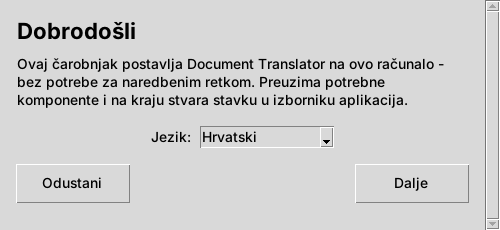
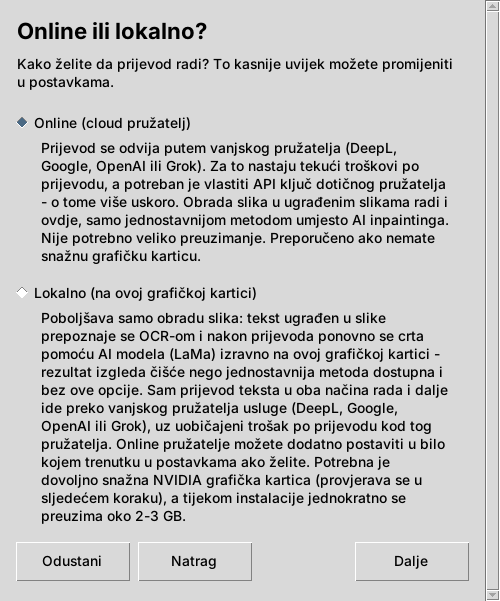
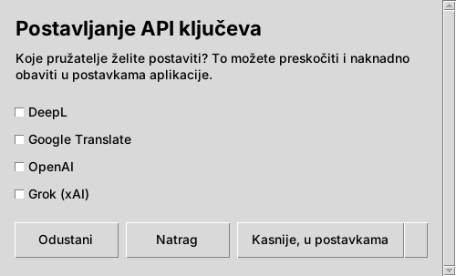
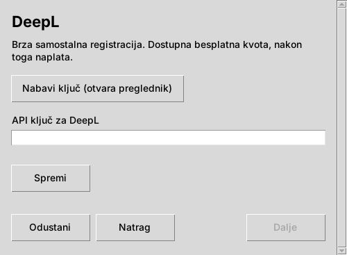
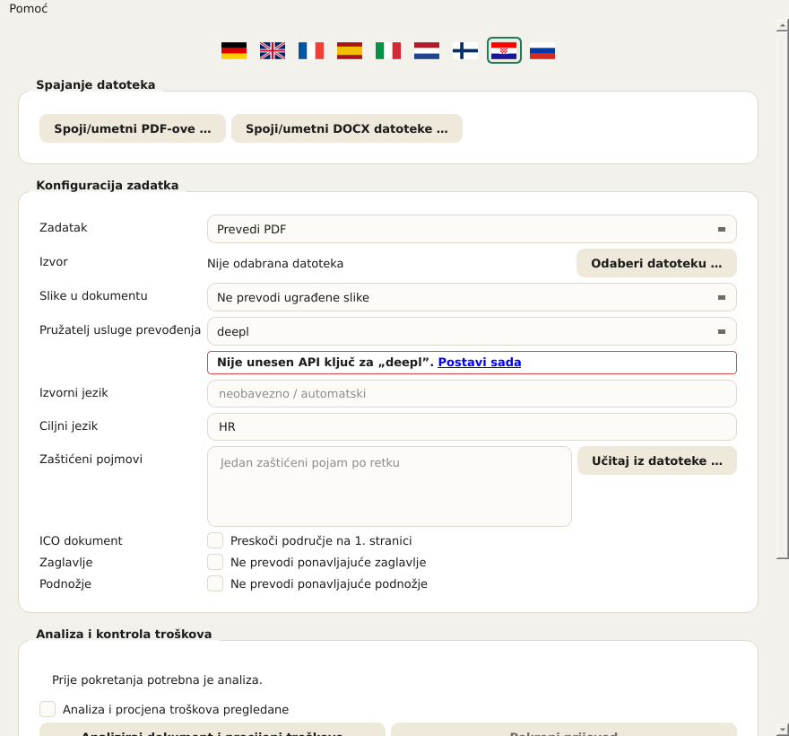
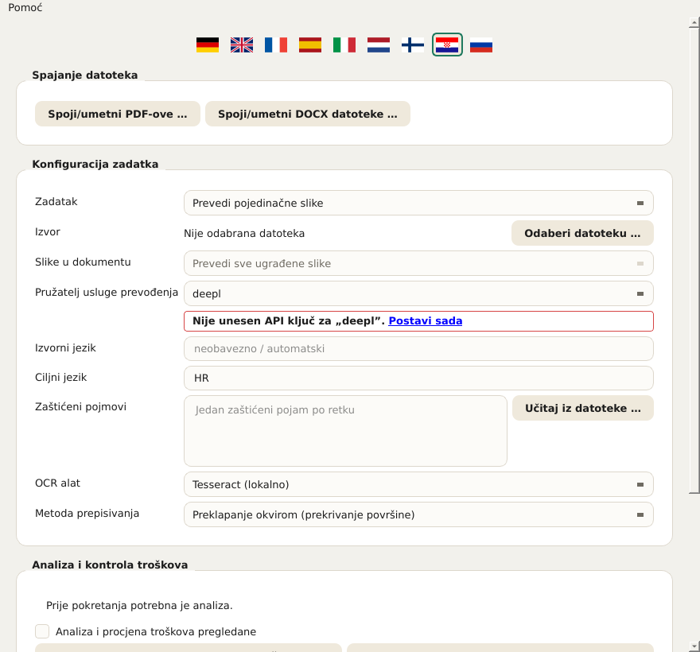
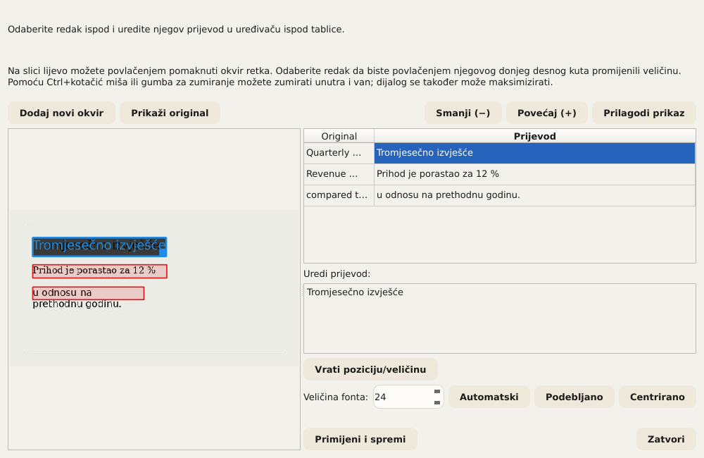
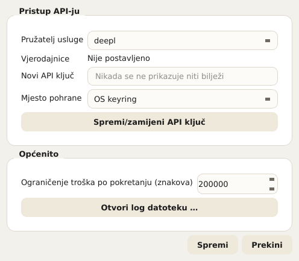
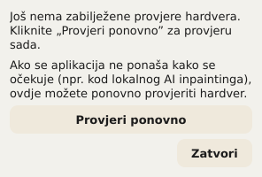

# Document Translator – Korisnički priručnik

Ovaj priručnik opisuje sve kontrole programa Document Translator: čarobnjak za
postavljanje (instalacijski program) i samu aplikaciju. Temelji se na istim
tekstovima pomoći koje aplikacija prikazuje izravno (opis alata pri prelasku
mišem te detaljniji tekst putem Pomoć → Što je ovo? ili Shift+F1 i zatim
klika na element). Tko već poznaje aplikaciju, ovaj dokument može koristiti
i jednostavno kao priručnik za snalaženje.

U aplikaciji se ovaj priručnik može u svakom trenutku otvoriti putem
**Pomoć → Korisnički priručnik …** – automatski na jeziku sučelja koji je
trenutačno odabran. Napomene koje se pojavljuju izravno ispod nekog polja
(npr. „PaddleOCR nije instaliran”) također vode ovamo.

## Sadržaj

1. Čarobnjak za postavljanje (instalacija)
2. Pregled aplikacije
3. Odabir dokumenta i osnovne postavke
4. Rad sa slikama u dokumentima
5. Zaštićeni pojmovi
6. Izuzimanje zaglavlja i podnožja
7. Procjena troškova i pokretanje prijevoda
8. Tijekom i nakon pokretanja
9. Ručno ispravljanje prijevoda
10. Spajanje više datoteka
11. Postavke
12. Jezik sučelja
13. Test hardvera (GPU)
14. Nadogradnje i podaci o verziji

---

## 1. Čarobnjak za postavljanje (instalacija)

Čarobnjak za postavljanje jednokratno instalira Document Translator na ovo
računalo. Ne zahtijeva administratorska/root prava jer se sve instalira u
osobnu mapu korisnika.

**Jezik.** Jezik odabran na prvom zaslonu odmah vrijedi za sve daljnje
zaslone čarobnjaka. Neovisan je o jeziku same aplikacije, koja ima vlastiti
odabir jezika (vidi poglavlje 12).

**Online ili lokalno?** Ovdje se bira kako se obrađuju slike u dokumentima:

- **Online (cloud pružatelj):** prijevod se obavlja putem cloud pružatelja
  usluge (DeepL, Google, OpenAI ili Grok). Za obradu slika koristi se
  jednostavniji, lokalni postupak. To je najbrža i najjednostavnija
  instalacija i radi na svakom računalu. Potreban je vlastiti API ključ
  odabranog pružatelja i internetska veza tijekom prevođenja.
- **Lokalno (na ovoj grafičkoj kartici):** uz online varijantu na vlastitu
  grafičku karticu instalira se bolja obrada slika temeljena na umjetnoj
  inteligenciji (LaMa). Obrada slika tada u potpunosti ostaje na ovom
  računalu. Potrebna je podržana NVIDIA grafička kartica s dovoljno video
  memorije (provjerava se u sljedećem koraku); jednokratno se preuzima oko
  2–3 GB. Sam prijevod teksta u oba načina uvijek se obavlja putem vanjskog
  pružatelja i ondje se, kao i obično, naplaćuje po prijevodu.

  Što ova opcija konkretno donosi, detaljnije je opisano u poglavlju 4 („Rad
  sa slikama u dokumentima”) – ukratko: znatno bolju kvalitetu slike kada
  prevedeni dokumenti sadrže fotografije ili druge složene pozadine; inače
  nije nužno potrebna.

Ako provjera GPU-a ne uspije (nije pronađena podržana kartica ili je
upravljački program zastario), čarobnjak nudi dvije mogućnosti: **„Ipak
nastavi lokalno”** (korisno ako je provjera pogrešno završila neuspjehom ili
ako ažuriranje upravljačkog programa tek slijedi – test hardvera može se u
aplikaciji ponoviti u bilo kojem trenutku, vidi poglavlje 13) ili
**„Prijeđi na Online”**. Neovisno o tome, online pružatelji mogu se u bilo
kojem trenutku dodati u postavkama aplikacije.

**Postavljanje API ključeva.** Ovdje se za svakog željenog pružatelja može
izravno pohraniti API ključ. Pružatelji koji nisu označeni mogu se kasnije u
bilo kojem trenutku dodati u postavkama aplikacije (gumb **„Kasnije, u
postavkama”**). Za svakog označenog pružatelja otvara se zaseban zaslon s
poljem za unos (unos se prikazuje kao točkice) i gumbom **„Nabavi ključ
(otvara preglednik)”**, koji u pregledniku otvara stranicu za registraciju
dotičnog pružatelja – ondje se ključ izrađuje, a zatim se lijepi ovdje. Tek
gumb **„Spremi”** stvarno pohranjuje unos. Čarobnjak se može dovršiti i bez
ključa; međutim, dok se ne pohrani barem jedan ključ, nijedan prijevod neće
raditi.

*Sigurnosna napomena pri otvaranju preglednika:* prije nego što čarobnjak
otvori poveznicu u zadanom pregledniku, ciljna adresa još se jednom prikazuje
u čitljivom obliku i mora se potvrditi. Tako se prije otvaranja može
provjeriti je li to doista očekivana adresa.

**Natrag, Dalje, Odustani.** Svaki zaslon ima na dnu istu traku s gumbima
**„Natrag”** (već uneseni podaci ostaju sačuvani), **„Dalje”** i
**„Odustani”**. Pri odustajanju se još jednom traži potvrda; ako se potvrdi,
čarobnjak automatski uklanja sve dotad izrađene datoteke – postavljanje se
može ponovno pokrenuti u bilo kojem trenutku. Ako je sama instalacija u
tijeku, u rijetkim slučajevima može ostati datoteka koja se upravo koristi;
i tada se ipak pokušava automatski ukloniti što je više moguće.

**Završetak.** Na kraju se čarobnjak može zatvoriti gumbom **„Zatvori”** bez
pokretanja aplikacije ili ga se gumbom **„Pokreni sada”** može izravno
povezati s pokretanjem aplikacije.

---

## 2. Pregled aplikacije

Nakon instalacije otvara se sama aplikacija Document Translator s obrascem za
pokretanje prijevoda. Sljedeća poglavlja prolaze kroz rukovanje odozgo prema
dolje, onim redoslijedom kojim je raspoređeno u prozoru. Trenutačni broj
verzije nalazi se u naslovnoj traci prozora.

---

## 3. Odabir dokumenta i osnovne postavke

**Polje „Zadatak” – određuje koji se postupak prevođenja koristi.** Ovisno
o odabiru, niže se prikazuju samo relevantna polja – postavke OCR-a,
primjerice, samo u načinu „Prevedi pojedinačne slike”. Na raspolaganju su
četiri opcije:

- **Prevedi PDF** – jedan PDF dokument.
- **Prevedi prezentaciju (PowerPoint/Impress)** – jedna PPTX datoteka.
- **Prevedi Word/Writer dokument** – jedna DOCX datoteka.
- **Prevedi pojedinačne slike** – jedna ili više slikovnih datoteka;
  dodatno prikazuje polja „OCR alat” i „Metoda prepisivanja” (vidi
  poglavlje 4).

**Polje „Izvor” – odabire datoteku za prevođenje.** Gumb **„Odaberi
datoteku …”** otvara dijalog za odabir datoteke (u načinu za slike može se
odabrati i više datoteka odjednom). Naziv odabrane datoteke zatim se
pojavljuje pokraj njega. Ako ondje piše „Nije odabrana datoteka”, najprije
treba odabrati datoteku prije nego što je moguća analiza troškova.

**Polja „Izvorni jezik” i „Ciljni jezik” – dva jezika ovog pokretanja.** Oba
se navode kao dvoslovni kod jezika prema ISO 639-1, npr. EN za engleski ili
DE za njemački. Izvorni jezik mora odgovarati stvarnom jeziku dokumenta,
inače pružatelj prijevoda vraća pogrešne rezultate ili ih uopće ne vraća.

**Polje „Pružatelj usluge prevođenja” – koja cloud usluga obavlja sam
prijevod teksta.** Na raspolaganju su četiri pružatelja, svaki s vlastitim
API ključem kojim se upravlja u postavkama (poglavlje 11):

- **DeepL**
- **Google**
- **OpenAI**
- **Grok**

Ako za odabranog pružatelja nedostaje ključ, izravno ispod pojavljuje se
napomena s crvenim okvirom i poveznicom na postavke.

---

## 4. Rad sa slikama u dokumentima

Obrazac za to ima polje **„Slike u dokumentu”** s tri mogućnosti:

- **Ne prevodi ugrađene slike** – ugrađene slike ostaju nepromijenjene.
- **Kasnije pojedinačno odaberi slike** – u budućnosti bi nakon analize
  troškova trebalo prikazati popis s kojeg se mogu ciljano odabrati slike.
- **Prevedi sve ugrađene slike** – u budućnosti bi trebalo automatski
  obraditi svaku ugrađenu sliku.

Važno, kako ne bi nastala pogrešna očekivanja:

> **Trenutačno stanje: kod PDF-a, PowerPoint/Impressa i Word/Writera ovo
> polje trenutačno NEMA nikakav učinak na rezultat.** Ugrađene slike u ova
> tri vrste dokumenata u sadašnjem stanju UVIJEK se preuzimaju
> nepromijenjene – bez obzira na to koja je od tri gore navedene opcije
> odabrana. To nije kvar, nego još neostvarena funkcija: ni gore opisani
> popis za odabir za „Kasnije pojedinačno odaberi slike” još ne postoji.
> Aplikacija na to sama izričito upozorava tijekom analize troškova čim
> dokument sadrži ugrađene slike, a nije odabrano „Ne prevodi ugrađene
> slike”. Samo čiste slikovne datoteke u zasebnom načinu **„Prevedi
> pojedinačne slike”** (vidi dolje) već se sada u potpunosti prevode – to je
> potpuno zaseban, zreo postupak na koji se ovo ograničenje ne odnosi.

U načinu za slike polje je stoga zaključano (fiksno na „Prevedi sve
ugrađene slike”) i ondje nema praktično značenje – za taj se način stvarno
upravljanje odvija putem dvaju polja „OCR alat” i „Metoda prepisivanja” niže
dolje.

Samo u načinu „Prevedi pojedinačne slike” (poglavlje 3) dodatno su vidljiva
dva polja, **„OCR alat”** i **„Metoda prepisivanja”**, prikazana na snimci
zaslona ispod sa svojim zadanim vrijednostima (Tesseract i preklapanje
okvirom) – oba se zatim zasebno objašnjavaju:

**Polje „OCR alat” – prepoznavanje teksta.** Prepoznaje tekst na slikama
prije nego što se prevede i ponovno upiše. Na raspolaganju su tri alata
(snimka zaslona iznad prikazuje prvi):

- **Tesseract (lokalno)** (zadano). Radi potpuno lokalno, bez cloud
  pružatelja i bez vlastitog API ključa – ali zahtijeva da je sam softver
  Tesseract instaliran na ovom računalu (vidi README.md). Prepoznaje tekst
  redak po redak; Document Translator zatim sam grupira retke u odlomke.
- **Google Cloud Vision (cloud, prepoznavanje odlomaka)**. Radi putem
  Googleove cloud usluge i koristi isti API ključ kao pružatelj prijevoda
  „Google” (poglavlja 3/11) – odlomke prepoznaje izravno kao takve umjesto da
  ih sastavlja iz pojedinačnih redaka, što na gusto ispisanim slikama daje
  primjetno bolje rezultate od Tesseractova pristupa redak po redak.
- **PaddleOCR (lokalno, prepoznavanje odlomaka)**. Također radi potpuno
  lokalno, bez cloud pružatelja, ali poput Google Cloud Visiona prepoznaje
  odlomke izravno putem vlastitog, istreniranog modela rasporeda umjesto
  geometrijske aproksimacije. **Čarobnjak za postavljanje ne instalira
  PaddleOCR** – dodatni, neobavezni paket mora se naknadno instalirati u
  Python okruženje aplikacije (popis paketa: requirements-paddleocr.txt u
  mapi aplikacije). Tko to ne želi, umjesto toga koristi Tesseract ili Google
  Cloud Vision.

Ako alat odabran u ovom polju nije dostupan na ovom računalu (program
Tesseract nije pronađen, nije pohranjen Google API ključ ili PaddleOCR nije
instaliran), izravno ispod pojavljuje se napomena s crvenim okvirom i
poveznicom na ovo poglavlje, a pokretanje s tim alatom nije moguće.

**Polje „Metoda prepisivanja” – kako se prevedeni tekst ponovno upisuje u
sliku.** Nakon što je izvorni tekst prepoznat i preveden, prijevod se mora
upisati na njegovo mjesto u slici – no prije toga treba obnoviti pozadinu
ispod njega kako stari tekst ne bi jednostavno prosijavao. Ovo polje za to
nudi tri postupka različite kvalitete i različitih preduvjeta (snimka zaslona
iznad prikazuje prvi):

- **Preklapanje okvirom (prekrivanje površine)** (zadano). Ispunjava
  područje jednobojnom površinom (ili jednostavnim prijelazom boja ako
  okolina jasno tako izgleda) i preko nje ispisuje prevedeni tekst. Radi
  uvijek, bez posebnog hardvera ili dodatnog softvera, pa je stoga zadana
  postavka. Na jednobojnim ili ujednačenim pozadinama (npr. tablice,
  dijagrami, okviri s informacijama) to se jedva primjećuje; na pravim
  fotografijama ili teksturiranim pozadinama područje se vidi kao uočljiva
  „zakrpa”.
- **Klasični CPU inpainting (rekonstrukcija pozadine)**. Koristi klasični
  postupak obrade slike (ne model umjetne inteligencije) iz slobodne
  biblioteke za obradu slika OpenCV kako bi nastavio okolinu oko teksta
  umjesto da je samo ispuni jednom bojom – jednostavni uzorci ili prijelazi
  boja tako se uvjerljivo nastavljaju do ruba (i malo preko ruba) okvira s
  tekstom. Također uvijek radi lokalno bez GPU-a, ali poput preklapanja
  okvirom nije zamjena za varijantu temeljenu na umjetnoj inteligenciji kod
  doista složenih, fotografskih pozadina.
- **AI inpainting lokalno (GPU, LaMa)**. Na lokalnoj grafičkoj kartici
  koristi poseban model umjetne inteligencije nazvan LaMa, istreniran upravo
  za ovaj zadatak, kako bi uvjerljivo rekonstruirao i složene, fotografske
  pozadine – daleko najbolja kvaliteta od tri postupka. Za to je potrebna
  podržana NVIDIA grafička kartica s podrškom za CUDA (instalira se samo ako
  je pri postavljanju odabrano „Lokalno”, vidi poglavlje 1), a pri prvoj
  upotrebi preuzima se model veličine nekoliko stotina MB (koji se zatim
  trajno sprema u predmemoriju). Ako PyTorch s podrškom za CUDA nije
  instaliran, ispod polja pojavljuje se napomena s crvenim okvirom. Ako
  grafička kartica ima manje video memorije od preporučene, umjesto toga
  pojavljuje se napomena sa žutim okvirom – postupak se tada ipak može
  koristiti, ali bez jamstva. Stanje hardvera može se u bilo kojem trenutku
  provjeriti testom hardvera (poglavlje 13).

Kao opće pravilo: za dokumente s jednostavnim, plošnim pozadinama (većina
tablica, dijagrama, slajdova prezentacija) preklapanje okvirom ili klasični
CPU inpainting sasvim su dovoljni – bez GPU-a, bez čekanja. Kod fotografija
ili pozadina bogatih detaljima AI inpainting se vidljivo isplati. Naknadno
ispravljeni prijevodi (poglavlje 9) usput se mogu ponovno iscrtati bilo kojim
od tri postupka, bez obzira na to kojim je postupkom izvorno pokretanje
obavljeno.

**Dodatne opcije za određene vrste dokumenata:**

- **Polje „ICO dokument”** (potvrdni okvir „Preskoči područje na 1.
  stranici”) odnosi se isključivo na internu vrstu dokumenta ICO i iz
  prijevoda izuzima područje metapodataka na 1. stranici (kod Worda područje
  prije razdjelne crte, kod PDF-a prepoznato pomoću sidrenih pojmova poput
  „Issuer Address”/„Asset Matrix”) – bez obzira na to je li to područje
  doista pronađeno. Za sve ostale dokumente ostavite ga isključenim.
- **Polje „Prikaz jedan pored drugog”** (potvrdni okvir „Original i prijevod
  jedan pored drugog”, samo Word) gradi glavni tekst umjesto uobičajenog
  rezultata vjernog izgledu kao usporednu tablicu s dva stupca (Original |
  Prijevod) u vodoravnom formatu. Zaglavlje i podnožje ostaju
  nepromijenjeni; tablice ugrađene u glavni tekst ne pojavljuju se u ovom
  prikazu.

---

## 5. Zaštićeni pojmovi

U polje **„Zaštićeni pojmovi”** mogu se unijeti pojmovi koji trebaju ostati
neprevedeni – jedan pojam po retku, primjerice nazivi tvrtki ili proizvoda.
Pružatelj prijevoda te pojmove ostavlja netaknutima. Gumbom **„Učitaj iz
datoteke …”** može se dodatno učitati popis iz CSV ili tekstualne datoteke
(jedan pojam po retku; kod CSV-a vrijedi prvi stupac); postojeći unosi
ostaju sačuvani, a duplikati se preskaču.

**Važno: štiti se samo pojavljivanje napisano VELIKIM SLOVIMA.** Uneseni
pojam smije biti napisan na bilo koji način (malim, velikim ili mješovitim
slovima – način pisanja u ovom polju nije bitan). Odlučujuće je kako je
pojam stvarno napisan u dokumentu koji se prevodi: iz prijevoda se izuzimaju
samo pojavljivanja koja su ondje u cijelosti napisana VELIKIM SLOVIMA. Ako se
isti pojam negdje drugdje u dokumentu pojavljuje malim ili mješovitim
slovima, ondje se normalno prevodi.

Razlog: neki zaštićeni pojmovi (poput naziva proizvoda ili projekata koji se
inače uvijek pišu velikim slovima) slučajno su i sasvim obične riječi
izvornog jezika. Kada bi se svako pojavljivanje štitilo bez obzira na način
pisanja, i obična bi riječ ostala neprevedena na svakom drugom mjestu u
dokumentu – i morala bi se ručno ispravljati. Tko želi biti siguran da je
pojam u dokumentu doista zaštićen, treba stoga provjeriti je li ondje
doista napisan velikim slovima – inače se slučajno štiti premalo
(pojavljivanje malim slovima ostaje nezaštićeno i prevodi se) ili, kod
nenamjernih velikih slova drugdje u dokumentu, previše.

---

## 6. Izuzimanje zaglavlja i podnožja

Dva polja (samo kod PDF-a) automatski prepoznaju tekst koji se ponavlja i
izuzimaju ga iz prijevoda:

- **Polje „Zaglavlje”** (potvrdni okvir „Ne prevodi ponavljajuće
  zaglavlje”) – tekst koji se pri vrhu većine stranica ponavlja identično
  (ili samo s drugim brojem stranice).
- **Polje „Podnožje”** (potvrdni okvir „Ne prevodi ponavljajuće podnožje”) –
  isto za tekst koji se ponavlja pri dnu stranice (npr. redak s autorskim
  pravima, broj stranice).

Ako se ne pronađe ništa odgovarajuće, jednostavno se ništa ne mijenja.

---

## 7. Procjena troškova i pokretanje prijevoda

Prije pokretanja prijevoda najprije se u odjeljku **„Analiza i kontrola
troškova”** mora procijeniti koliko će otprilike stajati:

1. **„Analiziraj dokument i procijeni troškove”** broji znakove za
   prevođenje i na temelju odabranog pružatelja procjenjuje približne
   troškove, a da još ništa ne prevodi.
2. Tek nakon toga može se označiti potvrdni okvir **„Analiza i procjena
   troškova pregledane”** – namjerni sigurnosni korak kako se nijedno
   pokretanje ne bi slučajno pokrenulo bez prethodnog pogleda na procijenjene
   troškove.
3. Tek s označenim potvrdnim okvirom gumb **„Pokreni prijevod”** postaje
   dostupan.

Ako se nakon toga nešto promijeni u obrascu (npr. druga datoteka ili drugi
pružatelj), analizu treba ponovno pokrenuti.

---

## 8. Tijekom i nakon pokretanja

Napredak prijevoda u tijeku prikazuje se u odjeljku **„Pokretanje i
rezultat”**. Pokretanje u tijeku može se što brže zaustaviti gumbom
**„Prekini”** (nakon poziva pružatelju prijevoda koji je upravo u tijeku);
već obrađeni dijelovi pritom se ne čuvaju automatski kao potpuna datoteka –
ovisno o formatu, može ostati nepotpuna datoteka.

Nakon završetka pokretanja dostupno je:

- **„Otvori mapu”** – otvara upravitelj datoteka u ciljnoj mapi upravo
  završenog pokretanja.
- **„Otvori QA izvještaj”** – prikazuje uočene nepravilnosti iz automatske
  provjere kvalitete pokretanja, npr. dijelove teksta koje bi možda trebalo
  provjeriti.
- **„Ispravi prijevod”** – vidljivo kod pokretanja PDF-a i slika s
  dijelovima teksta koji se mogu ispraviti; omogućuje ciljanu doradu
  pojedinih prevedenih dijelova bez ponavljanja cijelog pokretanja (detalji u
  poglavlju 9).

---

## 9. Ručno ispravljanje prijevoda

Nakon završenog pokretanja – ako uopće postoje dijelovi teksta koji se mogu
ispraviti – pojavljuje se gumb **„Ispravi prijevod”** (vidi poglavlje 8).
Ovisno o vrsti dokumenta otvara se jedan od dva dijaloga različite složenosti:

- Kod **pokretanja PDF-a** dijalog „Ispravak prijevoda PDF-a” s tablicom
  izvornog i prevedenog teksta po bloku teksta, u kojoj se pojedini prijevodi
  mogu izravno prepisati.
- Kod **pokretanja slika** znatno opsežniji dijalog **„Ispravak prijevoda
  slike”**, jer ovdje ne mora biti točan samo tekst, nego i njegov položaj i
  veličina na slici. Ako je u jednom pokretanju prevedeno više datoteka
  odjednom, aplikacija najprije pita koju od datoteka treba ispraviti.

Dijalog za ispravak slike lijevo prikazuje sliku s obojenim okvirom za svaki
prepoznati dio teksta, a desno tablicu s izvornim i prevedenim tekstom.
Odabirom retka u tablici njegov se prijevod učitava u uređivač ispod radi
uređivanja:

- **Uređivanje teksta.** Prijevod odabranog retka može se slobodno
  prepisati u uređivaču ispod.
- **Položaj i veličina.** Na slici lijevo okvir odabranog retka može se
  pomaknuti povlačenjem; na njegovu donjem desnom kutu može mu se promijeniti
  veličina. **„Vrati poziciju/veličinu”** vraća izvorno prepoznati položaj.
- **„Dodaj novi okvir”.** Ako OCR uopće nije pronašao neki dio teksta, na
  slici se može povući novo područje i ondje ručno unijeti vlastiti tekst –
  bez novog OCR prolaza.
- **Veličina fonta, Podebljano, Centrirano.** Za svaki dio teksta može se
  zamijeniti automatski određena veličina fonta (ili ponovno osloboditi
  opcijom „Automatski”) te uključiti podebljanje i centriranje.
- **Zumiranje i „Prikaži original”.** Ctrl+kotačić miša ili gumbi za
  zumiranje povećavaju i smanjuju prikaz slike; „Prikaži original” nakratko
  prikazuje neobrađenu izvornu sliku radi usporedbe. Sam dijalog može se i
  maksimizirati radi više prostora.
- **Pregled uživo.** Tijekom uređivanja slika se neprestano ponovno iscrtava
  stvarno korištenom metodom prepisivanja – ono što se ovdje vidi stoga
  uvelike odgovara kasnijem rezultatu, a ne samo grubom približavanju.

**„Primijeni i spremi”** ponovno izrađuje sliku sa svim promjenama i
prepisuje prethodno prevedenu izlaznu datoteku – bez novog OCR prolaza i bez
novog poziva pružatelju prijevoda, dakle bez dodatnih troškova. Dijalog se
zatim može ponovno otvoriti koliko god puta želite radi daljnjih poboljšanja;
svaki sljedeći krug nadovezuje se na posljednje spremljeno stanje, a ne opet
na izvorni strojni prijevod. **„Zatvori”** odbacuje nespremljene promjene
trenutačne sesije.

> **Napomena o stanju testiranja.** Funkcija ispravljanja – prije svega
> dijalog za ispravak slike s pozicioniranjem, novim okvirima i pregledom
> uživo – još nije 100 % testirana i u pojedinim slučajevima još može
> sadržavati pogreške. Prije „Primijeni i spremi” stoga se isplati pogledati
> pregled uživo, a kod više krugova ispravaka preporučuje se međurezultat
> provjeriti.

---

## 10. Spajanje više datoteka

Neovisno o obrascu za prevođenje, odjeljak **„Spajanje datoteka”** nudi dva
zasebna dijaloga za spajanje više datoteka u jednu zajedničku datoteku –
**„Spoji/umetni PDF-ove …”** za PDF datoteke i **„Spoji/umetni DOCX
datoteke …”** za Word datoteke. Pritom se ništa ne prevodi, samo se ponovno
kombinira. Oba su dijaloga, osim jedne razlike kod brojeva stranica (vidi
dolje), jednako građena.

**Tablica s izvornim datotekama.** Kod PDF-a ima dva stupca:

- **Datoteka** – izvorna datoteka.
- **Stranice** – neobavezni odabir stranica za ovu datoteku (prazno =
  cijela datoteka, inače npr. „1-3,5” ili „6-” za stranice od 6. do kraja ili
  „-4” za stranice od početka do 4.; „5-3” umeće stranice 5, 4, 3 tim
  obrnutim redoslijedom). Dodavanje iste datoteke više puta s različitim
  odabirom stranica umeće je na određeno mjesto u drugu datoteku.

Kod Worda/DOCX-a stupac „Stranice” izostaje – za razliku od PDF-a, DOCX u
samom formatu datoteke nema fiksne brojeve stranica, pa se uvijek spajaju
cijele datoteke. Ista se datoteka ipak i ovdje može dodati više puta kako bi
se umetnula na više mjesta. Kod više od 100 DOCX datoteka spajanje se
automatski obavlja u skupinama (to se zatim navodi u retku stanja).

Redoslijed u tablici određuje redoslijed u rezultatu. Za to su dostupni
sljedeći gumbi:

- **„Dodaj datoteke …”** – otvara uobičajeni dijalog za odabir jedne ili
  više datoteka.
- **„Pretraži mapu …”** – otvara zaseban dijalog za pretraživanje kako bi se
  iz mape s mnogo datoteka ciljano odabrale pojedine (vidi dolje).
- **„Ukloni”** – ponovno uklanja označeni redak (retke) iz tablice (same
  datoteke ostaju netaknute).
- **„Pomakni gore”** / **„Pomakni dolje”** – pomiče označeni redak u
  redoslijedu.
- **„Sortiraj po nazivu”** / **„Sortiraj po datumu”** – sortira cijelu
  tablicu po nazivu datoteke odnosno po datumu izmjene datoteke na disku
  (posljednja izmjena, ne datum izrade). Svaki klik izmjenjuje uzlazni i
  silazni redoslijed; natpis gumba pritom uvijek pokazuje koji bi smjer
  primijenio sljedeći klik.

**Polje „Ciljna datoteka”.** Gumbom **„Spremi kao …”** određuje se kamo će se
zapisati spojena datoteka.

**„Pokreni spajanje” / „Odustani”.** Pokreće odnosno zaustavlja postupak;
kod „Odustani” već zapisani djelomični rezultat ostaje sačuvan.

### Pretraži mapu

Dijalog za pretraživanje („Pretraga PDF-ova u mapi” odnosno „Pretraga DOCX
datoteka u mapi”) služi za ciljani odabir samo određenih datoteka iz mape s
mnogo datoteka (npr. 1000 ili više PDF-ova), umjesto da se sve ručno traže
jedna po jedna. Pogoci se zatim mogu preuzeti gumbom **„Preuzmi odabrane”** i
završavaju u gornjoj tablici.

- **Izvor: „Lokalna mapa” ili „Google Drive”** – umjesto mape na ovom
  računalu može se pretraživati i dijeljena mapa na Google Driveu; pogoci se
  tada preuzimaju u mapu predmemorije po izboru. Jednokratno postavljanje
  pristupa Googleu opisano je u datoteci docs/google_drive_setup.md u mapi
  aplikacije.
- **Polje „Mapa”** – mapa koja se pretražuje, postavlja se putem „Odaberi
  mapu …”.
- **Potvrdni okvir „Uklj. podmape”** – u pretraživanje uključuje i sve
  podmape.
- **Polje „Tekst pretrage”** – jedan ili više pojmova za pretraživanje, koji
  se mogu povezati s AND/OR (i kao && / ||) i zagradama, npr. „Acme AND
  ugovor” (samo datoteke s oba pojma) ili „Acme OR Zenith” (datoteke s barem
  jednim od njih). Ako se ostavi prazno, pronalazi sve datoteke u mapi.
- **Gdje se pretražuje** – tri potvrdna okvira, međusobno neovisna i
  slobodno kombinirana (barem jedan mora biti označen):
  - **ICO format (područje zaglavlja 1. stranice)** – kod PDF-a/Worda
    pretražuje samo ICO blok metapodataka na 1. stranici (Developer, QSI ICO,
    datum izdavanja itd.; kod DOCX-a: odlomke prije razdjelnog elementa, ne
    vezano za fiksnu stranicu).
  - **Zaglavlje (sve stranice)** – pretražuje samo gornje područje koje se
    ponavlja na svakoj stranici (npr. redak s nazivom tvrtke/logotipom) –
    zasebna regija teksta, neovisna o „ICO formatu”.
  - **Cjeloviti tekst** – pretražuje cijeli tekst na svim stranicama,
    uključujući oba gore navedena područja.
- **Skupina „Filtriraj po datumu”** – neobavezno, dodatno sužava pogotke na
  raspon datuma:
  - **Datum datoteke** ili **Datum u dokumentu** – potječe li datum od same
    datoteke (datum izmjene) ili od datuma prepoznatog u tekstu dokumenta.
    Kod „Datum u dokumentu” može se dodatno ograničiti područje: **ICO polje
    (1. stranica)**, **Zaglavlje (sve stranice)** ili **Podnožje (sve
    stranice)**.
  - **Format datuma** – jedan ili više unaprijed zadanih formata **ISO
    (GGGG-MM-DD)**, **Njemački (DD.MM.GGGG)**, **Engleski (naziv mjeseca,
    npr. September 4, 2026)** ili **Kosa crta (DD/MM/GGGG)**, ili **Vlastiti
    format** pomoću rezerviranih oznaka poput YYYY/MM/DD/MMMM (opis alata
    uz polje prikazuje sve oznake s primjerima).
  - **Točan datum** – prebacuje između jednog datuma (polje „Datum”) i
    razdoblja (polja „Od”/„Do”).

Područje rezultata zatim prikazuje broj pronađenih pogodaka i broj
pretraženih datoteka; nečitljive datoteke navode se zasebno.

---

## 11. Postavke

Gumbom **„Postavke …”** dostupno je sljedeće:

**Pristup API-ju.** Najprije se u polju **„Pružatelj usluge”** (DeepL,
Google, OpenAI, Grok) odabire na kojeg se pružatelja odnose stanje, novi
ključ i mjesto pohrane ispod – svaki pružatelj ima vlastiti, zasebno
pohranjeni ključ. Stanje pokazuje pronalazi li se za odabranog pružatelja
trenutačno ključ u OS keyringu, u varijabli okruženja ili nigdje („Nije
postavljeno”); varijabla okruženja pritom uvijek ima prednost pred
keyringom – u tom slučaju dijalog prikazuje odgovarajuće upozorenje. Novi
ključ lijepi se u polje **„Novi API ključ”** (unos se tijekom tipkanja
prikazuje kao točkice) i stvarno se pohranjuje tek gumbom **„Spremi/zamijeni
API ključ”**; nakon toga polje za unos se prazni, a stanje se ažurira. Kao
**„Mjesto pohrane”** može se odabrati:

- **OS keyring** – preporučeni, trajni izbor.
- **Varijabla okruženja (samo ova sesija)** – vrijedi samo za tekuću sesiju i
  prvenstveno je namijenjena posebnim slučajevima/traženju pogrešaka.
- **Oboje** – pohranjuje u keyring i dodatno zapisuje takvu varijablu sesije.

**„Ograničenje troška po pokretanju (znakova)”.** Pokretanje koje sadrži više
znakova nego što je ovdje postavljeno prekida se s napomenom, umjesto da
uzrokuje neočekivano visoke troškove. Po potrebi se vrijednost ovdje može
povećati.

**„Otvori log datoteku …”.** Otvara trenutačnu log datoteku u zadanom
programu sustava – korisno za kopiranje poruka o pogreškama u prijavu
pogreške bez izrade snimke zaslona.

Gumbom **„Spremi”** postavke se primjenjuju, a **„Prekini”** ih odbacuje.

---

## 12. Jezik sučelja

Trakom sa zastavama u glavnom prozoru jezik samog sučelja može se odmah i
trajno promijeniti – ne treba ga miješati s jezicima prijevoda u obrascu
(poglavlje 3). Odabir se odmah sprema. Na raspolaganju je devet jezika:
Deutsch, English, Français, Español, Italiano, Nederlands, Suomi, Hrvatski i
Русский. Ovaj je priručnik dostupan na istih devet jezika; Pomoć → Korisnički
priručnik … uvijek otvara verziju na trenutačno odabranom jeziku.

---

## 13. Test hardvera (GPU)

Putem **Pomoć → Prikaži/ponovi test hardvera …** može se u bilo kojem
trenutku provjeriti je li pronađen podržani NVIDIA GPU s dovoljno video
memorije, kada je posljednja provjera obavljena te podržava li instalirani
upravljački program (verzija CUDA-e) lokalni GPU inpainting. Bez
odgovarajućeg GPU-a/upravljačkog programa lokalni inpainting ipak radi –
samo sporije, na procesoru. Gumbom **„Provjeri ponovno”** može se ponoviti
ista provjera koju je obavio i instalacijski program – korisno nakon
ažuriranja upravljačkog programa ili zamjene grafičke kartice, bez ponovne
instalacije aplikacije.

---

## 14. Nadogradnje i podaci o verziji

Ako se pri pokretanju pronađe novija verzija programa Document Translator,
automatski se pojavljuje napomena („Dostupna nadogradnja: …”). Klikom na nju
nudi se instalacija nove verzije. Putem **Pomoć → Provjeri nadogradnje …**
provjera se može u bilo kojem trenutku pokrenuti i ručno.

**Pomoć → O aplikaciji …** prikazuje instaliranu verziju, licencu (GNU GPL
v3) i poveznicu na izvorni kod na GitHubu.
