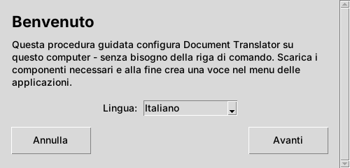
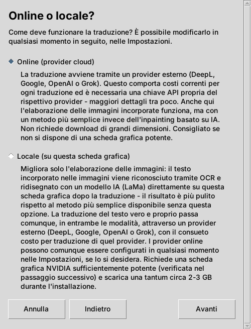
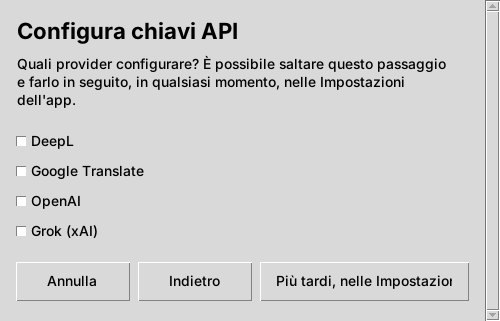
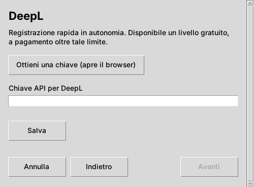
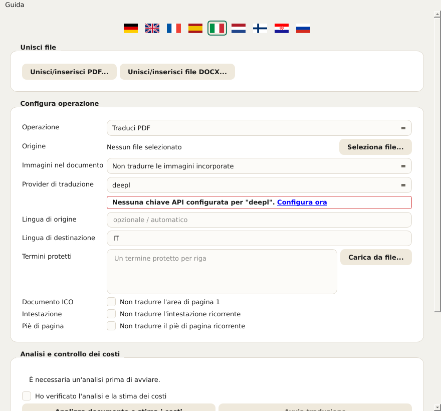
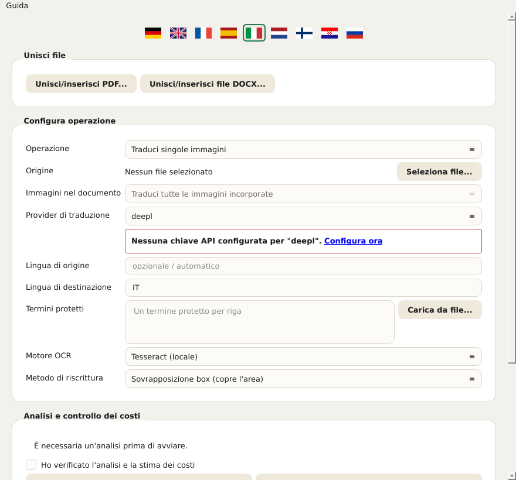
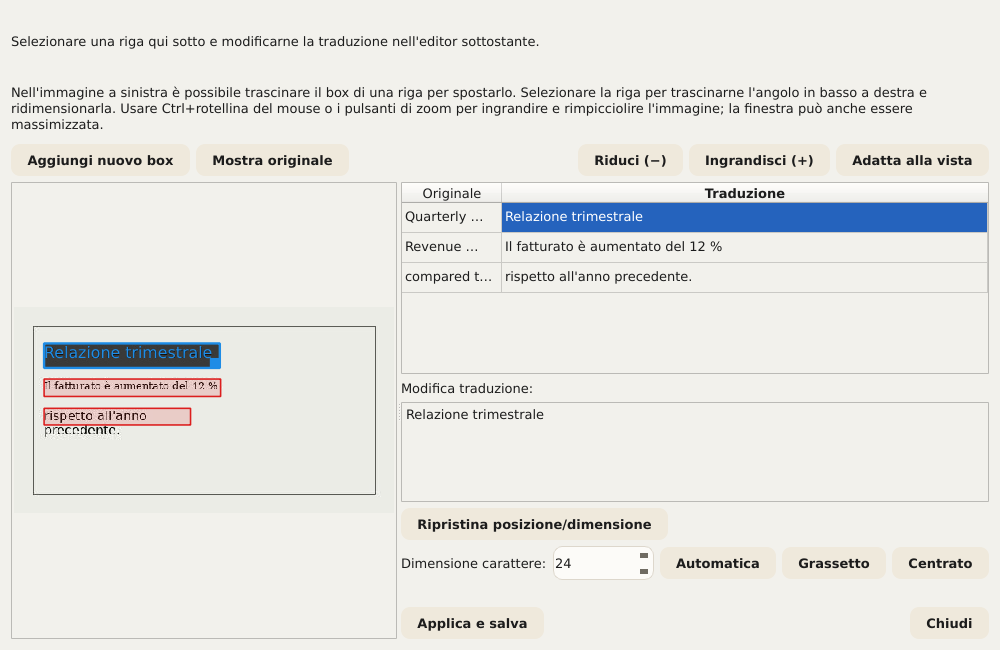
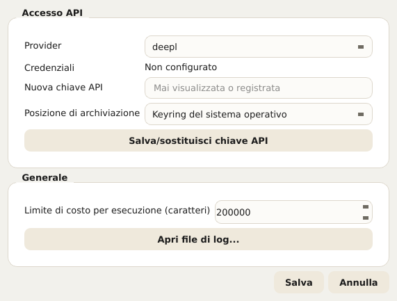

# Document Translator – Manuale utente

Questo manuale descrive tutti i comandi di Document Translator: la procedura
guidata di configurazione (programma di installazione) e l'applicazione vera
e propria. Si basa sugli stessi testi di aiuto che l'applicazione mostra
direttamente (descrizione comandi al passaggio del mouse e testo più
dettagliato tramite Guida → Che cos'è? oppure Maiusc+F1 seguito da un clic su
un elemento). Chi conosce già l'applicazione può quindi usare questo
documento semplicemente come opera di consultazione.

Nell'applicazione, questo manuale si apre in qualsiasi momento tramite
**Guida → Manuale utente...** – automaticamente nella lingua dell'interfaccia
attualmente impostata. Anche gli avvisi che compaiono direttamente sotto un
campo (ad es. «PaddleOCR non è installato») rimandano qui.

## Indice

1. Procedura guidata di configurazione (installazione)
2. L'applicazione in sintesi
3. Scegliere un documento e impostazioni di base
4. Gestione delle immagini nei documenti
5. Termini protetti
6. Escludere intestazioni e piè di pagina
7. Stimare i costi e avviare la traduzione
8. Durante e dopo l'esecuzione
9. Correggere manualmente le traduzioni
10. Unire più file
11. Impostazioni
12. Lingua dell'interfaccia
13. Test hardware (GPU)
14. Aggiornamenti e informazioni sulla versione

---

## 1. Procedura guidata di configurazione (installazione)

La procedura guidata installa Document Translator una sola volta su questo
computer. Non richiede diritti di amministratore/root, perché tutto viene
installato in una cartella personale di proprietà dell'utente.

**Lingua.** La lingua scelta nella prima schermata vale subito per tutte le
schermate successive della procedura. È indipendente dalla lingua
dell'applicazione vera e propria, che ha una propria selezione della lingua
(vedi capitolo 12).

**Online o locale?** Qui si sceglie come vengono elaborate le immagini nei
documenti:

- **Online (provider cloud):** la traduzione avviene tramite un provider
  cloud (DeepL, Google, OpenAI o Grok). Per l'elaborazione delle immagini si
  usa un procedimento locale più semplice. È l'installazione più rapida e
  semplice e funziona su qualsiasi computer. Servono una chiave API propria
  del provider scelto e una connessione Internet durante la traduzione.
- **Locale (su questa scheda grafica):** oltre alla variante online, sulla
  propria scheda grafica viene installata un'elaborazione delle immagini
  migliore, basata sull'IA (LaMa). L'elaborazione delle immagini resta così
  interamente su questo computer. Serve una scheda grafica NVIDIA supportata
  con memoria video sufficiente (verificata nel passaggio successivo);
  vengono scaricati una sola volta circa 2–3 GB. In entrambe le modalità, la
  traduzione vera e propria del testo avviene sempre tramite un provider
  esterno e viene addebitata lì per ogni traduzione, come di consueto.

  Che cosa porta concretamente questa opzione è descritto più in dettaglio
  nel capitolo 4 («Gestione delle immagini nei documenti») – in breve: una
  qualità d'immagine nettamente migliore quando i documenti tradotti
  contengono foto o altri sfondi complessi; altrimenti non è strettamente
  necessaria.

Se la verifica della GPU ha esito negativo (nessuna scheda supportata trovata
o driver obsoleto), la procedura offre due strade: **«Continua comunque in
locale»** (utile se la verifica è fallita per errore o se è ancora in
sospeso un aggiornamento del driver – il test hardware si può ripetere in
qualsiasi momento nell'applicazione, vedi capitolo 13) oppure **«Passa a
Online»**. Indipendentemente da ciò, i provider online si possono aggiungere
in qualsiasi momento nelle impostazioni dell'applicazione.

**Configurare le chiavi API.** Qui si può memorizzare direttamente una chiave
API per ogni provider desiderato. I provider non spuntati si possono
aggiungere in qualsiasi momento in seguito nelle impostazioni
dell'applicazione (pulsante **«Più tardi, nelle Impostazioni»**). Per ogni
provider spuntato si apre una schermata dedicata con un campo di immissione
(il testo inserito appare come puntini) e il pulsante **«Ottieni una chiave
(apre il browser)»**, che apre nel browser la pagina di registrazione del
provider – lì si genera la chiave, che poi si incolla qui. Solo il pulsante
**«Salva»** memorizza effettivamente l'inserimento. La procedura si può
completare anche senza chiave; tuttavia, finché non è memorizzata almeno una
chiave, nessuna traduzione funzionerà.

*Avviso di sicurezza all'apertura del browser:* prima che la procedura apra
un link nel browser predefinito, l'indirizzo di destinazione viene mostrato
ancora una volta in chiaro e deve essere confermato. Così si può verificare,
prima dell'apertura, che sia davvero l'indirizzo atteso.

**Indietro, Avanti, Annulla.** Ogni schermata ha in basso la stessa barra con
**«Indietro»** (i dati già inseriti vengono mantenuti), **«Avanti»** e
**«Annulla»**. In caso di annullamento viene chiesta conferma; se si
conferma, la procedura rimuove automaticamente tutti i file creati fino a
quel momento – la configurazione si può riavviare in qualsiasi momento. Se è
in corso l'installazione vera e propria, in rari casi può rimanere un file in
uso; anche in quel caso si tenta comunque di rimuovere automaticamente il più
possibile.

**Completamento.** Alla fine la procedura si può chiudere con **«Chiudi»**
senza avviare l'applicazione, oppure combinare direttamente con l'avvio
dell'applicazione tramite **«Avvia ora»**.

---

## 2. L'applicazione in sintesi

Dopo l'installazione si apre l'applicazione Document Translator con un modulo per
l'esecuzione della traduzione. I capitoli seguenti lo percorrono dall'alto
verso il basso, nell'ordine in cui è disposto nella finestra. Il numero di
versione attuale è indicato nella barra del titolo della finestra.

---

## 3. Scegliere un documento e impostazioni di base

**Campo «Operazione» – determina quale procedura di traduzione viene usata.**
A seconda della selezione, più in basso compaiono solo i campi pertinenti –
le impostazioni OCR, ad esempio, solo in modalità «Traduci singole
immagini». Sono disponibili quattro opzioni:

- **Traduci PDF** – un singolo documento PDF.
- **Traduci presentazione (PowerPoint/Impress)** – un singolo file PPTX.
- **Traduci documento Word/Writer** – un singolo file DOCX.
- **Traduci singole immagini** – uno o più file immagine; mostra inoltre i
  campi «Motore OCR» e «Metodo di riscrittura» (vedi capitolo 4).

**Campo «Origine» – seleziona il file da tradurre.** Il pulsante
**«Seleziona file...»** apre la finestra di selezione dei file (in modalità
immagini si possono scegliere anche più file contemporaneamente). Il nome del
file scelto appare poi accanto. Se compare «Nessun file selezionato», occorre
prima scegliere un file prima di poter eseguire un'analisi dei costi.

**Campi «Lingua di origine» e «Lingua di destinazione» – le due lingue di
questa esecuzione.** Entrambe si indicano come codice lingua di due lettere
secondo ISO 639-1, ad es. EN per l'inglese o DE per il tedesco. La lingua di
origine deve corrispondere alla lingua effettiva del documento, altrimenti il
provider di traduzione restituisce risultati errati o nessun risultato.

**Campo «Provider di traduzione» – quale servizio cloud esegue la traduzione
vera e propria del testo.** Sono disponibili quattro provider, ognuno con una
propria chiave API gestita nelle impostazioni (capitolo 11):

- **DeepL**
- **Google**
- **OpenAI**
- **Grok**

Se manca la chiave per il provider scelto, subito sotto compare un avviso con
bordo rosso e un link alle impostazioni.

---

## 4. Gestione delle immagini nei documenti

Il modulo contiene a questo scopo il campo **«Immagini nel documento»**, con
tre possibilità:

- **Non tradurre le immagini incorporate** – le immagini incorporate restano
  invariate.
- **Seleziona le immagini singolarmente in seguito** – in futuro mostrerà,
  dopo l'analisi dei costi, un elenco da cui scegliere immagini specifiche.
- **Traduci tutte le immagini incorporate** – in futuro elaborerà
  automaticamente ogni immagine incorporata.

Importante, per non creare false aspettative:

> **Stato attuale: per PDF, PowerPoint/Impress e Word/Writer questo campo
> attualmente NON ha alcun effetto sul risultato.** Le immagini incorporate
> in questi tre tipi di documento vengono, allo stato attuale, SEMPRE
> riprese invariate – indipendentemente da quale delle tre opzioni sia
> selezionata. Non è un malfunzionamento, ma una funzione non ancora
> realizzata: anche l'elenco di selezione descritto sopra per «Seleziona le
> immagini singolarmente in seguito» non esiste ancora. L'applicazione stessa
> lo segnala esplicitamente durante l'analisi dei costi non appena un
> documento contiene immagini incorporate e non è selezionato «Non tradurre
> le immagini incorporate». Solo i file immagine puri nella modalità
> dedicata **«Traduci singole immagini»** (vedi sotto) vengono già tradotti
> completamente – si tratta di una procedura del tutto separata e matura,
> non interessata da questa limitazione.

Nella modalità immagini il campo è quindi bloccato (fisso su «Traduci tutte
le immagini incorporate») e lì non ha alcun significato pratico – per questa
modalità il controllo avviene tramite i due campi «Motore OCR» e «Metodo di
riscrittura» più in basso.

Solo nella modalità «Traduci singole immagini» (capitolo 3) sono visibili due
campi aggiuntivi, **«Motore OCR»** e **«Metodo di riscrittura»**, mostrati
nella schermata seguente con i loro valori predefiniti (Tesseract e
sovrapposizione box) – entrambi vengono spiegati di seguito uno per uno:

**Campo «Motore OCR» – riconoscimento del testo.** Riconosce il testo nelle
immagini prima che venga tradotto e riscritto. Sono disponibili tre motori
(la schermata sopra mostra il primo):

- **Tesseract (locale)** (predefinito). Funziona completamente in locale,
  senza provider cloud né chiave API propria – ma richiede che il software
  Tesseract stesso sia installato su questo computer (vedi README.md).
  Riconosce il testo riga per riga; Document Translator raggruppa poi da sé le
  righe in paragrafi.
- **Google Cloud Vision (cloud, rilevamento paragrafi)**. Funziona tramite il
  servizio cloud di Google e usa la stessa chiave API del provider di
  traduzione «Google» (capitoli 3/11) – riconosce i paragrafi direttamente
  come tali, invece di ricomporli da singole righe, il che su immagini
  densamente scritte dà risultati sensibilmente migliori rispetto
  all'approccio riga per riga di Tesseract.
- **PaddleOCR (locale, rilevamento paragrafi)**. Funziona anch'esso
  completamente in locale, senza provider cloud, ma, come Google Cloud
  Vision, riconosce i paragrafi direttamente tramite un proprio modello di
  layout addestrato anziché tramite un'approssimazione geometrica.
  **PaddleOCR non viene installato dalla procedura guidata** – il pacchetto
  opzionale aggiuntivo va installato successivamente nell'ambiente Python
  dell'applicazione (elenco dei pacchetti: requirements-paddleocr.txt nella
  cartella dell'applicazione). Chi non desidera farlo usa invece Tesseract o
  Google Cloud Vision.

Se il motore scelto in questo campo non è disponibile su questo computer
(programma Tesseract non trovato, nessuna chiave API di Google memorizzata o
PaddleOCR non installato), subito sotto compare un avviso con bordo rosso e
un link a questo capitolo, e non è possibile avviare un'esecuzione con questo
motore.

**Campo «Metodo di riscrittura» – come il testo tradotto viene riscritto
nell'immagine.** Dopo che il testo originale è stato riconosciuto e tradotto,
la traduzione deve essere riscritta al suo posto nell'immagine – ma prima
occorre ripristinare lo sfondo sottostante, affinché il vecchio testo non
traspaia. Questo campo offre a tale scopo tre procedimenti con qualità e
requisiti diversi (la schermata sopra mostra il primo):

- **Sovrapposizione box (copre l'area)** (predefinito). Riempie l'area con un
  colore uniforme (o con una sfumatura semplice, se l'ambiente lo suggerisce
  chiaramente) e scrive sopra il testo tradotto. Funziona sempre, senza
  hardware particolare né software aggiuntivo, ed è quindi l'impostazione
  predefinita. Su sfondi uniformi o regolari (ad es. tabelle, grafici,
  riquadri informativi) si nota appena; su vere foto o sfondi con texture
  l'area è riconoscibile come una «toppa» visibile.
- **Inpainting CPU classico (ricostruisce lo sfondo)**. Usa un procedimento
  classico di elaborazione delle immagini (non un modello di IA) della
  libreria libera OpenCV per proseguire l'ambiente attorno al testo invece di
  riempirlo con un solo colore – motivi o sfumature semplici proseguono così
  in modo credibile fino al bordo (e leggermente oltre) della casella di
  testo. Funziona anch'esso sempre in locale senza GPU, ma, come la
  sovrapposizione box, non sostituisce la variante basata sull'IA per sfondi
  fotografici davvero complessi.
- **Inpainting AI locale (GPU, LaMa)**. Usa sulla scheda grafica locale uno
  speciale modello di IA chiamato LaMa, addestrato proprio per questo
  compito, per ricostruire in modo credibile anche sfondi fotografici
  complessi – di gran lunga la migliore qualità dei tre procedimenti. Serve
  una scheda grafica NVIDIA supportata con supporto CUDA (installato solo se
  durante la configurazione è stato scelto «Locale», vedi capitolo 1), e al
  primissimo utilizzo viene scaricato un modello di diverse centinaia di MB
  (poi memorizzato in modo permanente). Se PyTorch con supporto CUDA non è
  installato, sotto il campo compare un avviso con bordo rosso. Se la scheda
  grafica ha meno memoria video di quella consigliata, compare invece un
  avviso con bordo giallo – il procedimento si può comunque usare, ma senza
  garanzia. Lo stato dell'hardware si può verificare in qualsiasi momento
  con il test hardware (capitolo 13).

Come regola generale: per documenti con sfondi semplici e piatti (la maggior
parte di tabelle, grafici, diapositive) la sovrapposizione box o
l'inpainting CPU classico sono più che sufficienti – senza GPU, senza
attese. Per foto o sfondi ricchi di dettagli l'inpainting AI vale
visibilmente la pena. Le traduzioni corrette in seguito (capitolo 9) si
possono peraltro rigenerare con uno qualsiasi dei tre procedimenti,
indipendentemente da quello usato nell'esecuzione originale.

**Altre opzioni per determinati tipi di documento:**

- **Campo «Documento ICO»** (casella «Non tradurre l'area di pagina 1»)
  riguarda esclusivamente il tipo di documento interno ICO ed esclude dalla
  traduzione l'area dei metadati a pagina 1 (in Word l'area prima della linea
  di separazione, in PDF riconosciuta tramite termini di ancoraggio come
  «Issuer Address»/«Asset Matrix») – indipendentemente dal fatto che tale
  area venga effettivamente trovata. Per tutti gli altri documenti lasciarla
  disattivata.
- **Campo «Visualizzazione affiancata»** (casella «Originale e traduzione
  affiancati», solo Word) costruisce il testo principale, invece del normale
  risultato fedele al layout, come tabella di confronto a due colonne
  (Originale | Traduzione) in formato orizzontale. Intestazione e piè di
  pagina restano invariati; le tabelle incorporate nel testo principale non
  compaiono in questa vista.

---

## 5. Termini protetti

Nel campo **«Termini protetti»** si possono inserire termini che devono
restare non tradotti – un termine per riga, ad esempio nomi di aziende o di
prodotti. Il provider di traduzione lascia intatti questi termini. Con il
pulsante **«Carica da file...»** si può inoltre caricare un elenco da un file
CSV o di testo (un termine per riga; per i CSV conta la prima colonna); le
voci esistenti vengono mantenute e i duplicati ignorati.

**Importante: viene protetta solo l'occorrenza scritta in MAIUSCOLO.** Il
termine inserito può essere scritto in qualsiasi modo (minuscolo, maiuscolo,
misto – la grafia in questo campo non ha importanza). Ciò che conta è come il
termine è effettivamente scritto nel documento da tradurre: vengono escluse
dalla traduzione solo le occorrenze scritte lì interamente in MAIUSCOLO. Se
lo stesso termine compare altrove nel documento in minuscolo o in forma
mista, lì viene tradotto normalmente.

Il motivo: alcuni termini protetti (come nomi di prodotti o progetti che di
norma si scrivono sempre in maiuscolo) sono per caso anche parole del tutto
comuni della lingua di origine. Se ogni occorrenza fosse protetta
indipendentemente dalla grafia, anche la parola comune resterebbe non
tradotta in ogni altro punto del documento – e andrebbe corretta a mano. Chi
vuole essere sicuro che un termine sia effettivamente protetto nel documento
dovrebbe quindi verificare che lì sia davvero scritto in maiuscolo –
altrimenti si protegge per errore troppo poco (un'occorrenza in minuscolo
resta non protetta e viene tradotta) oppure, con maiuscole involontarie
altrove nel documento, troppo.

---

## 6. Escludere intestazioni e piè di pagina

Due campi (solo PDF) riconoscono automaticamente il testo ricorrente e lo
escludono dalla traduzione:

- **Campo «Intestazione»** (casella «Non tradurre l'intestazione
  ricorrente») – testo che ricorre vicino al bordo superiore della maggior
  parte delle pagine, identico (o diverso solo per il numero di pagina).
- **Campo «Piè di pagina»** (casella «Non tradurre il piè di pagina
  ricorrente») – lo stesso per il testo ricorrente vicino al bordo inferiore
  della pagina (ad es. riga del copyright, numero di pagina).

Se non viene trovato nulla di adatto, semplicemente non cambia nulla.

---

## 7. Stimare i costi e avviare la traduzione

Prima che una traduzione parta, occorre stimarne il costo approssimativo
nella sezione **«Analisi e controllo dei costi»**:

1. **«Analizza documento e stima i costi»** conta i caratteri da tradurre e
   stima il costo approssimativo in base al provider scelto, senza tradurre
   ancora nulla.
2. Solo dopo si può spuntare la casella **«Ho verificato l'analisi e la
   stima dei costi»** – un passaggio di sicurezza voluto, affinché nessuna
   esecuzione venga avviata per errore senza aver prima dato un'occhiata ai
   costi stimati.
3. Solo con la casella spuntata **«Avvia traduzione»** diventa cliccabile.

Se in seguito si modifica qualcosa nel modulo (ad es. un altro file o un altro
provider), occorre eseguire di nuovo l'analisi.

---

## 8. Durante e dopo l'esecuzione

L'avanzamento di una traduzione in corso compare nella sezione
**«Esecuzione e risultato»**. Un'esecuzione in corso si può interrompere il
più rapidamente possibile con **«Annulla»** (dopo la chiamata al provider di
traduzione in corso); le parti già elaborate non vengono conservate
automaticamente come file completo – a seconda del formato può rimanere un
file incompleto.

Al termine di un'esecuzione sono disponibili:

- **«Apri cartella»** – apre il gestore file nella cartella di destinazione
  dell'esecuzione appena terminata.
- **«Apri report QA»** – mostra le anomalie rilevate dal controllo qualità
  automatico dell'esecuzione, ad es. passaggi che potrebbe essere utile
  verificare.
- **«Correggi traduzione»** – visibile per esecuzioni PDF e immagini con
  passaggi correggibili; consente di rielaborare in modo mirato singoli
  passaggi tradotti senza ripetere l'intera esecuzione (dettagli nel
  capitolo 9).

---

## 9. Correggere manualmente le traduzioni

Dopo un'esecuzione conclusa – purché esistano passaggi correggibili – compare
il pulsante **«Correggi traduzione»** (vedi capitolo 8). A seconda del tipo
di documento si apre una di due finestre di dialogo di diversa complessità:

- Per le **esecuzioni PDF**, la finestra «Correggi traduzione PDF» con una
  tabella di testo originale e tradotto per ogni blocco di testo, in cui le
  singole traduzioni si possono sovrascrivere direttamente.
- Per le **esecuzioni di immagini**, la finestra decisamente più completa
  **«Correggi traduzione immagine»**, perché qui non solo il testo, ma anche
  la sua posizione e dimensione nell'immagine devono essere corrette. Se in
  un'esecuzione sono stati tradotti più file contemporaneamente,
  l'applicazione chiede prima quale file correggere.

La finestra di correzione delle immagini mostra a sinistra l'immagine con un
riquadro colorato per ogni passaggio di testo riconosciuto, a destra una
tabella con testo originale e tradotto. Selezionando una riga della tabella,
la sua traduzione viene caricata nell'editor in basso per la modifica:

- **Modificare il testo.** La traduzione della riga selezionata si può
  sovrascrivere liberamente nell'editor in basso.
- **Posizione e dimensione.** Nell'immagine a sinistra il riquadro della riga
  selezionata si può spostare trascinandolo; dall'angolo inferiore destro se
  ne può modificare la dimensione. **«Ripristina posizione/dimensione»**
  riporta alla posizione riconosciuta in origine.
- **«Aggiungi nuovo box».** Se un passaggio di testo non è stato trovato
  affatto dall'OCR, si può tracciare una nuova area nell'immagine e
  inserirvi a mano un testo proprio – senza un nuovo passaggio OCR.
- **Dimensione carattere, Grassetto, Centrato.** Per ogni passaggio si può
  sovrascrivere la dimensione del carattere determinata automaticamente (o
  ripristinarla con «Automatica»), nonché attivare grassetto e centratura.
- **Zoom e «Mostra originale».** Con Ctrl+rotellina del mouse o i pulsanti di
  zoom si può ingrandire e ridurre l'immagine; «Mostra originale» mostra
  brevemente l'immagine di partenza non modificata per un confronto. La
  finestra stessa si può anche ingrandire per avere più spazio.
- **Anteprima dal vivo.** Durante la modifica l'immagine viene rigenerata di
  continuo con il metodo di riscrittura effettivamente usato – ciò che si vede
  qui corrisponde quindi in larga misura al risultato finale, non solo a
  un'approssimazione grossolana.

**«Applica e salva»** rigenera l'immagine con tutte le modifiche e
sovrascrive il file tradotto in precedenza – senza un nuovo passaggio OCR e
senza una nuova chiamata al provider di traduzione, quindi senza costi
aggiuntivi. La finestra si può poi riaprire quante volte si vuole per
migliorare ulteriormente; ogni nuovo giro parte dall'ultimo stato salvato,
non di nuovo dalla traduzione automatica originale. **«Chiudi»** scarta le
modifiche non salvate della sessione corrente.

> **Nota sullo stato dei test.** La funzione di correzione – soprattutto la
> finestra di correzione delle immagini con posizionamento, nuovi box e
> anteprima dal vivo – non è ancora testata al 100 % e in singoli casi può
> ancora contenere errori. Prima di «Applica e salva» conviene quindi
> guardare l'anteprima dal vivo e, con più giri di correzione, è consigliabile
> verificare il risultato nel frattempo.

---

## 10. Unire più file

Indipendentemente dal modulo di traduzione, la sezione **«Unisci file»**
offre due finestre di dialogo dedicate per unire più file in un unico file –
**«Unisci/inserisci PDF...»** per i file PDF e **«Unisci/inserisci file
DOCX...»** per i file Word. Qui non si traduce nulla, si ricombina soltanto.
Le due finestre sono costruite in modo identico, salvo una differenza
relativa ai numeri di pagina (vedi sotto).

**Tabella dei file di origine.** Per i PDF ha due colonne:

- **File** – il file di origine.
- **Pagine** – selezione di pagine facoltativa per questo file (vuoto = file
  intero, altrimenti ad es. «1-3,5» oppure «6-» per dalla pagina 6 fino alla
  fine o «-4» per dall'inizio fino alla pagina 4; «5-3» inserisce le pagine
  5, 4, 3 in quest'ordine inverso). Aggiungere lo stesso file più volte con
  selezioni di pagine diverse permette di inserirlo in un punto preciso di un
  altro file.

Per Word/DOCX la colonna «Pagine» non c'è – a differenza del PDF, il formato
DOCX non contiene numeri di pagina fissi, perciò si uniscono sempre file
interi. Lo stesso file si può comunque aggiungere più volte per inserirlo in
più punti. Oltre 100 file DOCX, l'unione avviene automaticamente a gruppi
(indicato poi nella riga di stato).

L'ordine della tabella determina l'ordine nel risultato. Sono disponibili i
seguenti pulsanti:

- **«Aggiungi file...»** – apre la normale finestra di selezione per uno o
  più file.
- **«Cerca in una cartella...»** – apre una finestra di ricerca dedicata per
  scegliere singoli file da una cartella che ne contiene molti (vedi sotto).
- **«Rimuovi»** – rimuove dalla tabella la riga o le righe selezionate (i file
  stessi non vengono toccati).
- **«Sposta su»** / **«Sposta giù»** – sposta la riga selezionata
  nell'ordine.
- **«Ordina per nome»** / **«Ordina per data»** – ordina l'intera tabella per
  nome file o per data di modifica del file sul disco (ultima modifica, non la
  data di creazione). Ogni clic alterna tra ordine crescente e decrescente;
  la dicitura del pulsante mostra sempre quale direzione applicherebbe il
  clic successivo.

**Campo «File di destinazione».** Con **«Salva con nome...»** si stabilisce
dove viene scritto il file unito.

**«Avvia unione» / «Annulla».** Avvia o interrompe l'esecuzione; con
«Annulla» un risultato parziale già scritto viene mantenuto.

### Cerca in una cartella

La finestra di ricerca («Cerca PDF in una cartella» o l'equivalente per i
DOCX) serve a scegliere solo determinati file da una cartella che ne contiene
molti (ad es. 1000 o più PDF), invece di cercarli tutti a mano uno per uno. I
risultati si possono poi riprendere con **«Aggiungi selezionati»** e finiscono
nella tabella sopra.

- **Origine: «Cartella locale» o «Google Drive»** – invece di una cartella su
  questo computer si può cercare anche in una cartella condivisa di Google
  Drive; i risultati vengono allora scaricati in una cartella cache a
  scelta. La configurazione una tantum dell'accesso a Google è descritta nel
  file docs/google_drive_setup.md nella cartella dell'applicazione.
- **Campo «Cartella»** – la cartella in cui cercare, impostata tramite
  «Scegli cartella...».
- **Casella «Includi sottocartelle»** – include nella ricerca anche tutte le
  sottocartelle.
- **Campo «Testo di ricerca»** – uno o più termini, combinabili con AND/OR
  (anche come && / ||) e parentesi, ad es. «Acme AND contratto» (solo file
  con entrambi i termini) o «Acme OR Zenith» (file con almeno uno dei due).
  Se lasciato vuoto trova tutti i file della cartella.
- **Dove cercare** – tre caselle, indipendenti l'una dall'altra e
  liberamente combinabili (almeno una deve essere spuntata):
  - **Formato ICO (area di intestazione pagina 1)** – per PDF/Word cerca solo
    nel blocco di metadati ICO a pagina 1 (Developer, QSI ICO, data di
    emissione ecc.; per i DOCX: i paragrafi prima dell'elemento di
    separazione, non legati a una pagina fissa).
  - **Intestazione (tutte le pagine)** – cerca solo nell'area superiore
    ricorrente su ogni pagina (ad es. riga con nome azienda/logo) – una
    regione di testo a sé, indipendente da «Formato ICO».
  - **Testo completo** – cerca in tutto il testo di tutte le pagine, comprese
    le due aree sopra.
- **Gruppo «Filtra per data»** – facoltativo, restringe ulteriormente i
  risultati a un intervallo di date:
  - **Data del file** o **Data nel documento** – se la data proviene dal file
    stesso (data di modifica) o da una data riconosciuta nel testo del
    documento. Con «Data nel documento» si può inoltre limitare l'area:
    **Campo ICO (pagina 1)**, **Intestazione (tutte le pagine)** o **Piè di
    pagina (tutte le pagine)**.
  - **Formato data** – uno o più dei formati predefiniti **ISO
    (AAAA-MM-GG)**, **Tedesco (GG.MM.AAAA)**, **Inglese (nome del mese, ad
    es. September 4, 2026)** o **Barra (GG/MM/AAAA)**, oppure un **Formato
    personalizzato** tramite segnaposto come YYYY/MM/DD/MMMM (la
    descrizione comandi del campo mostra tutti i segnaposto con esempi).
  - **Data esatta** – passa da una data singola (campo «Data») a un
    intervallo (campi «Da»/«A»).

L'area dei risultati mostra poi il numero di risultati trovati e il numero di
file esaminati; i file illeggibili sono indicati separatamente.

---

## 11. Impostazioni

Con il pulsante **«Impostazioni...»** si accede a:

**Accesso API.** Per prima cosa si sceglie nel campo **«Provider»** (DeepL,
Google, OpenAI, Grok) a quale provider si riferiscono lo stato, la nuova
chiave e la posizione di archiviazione sotto – ogni provider ha la propria
chiave, memorizzata separatamente. Lo stato indica se per il provider scelto
viene trovata al momento una chiave nel keyring del sistema operativo, in una
variabile d'ambiente o da nessuna parte («Non configurato»); una variabile
d'ambiente ha sempre la precedenza sul keyring – in tal caso la finestra
mostra un avviso corrispondente. Una nuova chiave si incolla nel campo
**«Nuova chiave API»** (il testo inserito appare come puntini) e viene
memorizzata effettivamente solo con **«Salva/sostituisci chiave API»**; dopo
il campo di immissione viene svuotato e lo stato si aggiorna. Come
**«Posizione di archiviazione»** si può scegliere:

- **Keyring del sistema operativo** – la scelta consigliata e permanente.
- **Variabile d'ambiente (solo questa sessione)** – vale solo per la sessione
  corrente ed è pensata soprattutto per casi particolari/ricerca di errori.
- **Entrambi** – memorizza nel keyring e scrive inoltre una tale variabile di
  sessione.

**«Limite di costo per esecuzione (caratteri)».** Un'esecuzione che contiene
più caratteri di quanti impostati qui viene interrotta con un avviso, invece
di causare costi inaspettatamente alti. Se necessario, il valore si può
aumentare qui.

**«Apri file di log...».** Apre il file di log attuale con il programma
predefinito del sistema – utile per copiare messaggi di errore in una
segnalazione di bug senza dover fare uno screenshot.

**«Salva»** applica le impostazioni, **«Annulla»** le scarta.

---

## 12. Lingua dell'interfaccia

Con la barra delle bandiere nella finestra principale si cambia subito e in
modo permanente la lingua dell'interfaccia stessa – da non confondere con le
lingue di traduzione nel modulo (capitolo 3). La scelta viene salvata
subito. Sono disponibili nove lingue: Deutsch, English, Français, Español,
Italiano, Nederlands, Suomi, Hrvatski e Русский. Questo manuale è disponibile
nelle stesse nove lingue; Guida → Manuale utente... apre sempre la versione
nella lingua attualmente impostata.

---

## 13. Test hardware (GPU)

Con **Guida → Mostra/ripeti test hardware...** si può verificare in qualsiasi
momento se è stata trovata una GPU NVIDIA supportata con memoria video
sufficiente, quando è stata eseguita l'ultima verifica e se il driver
installato (versione CUDA) supporta l'inpainting GPU locale. Senza
GPU/driver adatti l'inpainting locale funziona comunque – solo più lentamente,
sulla CPU. Con **«Verifica di nuovo»** si ripete la stessa verifica eseguita
dal programma di installazione – utile dopo un aggiornamento del driver o un
cambio di scheda grafica, senza dover reinstallare l'applicazione.

---

## 14. Aggiornamenti e informazioni sulla versione

Se all'avvio viene trovata una versione più recente di Document Translator,
compare automaticamente un avviso («Aggiornamento disponibile: …»). Facendo
clic viene proposta l'installazione della nuova versione. Con **Guida → Cerca
aggiornamenti...** si può avviare la verifica manualmente in qualsiasi
momento.

**Guida → Informazioni...** mostra la versione installata, la licenza (GNU GPL
v3) e un link al codice sorgente su GitHub.
