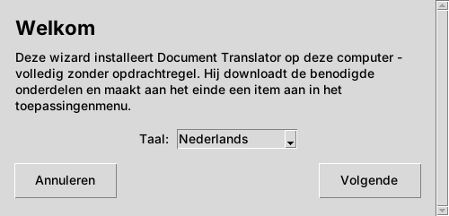
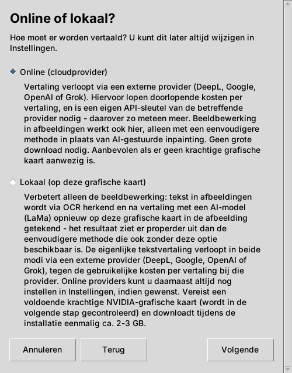
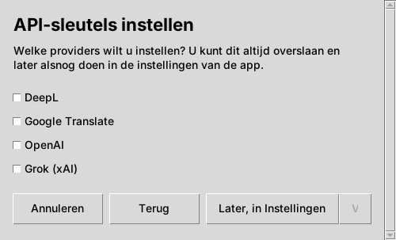
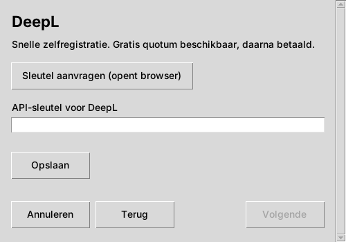
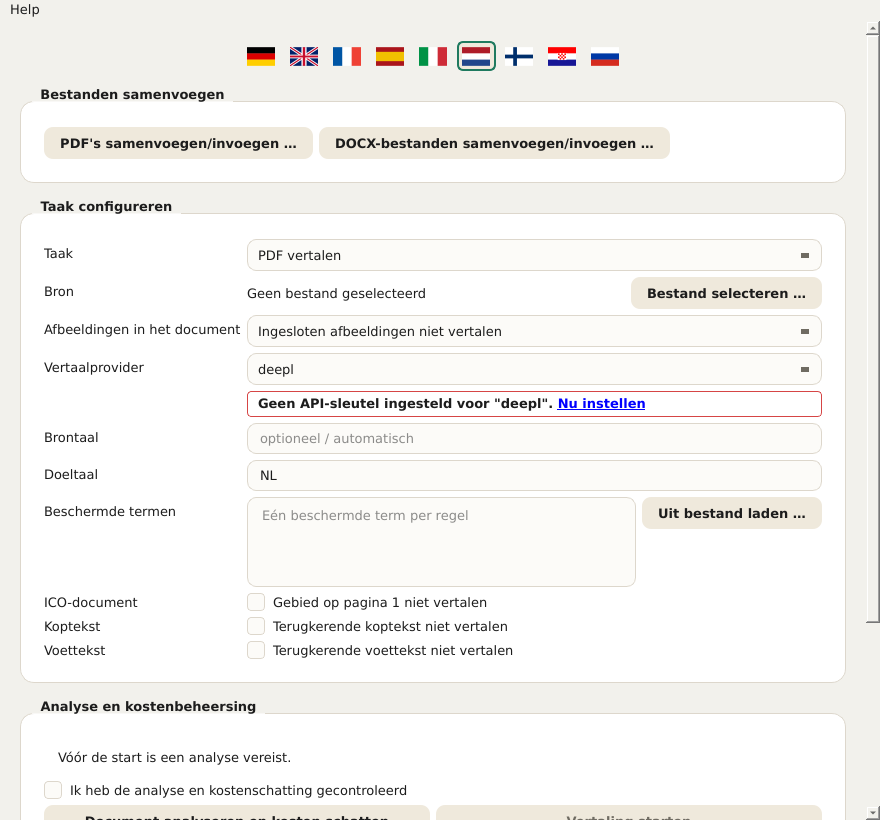
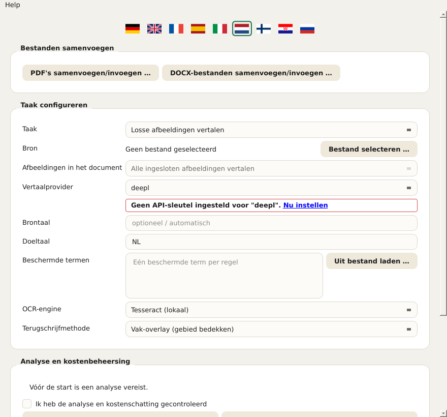
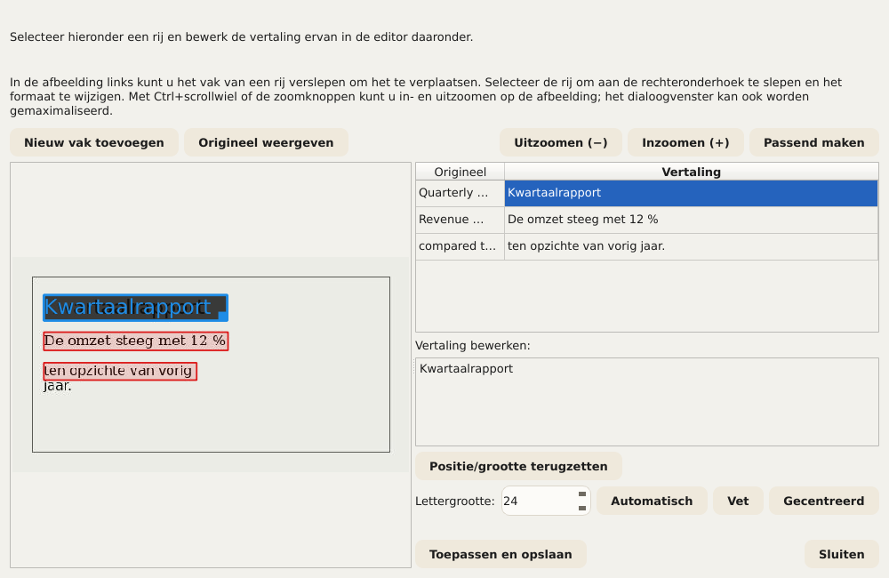
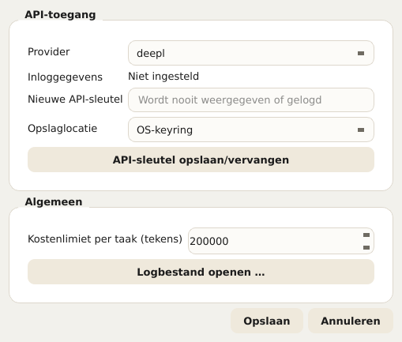
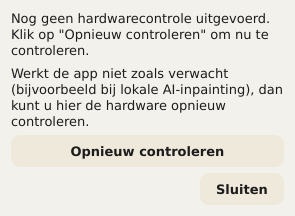

# Document Translator – Gebruikershandleiding

Deze handleiding beschrijft alle bedieningselementen van Document Translator: de
installatiewizard (installer) en de eigenlijke app. Ze is gebaseerd op
dezelfde helpteksten die de applicatie zelf toont (tooltip bij het aanwijzen
met de muis, uitgebreide tekst via Help → Wat is dit? of Shift+F1 en
vervolgens een klik op een element). Wie de app al kent, kan dit document dus
ook gewoon als naslagwerk gebruiken.

In de app kan deze handleiding op elk moment worden geopend via
**Help → Gebruikershandleiding …** – automatisch in de taal van de
gebruikersinterface die op dat moment is ingesteld. Meldingen die direct
onder een veld verschijnen (bijv. „PaddleOCR is niet geïnstalleerd”) linken
eveneens hiernaartoe.

## Inhoud

1. Installatiewizard (installatie)
2. De app in één oogopslag
3. Document kiezen en basisinstellingen
4. Omgaan met afbeeldingen in documenten
5. Beschermde termen
6. Kop- en voetteksten uitsluiten
7. Kosten schatten en vertaling starten
8. Tijdens en na de taak
9. Vertalingen handmatig corrigeren
10. Meerdere bestanden samenvoegen
11. Instellingen
12. Taal van de gebruikersinterface
13. Hardwaretest (GPU)
14. Updates en versie-informatie

---

## 1. Installatiewizard (installatie)

De installatiewizard installeert Document Translator eenmalig op deze computer.
Er zijn geen beheerders-/rootrechten nodig, omdat alles in een persoonlijke
map van de gebruiker wordt geïnstalleerd.

**Taal.** De taal die op het eerste scherm wordt gekozen, geldt direct voor
alle volgende schermen van de wizard. Ze staat los van de taal van de app
zelf, die een eigen taalkeuze heeft (zie hoofdstuk 12).

**Online of lokaal?** Hier wordt gekozen hoe afbeeldingen in documenten
worden bewerkt:

- **Online (cloudprovider):** de vertaling loopt via een cloudprovider
  (DeepL, Google, OpenAI of Grok). Voor de beeldbewerking wordt een
  eenvoudiger, lokaal procedé gebruikt. Dit is de snelste en eenvoudigste
  installatie en werkt op elke computer. Er is een eigen API-sleutel van de
  gekozen provider nodig en een internetverbinding tijdens het vertalen.
- **Lokaal (op deze grafische kaart):** naast de online-variant wordt een
  betere, AI-gestuurde beeldbewerking (LaMa) op de eigen grafische kaart
  geïnstalleerd. De beeldbewerking blijft daardoor volledig op deze
  computer. Er is een ondersteunde NVIDIA-grafische kaart met voldoende
  videogeheugen nodig (wordt in de volgende stap gecontroleerd); er wordt
  eenmalig ca. 2–3 GB gedownload. De eigenlijke tekstvertaling loopt in
  beide modi altijd via een externe provider en kost daar zoals gewoonlijk
  per vertaling.

  Wat deze optie concreet oplevert, staat uitgebreider in hoofdstuk 4
  („Omgaan met afbeeldingen in documenten”) – kort gezegd: een duidelijk
  betere beeldkwaliteit wanneer vertaalde documenten foto's of andere
  complexe achtergronden bevatten; anders niet per se nodig.

Valt de GPU-controle negatief uit (geen ondersteunde kaart gevonden of
verouderd stuurprogramma), dan biedt de wizard twee mogelijkheden: **„Toch
doorgaan met lokaal”** (zinvol als de controle ten onrechte mislukte of een
update van het stuurprogramma nog moet volgen – de hardwaretest kan later op
elk moment in de app worden herhaald, zie hoofdstuk 13) of **„Overschakelen
naar Online”**. Los daarvan kunnen online-providers op elk moment in de
instellingen van de app worden toegevoegd.

**API-sleutels instellen.** Voor elke gewenste provider kan hier direct een
API-sleutel worden opgeslagen. Niet aangevinkte providers kunnen later op elk
moment in de instellingen van de app worden toegevoegd (knop **„Later, in
Instellingen”**). Voor elke aangevinkte provider opent een eigen scherm met
een invoerveld (de invoer verschijnt als puntjes) en de knop **„Sleutel
aanvragen (opent browser)”**, die de registratiepagina van de betreffende
provider in de browser opent – daar wordt de sleutel aangemaakt, die daarna
hier wordt geplakt. Pas de knop **„Opslaan”** neemt de invoer echt over. De
wizard kan ook zonder sleutel worden afgerond; zonder ten minste één
opgeslagen sleutel werkt daarna echter nog geen enkele vertaling.

*Veiligheidsopmerking bij het openen van de browser:* voordat de wizard een
link in de standaardbrowser opent, wordt het doeladres nog een keer in
leesbare tekst getoond en moet het worden bevestigd. Zo kan vóór het openen
worden gecontroleerd of het echt het verwachte adres is.

**Terug, Volgende, Annuleren.** Elk scherm heeft onderaan dezelfde balk met
**„Terug”** (al gemaakte invoer blijft behouden), **„Volgende”** en
**„Annuleren”**. Bij annuleren wordt nog een keer om bevestiging gevraagd;
wordt dit bevestigd, dan verwijdert de wizard automatisch alle tot dan toe
aangemaakte bestanden – de installatie kan op elk moment opnieuw worden
gestart. Loopt de eigenlijke installatie al, dan kan in zeldzame gevallen een
bestand dat net in gebruik is achterblijven; ook dan wordt geprobeerd zoveel
mogelijk automatisch te verwijderen.

**Afronden.** Aan het eind kan de wizard met **„Sluiten”** worden beëindigd
zonder de app te starten, of met **„Nu starten”** direct gecombineerd worden
met het starten van de app.

---

## 2. De app in één oogopslag

Na de installatie opent de eigenlijke Document Translator-app met een formulier
voor de vertaaltaak. De volgende hoofdstukken lopen de bediening van boven
naar beneden door, in de volgorde waarin ze in het venster is opgebouwd. Het
huidige versienummer staat in de titelbalk van het venster.

---

## 3. Document kiezen en basisinstellingen

**Veld „Taak” – bepaalt welke vertaalprocedure wordt gebruikt.** Afhankelijk
van de keuze worden verderop alleen de relevante velden getoond – de
OCR-instellingen bijvoorbeeld alleen in de modus „Losse afbeeldingen
vertalen”. Er zijn vier opties:

- **PDF vertalen** – één PDF-document.
- **Presentatie (PowerPoint/Impress) vertalen** – één PPTX-bestand.
- **Word/Writer-document vertalen** – één DOCX-bestand.
- **Losse afbeeldingen vertalen** – een of meer afbeeldingsbestanden; toont
  daarnaast de velden „OCR-engine” en „Terugschrijfmethode” (zie
  hoofdstuk 4).

**Veld „Bron” – kiest het te vertalen bestand.** De knop **„Bestand
selecteren …”** opent het dialoogvenster voor bestandsselectie (in de
afbeeldingsmodus kunnen ook meerdere bestanden tegelijk worden gekozen). De
gekozen bestandsnaam verschijnt daarna ernaast. Staat daar „Geen bestand
geselecteerd”, dan moet eerst een bestand worden gekozen voordat een
kostenanalyse mogelijk is.

**Velden „Brontaal” en „Doeltaal” – de twee talen van deze taak.** Beide
worden opgegeven als tweeletterige taalcode volgens ISO 639-1, bijv. EN voor
Engels of DE voor Duits. De brontaal moet overeenkomen met de werkelijke taal
van het document, anders levert de vertaalprovider verkeerde of helemaal
geen resultaten.

**Veld „Vertaalprovider” – welke clouddienst de eigenlijke tekstvertaling
uitvoert.** Er zijn vier providers, elk met een eigen API-sleutel die in de
instellingen wordt beheerd (hoofdstuk 11):

- **DeepL**
- **Google**
- **OpenAI**
- **Grok**

Ontbreekt voor de gekozen provider een sleutel, dan verschijnt er direct
onder een rood omrande melding met een link naar de instellingen.

---

## 4. Omgaan met afbeeldingen in documenten

Het formulier heeft hiervoor het veld **„Afbeeldingen in het document”**,
met drie keuzemogelijkheden:

- **Ingesloten afbeeldingen niet vertalen** – ingesloten afbeeldingen blijven
  ongewijzigd.
- **Afbeeldingen later afzonderlijk selecteren** – moet in de toekomst na de
  kostenanalyse een lijst tonen waaruit gericht afbeeldingen kunnen worden
  gekozen.
- **Alle ingesloten afbeeldingen vertalen** – moet in de toekomst elke
  ingesloten afbeelding automatisch meenemen.

Belangrijk, om geen verkeerde verwachtingen te wekken:

> **Huidige stand: bij PDF, PowerPoint/Impress en Word/Writer heeft dit veld
> momenteel nog GEEN invloed op het resultaat.** Ingesloten afbeeldingen in
> deze drie documenttypen worden in de huidige stand ALTIJD ongewijzigd
> overgenomen – ongeacht welke van de drie opties hierboven is gekozen. Dat
> is geen storing, maar een nog niet gerealiseerd onderdeel: ook de
> hierboven beschreven keuzelijst voor „Afbeeldingen later afzonderlijk
> selecteren” bestaat nog niet. De app wijst hier tijdens de kostenanalyse
> zelf uitdrukkelijk op zodra een document ingesloten afbeeldingen bevat en
> niet „Ingesloten afbeeldingen niet vertalen” is gekozen. Alleen losse
> afbeeldingsbestanden in de eigen modus **„Losse afbeeldingen vertalen”**
> (zie hieronder) worden nu al volledig vertaald – dat is een volledig eigen,
> uitontwikkelde procedure die niet onder deze beperking valt.

In de afbeeldingsmodus zelf is het veld daarom ook vergrendeld (vast op „Alle
ingesloten afbeeldingen vertalen”) en heeft het daar geen praktische
betekenis – de eigenlijke sturing gebeurt voor deze modus via de twee velden
„OCR-engine” en „Terugschrijfmethode” verderop.

Alleen zichtbaar in de modus „Losse afbeeldingen vertalen” (hoofdstuk 3)
zijn twee extra velden, **„OCR-engine”** en **„Terugschrijfmethode”**, op de
schermafbeelding hieronder te zien met hun standaardwaarden (Tesseract en
vak-overlay) – beide worden hierna afzonderlijk toegelicht:

**Veld „OCR-engine” – tekstherkenning.** Herkent tekst in de afbeeldingen
voordat die wordt vertaald en teruggeschreven. Er zijn drie engines
beschikbaar (de schermafbeelding hierboven toont de eerste):

- **Tesseract (lokaal)** (standaard). Draait volledig lokaal, zonder
  cloudprovider of eigen API-sleutel – maar heeft daarvoor de
  Tesseract-software zelf nodig op deze computer (zie README.md). Herkent
  tekst regel voor regel; Document Translator groepeert de regels daarna zelf tot
  alinea's.
- **Google Cloud Vision (cloud, alineaherkenning)**. Draait via de clouddienst
  van Google en gebruikt dezelfde API-sleutel als de vertaalprovider
  „Google” (hoofdstukken 3/11) – herkent alinea's direct als zodanig, in
  plaats van ze uit losse regels samen te stellen, wat bij dicht beschreven
  afbeeldingen merkbaar betere resultaten oplevert dan de regel-voor-regel
  aanpak van Tesseract.
- **PaddleOCR (lokaal, alineaherkenning)**. Draait eveneens volledig lokaal,
  zonder cloudprovider, maar herkent net als Google Cloud Vision alinea's
  direct via een eigen, getraind lay-outmodel in plaats van via een
  geometrische benadering. **PaddleOCR wordt niet door de
  installatiewizard meegeïnstalleerd** – het extra, optionele pakket moet
  achteraf in de Python-omgeving van de app worden geïnstalleerd
  (pakketlijst: requirements-paddleocr.txt in de app-map). Wie dat niet wil,
  gebruikt in plaats daarvan Tesseract of Google Cloud Vision.

Is de in dit veld gekozen engine op deze computer niet beschikbaar
(Tesseract-programma niet gevonden, geen Google-API-sleutel opgeslagen of
PaddleOCR niet geïnstalleerd), dan verschijnt er direct onder een rood
omrande melding met een link naar dit hoofdstuk, en kan een taak met deze
engine niet worden gestart.

**Veld „Terugschrijfmethode” – hoe de vertaalde tekst in de afbeelding wordt
teruggeschreven.** Nadat de oorspronkelijke tekst is herkend en vertaald,
moet de vertaling op die plek in de afbeelding worden teruggeschreven – maar
eerst moet de onderliggende achtergrond worden hersteld, zodat de oude tekst
niet zomaar doorschemert. Dit ene veld biedt daarvoor drie procedés met
verschillende kwaliteit en verschillende vereisten (de schermafbeelding
hierboven toont het eerste):

- **Vak-overlay (gebied bedekken)** (standaard). Vult het gebied met een
  egale kleur (of een eenvoudig verloop als de omgeving daar duidelijk naar
  uitziet) en schrijft de vertaalde tekst eroverheen. Werkt altijd, zonder
  bijzondere hardware of extra software, en is daarom de standaardinstelling.
  Op egale of gelijkmatige achtergronden (bijv. tabellen, diagrammen,
  infokaders) valt dat nauwelijks op; op echte foto's of getextureerde
  achtergronden is het gebied als zichtbare „lap” te herkennen.
- **Klassieke CPU-inpainting (achtergrond reconstrueren)**. Gebruikt een
  klassiek beeldbewerkingsprocedé (geen AI-model) uit de vrije
  beeldbewerkingsbibliotheek OpenCV om de omgeving rond de tekst voort te
  zetten in plaats van die alleen egaal te vullen – eenvoudige patronen of
  verlopen lopen daardoor geloofwaardig door tot aan (en iets over) de rand
  van het tekstvak. Draait eveneens altijd lokaal zonder GPU, maar is net als
  vak-overlay geen vervanging voor de AI-variant bij echt complexe,
  fotografische achtergronden.
- **AI-inpainting lokaal (GPU, LaMa)**. Gebruikt een speciaal, precies voor
  deze taak getraind AI-model genaamd LaMa op de lokale grafische kaart om
  ook complexe, fotografische achtergronden geloofwaardig te reconstrueren –
  verreweg de beste kwaliteit van de drie procedés. Hiervoor is een
  ondersteunde NVIDIA-grafische kaart met CUDA-ondersteuning nodig (alleen
  geïnstalleerd als bij de installatie „Lokaal” is gekozen, zie
  hoofdstuk 1), en bij het allereerste gebruik wordt een model van enkele
  honderden MB gedownload (daarna blijvend in de cache opgeslagen). Is
  PyTorch met CUDA-ondersteuning niet geïnstalleerd, dan verschijnt onder het
  veld een rood omrande melding. Heeft de grafische kaart minder
  videogeheugen dan aanbevolen, dan verschijnt in plaats daarvan een geel
  omrande melding – het procedé kan dan toch worden gebruikt, maar zonder
  garantie. De hardwarestatus kan op elk moment met de hardwaretest worden
  gecontroleerd (hoofdstuk 13).

Vuistregel: voor documenten met eenvoudige, egale achtergronden (de meeste
tabellen, diagrammen, presentatiedia's) volstaan vak-overlay of klassieke
CPU-inpainting ruimschoots – zonder GPU, zonder wachttijd. Bij foto's of
gedetailleerde achtergronden loont AI-inpainting duidelijk zichtbaar.
Achteraf gecorrigeerde vertalingen (hoofdstuk 9) kunnen overigens met elk van
de drie procedés opnieuw worden gerenderd, ongeacht met welk procedé de
oorspronkelijke taak is uitgevoerd.

**Overige opties voor bepaalde documenttypen:**

- **Veld „ICO-document”** (selectievakje „Gebied op pagina 1 niet
  vertalen”) betreft uitsluitend het interne documenttype ICO en sluit het
  metadatagebied op pagina 1 uit van de vertaling (bij Word het gebied vóór
  de scheidingslijn, bij PDF herkend aan de hand van ankertermen zoals
  „Issuer Address”/„Asset Matrix”) – ongeacht of dit gebied daadwerkelijk
  wordt gevonden. Voor alle andere documenten uitgeschakeld laten.
- **Veld „Naast elkaar weergeven”** (selectievakje „Origineel en vertaling
  naast elkaar”, alleen Word) bouwt de hoofdtekst in plaats van het normale,
  lay-outgetrouwe resultaat op als vergelijkingstabel met twee kolommen
  (Origineel | Vertaling) in liggend formaat. Kop- en voettekst blijven
  ongewijzigd; ingesloten tabellen in de hoofdtekst verschijnen niet in deze
  weergave.

---

## 5. Beschermde termen

In het veld **„Beschermde termen”** kunnen termen worden ingevoerd die
onvertaald moeten blijven – één term per regel, bijvoorbeeld bedrijfs- of
productnamen. De vertaalprovider laat deze termen ongemoeid. Met de knop
**„Uit bestand laden …”** kan daarnaast een lijst uit een CSV- of
tekstbestand worden geladen (één term per regel, bij CSV telt de eerste
kolom); bestaande invoer blijft behouden, duplicaten worden overgeslagen.

**Belangrijk: alleen de in HOOFDLETTERS geschreven vindplaats wordt
beschermd.** Een ingevoerde term mag op elke manier worden geschreven (klein,
groot, gemengd – de schrijfwijze in dit veld doet er niet toe).
Doorslaggevend is hoe de term in het te vertalen document daadwerkelijk is
geschreven: alleen vindplaatsen die daar volledig in HOOFDLETTERS staan,
worden van de vertaling uitgezonderd. Komt dezelfde term elders in het
document in kleine letters of gemengd voor, dan wordt hij daar gewoon
meevertaald.

De reden: sommige beschermde termen (zoals product- of projectnamen die
eigenlijk altijd in hoofdletters worden geschreven) zijn toevallig ook heel
gewone woorden van de brontaal. Als elke vindplaats ongeacht de schrijfwijze
werd beschermd, bleef ook het gewone woord op elke andere plek in het
document onvertaald – en zou het met de hand moeten worden gecorrigeerd. Wie
zeker wil weten dat een term in het document echt wordt beschermd, moet dus
controleren of hij daar ook echt in hoofdletters staat – anders wordt per
ongeluk te weinig beschermd (een vindplaats in kleine letters blijft
onbeschermd en wordt vertaald) of, bij onbedoelde hoofdletters elders in het
document, te veel.

---

## 6. Kop- en voetteksten uitsluiten

Twee velden (alleen bij PDF) herkennen automatisch terugkerende tekst en
sluiten die uit van de vertaling:

- **Veld „Koptekst”** (selectievakje „Terugkerende koptekst niet
  vertalen”) – tekst die bovenaan op de meeste pagina's identiek (of alleen
  met een ander paginanummer) terugkeert.
- **Veld „Voettekst”** (selectievakje „Terugkerende voettekst niet
  vertalen”) – hetzelfde voor terugkerende tekst onderaan de pagina (bijv.
  copyrightregel, paginanummer).

Wordt niets passends gevonden, dan verandert er gewoon niets.

---

## 7. Kosten schatten en vertaling starten

Voordat een vertaling start, moet in het onderdeel **„Analyse en
kostenbeheersing”** eerst worden geschat wat die ongeveer kost:

1. **„Document analyseren en kosten schatten”** telt de te vertalen tekens
   en schat aan de hand van de gekozen provider de globale kosten, zonder al
   iets te vertalen.
2. Pas daarna kan het vinkje **„Ik heb de analyse en kostenschatting
   gecontroleerd”** worden gezet – een bewuste veiligheidsstap, zodat geen
   taak per ongeluk wordt gestart zonder eerst de geschatte kosten te hebben
   bekeken.
3. Pas met het vinkje gezet wordt **„Vertaling starten”** klikbaar.

Wordt daarna iets in het formulier gewijzigd (bijv. een ander bestand of een
andere provider), dan moet de analyse opnieuw worden uitgevoerd.

---

## 8. Tijdens en na de taak

De voortgang van een lopende vertaling verschijnt in het onderdeel **„Taak en
resultaat”**. Een lopende taak kan met **„Annuleren”** zo snel mogelijk worden
gestopt (na de lopende aanroep naar de vertaalprovider); al verwerkte delen
blijven daarbij niet automatisch als volledig bestand behouden – afhankelijk
van het formaat kan een onvolledig bestand achterblijven.

Na afloop van een taak zijn beschikbaar:

- **„Map openen”** – opent de bestandsbeheerder in de doelmap van de zojuist
  afgeronde taak.
- **„QA-rapport openen”** – toont opvallende zaken uit de automatische
  kwaliteitscontrole van de taak, bijv. tekstpassages die mogelijk
  gecontroleerd moeten worden.
- **„Vertaling corrigeren”** – zichtbaar bij PDF- en afbeeldingstaken met
  corrigeerbare tekstpassages; maakt het mogelijk afzonderlijke vertaalde
  passages gericht na te bewerken zonder de hele taak te herhalen (details in
  hoofdstuk 9).

---

## 9. Vertalingen handmatig corrigeren

Na een afgeronde taak verschijnt – voor zover er überhaupt corrigeerbare
tekstpassages zijn – de knop **„Vertaling corrigeren”** (zie hoofdstuk 8).
Afhankelijk van het documenttype opent een van twee dialoogvensters van
verschillende omvang:

- Bij **PDF-taken** het dialoogvenster „PDF-vertaling corrigeren” met een
  tabel van originele en vertaalde tekst per tekstblok, waarin afzonderlijke
  vertalingen direct kunnen worden overschreven.
- Bij **afbeeldingstaken** het duidelijk uitgebreidere dialoogvenster
  **„Afbeeldingsvertaling corrigeren”**, omdat hier niet alleen de tekst
  maar ook de positie en grootte ervan in de afbeelding moeten kloppen. Zijn
  in een afbeeldingstaak meerdere bestanden tegelijk vertaald, dan vraagt de
  app eerst welk bestand moet worden gecorrigeerd.

Het correctievenster voor afbeeldingen toont links de afbeelding met een
gekleurd vak per herkende tekstpassage, rechts een tabel met originele en
vertaalde tekst. Het selecteren van een rij in de tabel laadt de vertaling
ervan onderaan in de editor om te bewerken:

- **Tekst bewerken.** De vertaling van de geselecteerde rij kan vrij in de
  editor onderaan worden overschreven.
- **Positie en grootte.** In de afbeelding links kan het vak van de
  geselecteerde rij door slepen worden verplaatst; via de rechteronderhoek
  kan het in grootte worden gewijzigd. Met **„Positie/grootte
  terugzetten”** gaat het terug naar de oorspronkelijk herkende positie.
- **„Nieuw vak toevoegen”.** Is een tekstpassage door de OCR helemaal niet
  gevonden, dan kan in de afbeelding een nieuw gebied worden getrokken en
  daar met de hand een eigen tekst worden ingevoerd – zonder nieuwe OCR-ronde.
- **Lettergrootte, Vet, Gecentreerd.** Per tekstpassage kan de automatisch
  bepaalde lettergrootte worden overschreven (of via „Automatisch” weer
  worden vrijgegeven), en kunnen vetgedrukt en centreren worden ingeschakeld.
- **Zoomen en „Origineel weergeven”.** Met Ctrl+muiswiel of de zoomknoppen
  kan in de afbeelding worden in- en uitgezoomd; „Origineel weergeven” toont
  kort de onbewerkte uitgangsafbeelding om te vergelijken. Het
  dialoogvenster zelf kan ook worden gemaximaliseerd voor meer ruimte.
- **Live-voorbeeld.** Tijdens het bewerken wordt voortdurend opnieuw
  gerenderd met de daadwerkelijk gebruikte terugschrijfmethode – wat hier te
  zien is, komt dus grotendeels overeen met het latere resultaat, niet alleen
  met een ruwe benadering.

Met **„Toepassen en opslaan”** wordt de afbeelding met alle wijzigingen
opnieuw aangemaakt en wordt het eerder vertaalde uitvoerbestand overschreven
– zonder nieuwe OCR-ronde en zonder nieuwe aanroep van de vertaalprovider,
dus zonder extra kosten. Het dialoogvenster kan daarna zo vaak als gewenst
opnieuw worden geopend om verder te verbeteren; elke volgende ronde bouwt
voort op de laatst opgeslagen stand, niet opnieuw op de oorspronkelijke
machinevertaling. **„Sluiten”** verwerpt niet-opgeslagen wijzigingen van de
huidige sessie.

> **Opmerking over de teststatus.** De correctiefunctie – vooral het
> correctievenster voor afbeeldingen met positionering, nieuwe vakken en
> live-voorbeeld – is nog niet 100 % doorgetest en kan in afzonderlijke
> gevallen nog fouten bevatten. Vóór „Toepassen en opslaan” loont het daarom
> om naar het live-voorbeeld te kijken, en bij meerdere correctierondes is
> het raadzaam het resultaat tussendoor te controleren.

---

## 10. Meerdere bestanden samenvoegen

Los van het vertaalformulier biedt het onderdeel **„Bestanden
samenvoegen”** twee eigen dialoogvensters om meerdere bestanden tot één
bestand samen te voegen – **„PDF's samenvoegen/invoegen …”** voor
PDF-bestanden en **„DOCX-bestanden samenvoegen/invoegen …”** voor
Word-bestanden. Hierbij wordt niets vertaald, alleen opnieuw gecombineerd.
Beide dialoogvensters zijn op één verschil bij de paginanummers na (zie
hieronder) identiek opgebouwd.

**Tabel met de bronbestanden.** Bevat bij PDF twee kolommen:

- **Bestand** – het bronbestand.
- **Pagina's** – optionele paginaselectie voor dit bestand (leeg = hele
  bestand, anders bijv. „1-3,5” of „6-” voor pagina 6 tot het eind of „-4”
  voor begin tot pagina 4; „5-3” voegt de pagina's 5, 4, 3 in deze omgekeerde
  volgorde in). Hetzelfde bestand meerdere keren met verschillende
  paginaselectie toevoegen, voegt het op een bepaalde plek in een ander
  bestand in.

Bij Word/DOCX vervalt de kolom „Pagina's” – anders dan PDF kent DOCX geen
vaste paginanummers in het bestandsformaat zelf, daarom worden altijd hele
bestanden samengevoegd. Hetzelfde bestand kan ook hier meerdere keren worden
toegevoegd om het op meerdere plekken in te voegen. Bij meer dan 100
DOCX-bestanden wordt automatisch in groepen samengevoegd (staat daarna in de
statusregel).

De volgorde van de tabel bepaalt de volgorde in het resultaat. Daarvoor zijn
de volgende knoppen beschikbaar:

- **„Bestanden toevoegen …”** – opent het normale dialoogvenster voor
  bestandsselectie voor een of meer bestanden.
- **„Map doorzoeken …”** – opent een eigen zoekvenster om uit een map met
  veel bestanden gericht afzonderlijke te kiezen (zie hieronder).
- **„Verwijderen”** – verwijdert de gemarkeerde rij(en) weer uit de tabel (de
  bestanden zelf blijven onaangeroerd).
- **„Omhoog”** / **„Omlaag”** – verplaatst de gemarkeerde rij in de volgorde.
- **„Sorteren op naam”** / **„Sorteren op datum”** – sorteert de hele tabel
  op bestandsnaam of op de wijzigingsdatum van het bestand op de schijf
  (laatste wijziging, niet de aanmaakdatum). Elke klik wisselt tussen
  oplopend en aflopend; het opschrift van de knop toont daarbij altijd welke
  richting de volgende klik zou toepassen.

**Veld „Doelbestand”.** Via **„Opslaan als …”** wordt bepaald waar het
samengevoegde bestand wordt weggeschreven.

**„Samenvoegen starten” / „Annuleren”.** Start resp. stopt de taak; bij
„Annuleren” blijft een al weggeschreven deelresultaat behouden.

### Map doorzoeken

Het zoekvenster („PDF's zoeken in een map” resp. „DOCX-bestanden zoeken in
een map”) dient om uit een map met veel bestanden (bijv. 1000 of meer PDF's)
gericht alleen bepaalde te kiezen, in plaats van ze allemaal met de hand op
te zoeken. Treffers kunnen daarna met **„Geselecteerde overnemen”** worden
overgenomen en komen in de tabel hierboven terecht.

- **Bron: „Lokale map” of „Google Drive”** – in plaats van een map op deze
  computer kan ook een gedeelde Google Drive-map worden doorzocht; treffers
  worden dan gedownload naar een te kiezen cachemap. De eenmalige inrichting
  van de Google-toegang staat beschreven in het bestand
  docs/google_drive_setup.md in de app-map.
- **Veld „Map”** – de te doorzoeken map, ingesteld via „Map kiezen …”.
- **Selectievakje „Incl. submappen”** – betrekt ook alle submappen bij de
  zoekopdracht.
- **Veld „Zoektekst”** – een of meer zoektermen, te combineren met AND/OR
  (ook als && / ||) en haakjes, bijv. „Acme AND contract” (alleen bestanden
  met beide termen) of „Acme OR Zenith” (bestanden met ten minste een van
  beide). Leeg laten vindt alle bestanden in de map.
- **Waar gezocht wordt** – drie selectievakjes, onafhankelijk van elkaar en
  vrij te combineren (ten minste één moet zijn aangevinkt):
  - **ICO-formaat (kopgebied pagina 1)** – doorzoekt bij PDF/Word alleen het
    ICO-metadatablok op pagina 1 (Developer, QSI ICO, uitgiftedatum enz.;
    bij DOCX: de alinea's vóór het scheidingselement, niet gebonden aan een
    vaste pagina).
  - **Header (alle pagina's)** – doorzoekt alleen het op elke pagina
    terugkerende bovenste gebied (bijv. regel met bedrijfsnaam/logo) – een
    eigen tekstregio, onafhankelijk van „ICO-formaat”.
  - **Volledige tekst** – doorzoekt de volledige tekst op alle pagina's,
    inclusief de beide gebieden hierboven.
- **Groep „Filteren op datum”** – optioneel, beperkt de treffers bovendien
  tot een datumbereik:
  - **Bestandsdatum** of **Datum in het document** – of de datum van het
    bestand zelf komt (wijzigingsdatum) of van een herkende datum in de
    documenttekst. Bij „Datum in het document” kan bovendien het gebied
    worden beperkt: **ICO-veld (pagina 1)**, **Header (alle pagina's)** of
    **Footer (alle pagina's)**.
  - **Datumnotatie** – een of meer van de vooraf ingestelde notaties **ISO
    (JJJJ-MM-DD)**, **Duits (DD.MM.JJJJ)**, **Engels (maandnaam, bijv.
    September 4, 2026)** of **Schuine streep (DD/MM/JJJJ)**, of een **Eigen
    notatie** met plaatshouders zoals YYYY/MM/DD/MMMM (de tooltip bij het
    veld toont alle plaatshouders met voorbeelden).
  - **Exacte datum** – schakelt tussen één datum (veld „Datum”) en een
    periode (velden „Van”/„Tot”).

Het resultaatgebied toont daarna het aantal gevonden treffers en het aantal
doorzochte bestanden; onleesbare bestanden worden apart vermeld.

---

## 11. Instellingen

Via de knop **„Instellingen …”** zijn bereikbaar:

**API-toegang.** Eerst wordt in het veld **„Provider”** gekozen (DeepL,
Google, OpenAI, Grok) voor welke provider status, nieuwe sleutel en
opslaglocatie hieronder gelden – elke provider heeft een eigen, apart
opgeslagen sleutel. De status toont of voor de gekozen provider op dit moment
een sleutel uit de OS-keyring, uit een omgevingsvariabele of helemaal geen
(„Niet ingesteld”) wordt gevonden; een omgevingsvariabele heeft daarbij altijd
voorrang op de keyring – in dat geval toont het dialoogvenster een
bijbehorende waarschuwing. Een nieuwe sleutel wordt in het veld **„Nieuwe
API-sleutel”** geplakt (de invoer verschijnt tijdens het typen als puntjes)
en pas met **„API-sleutel opslaan/vervangen”** echt overgenomen; daarna wordt
het invoerveld leeggemaakt en wordt de status bijgewerkt. Als
**„Opslaglocatie”** kan worden gekozen:

- **OS-keyring** – de aanbevolen, blijvende keuze.
- **Omgevingsvariabele (alleen deze sessie)** – geldt alleen voor de lopende
  sessie en is vooral bedoeld voor bijzondere gevallen/foutopsporing.
- **Beide** – slaat op in de keyring en schrijft daarnaast ook zo'n
  sessievariabele.

**„Kostenlimiet per taak (tekens)”.** Een taak met meer tekens dan hier
ingesteld wordt met een melding afgebroken, in plaats van onverwacht hoge
kosten te veroorzaken. Indien nodig kan de waarde hier worden verhoogd.

**„Logbestand openen …”.** Opent het huidige logbestand in het
standaardprogramma van het systeem – handig om foutmeldingen voor een
bugrapport te kopiëren zonder een schermafbeelding te hoeven maken.

Met **„Opslaan”** worden de instellingen overgenomen, **„Annuleren”** verwerpt
ze.

---

## 12. Taal van de gebruikersinterface

Via de vlaggenbalk in het hoofdvenster kan de taal van de
gebruikersinterface zelf direct en blijvend worden gewijzigd – niet te
verwarren met de vertaaltalen in het formulier (hoofdstuk 3). De keuze wordt
direct opgeslagen. Er zijn negen talen beschikbaar: Deutsch, English,
Français, Español, Italiano, Nederlands, Suomi, Hrvatski en Русский. Deze
handleiding is in dezelfde negen talen beschikbaar; Help →
Gebruikershandleiding … opent altijd de versie in de op dat moment
ingestelde taal.

---

## 13. Hardwaretest (GPU)

Via **Help → Hardwaretest weergeven/herhalen …** kan op elk moment worden
gecontroleerd of een ondersteunde NVIDIA-GPU met voldoende videogeheugen is
gevonden, wanneer voor het laatst is gecontroleerd en of het geïnstalleerde
stuurprogramma (CUDA-versie) lokale GPU-inpainting ondersteunt. Zonder
geschikte GPU/stuurprogramma werkt lokale inpainting toch – alleen
langzamer, op de CPU. Met **„Opnieuw controleren”** kan dezelfde controle
worden herhaald die ook de installer heeft uitgevoerd – zinvol na een update
van het stuurprogramma of een wissel van grafische kaart, zonder de app
opnieuw te hoeven installeren.

---

## 14. Updates en versie-informatie

Wordt bij het starten een nieuwere versie van Document Translator gevonden, dan
verschijnt automatisch een melding („Update beschikbaar: …”). Erop klikken
biedt de installatie van de nieuwe versie aan. Via **Help → Controleren op
updates …** kan de controle ook op elk moment handmatig worden gestart.

**Help → Over …** toont de geïnstalleerde versie, de licentie (GNU GPL v3)
en een link naar de broncode op GitHub.
