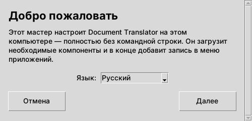
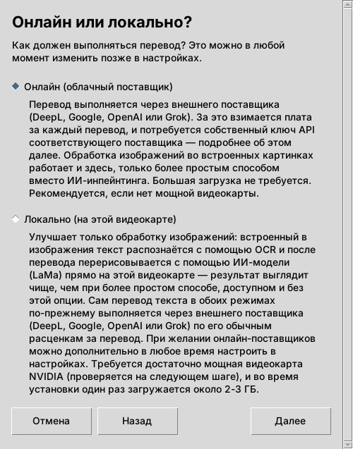
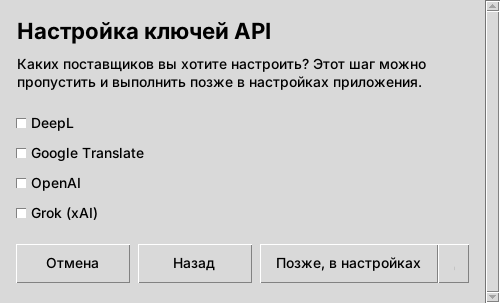
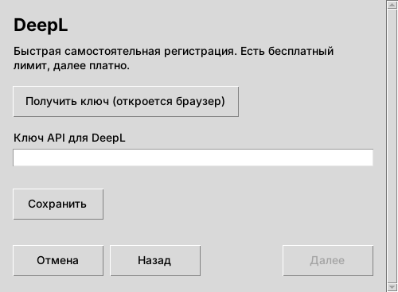
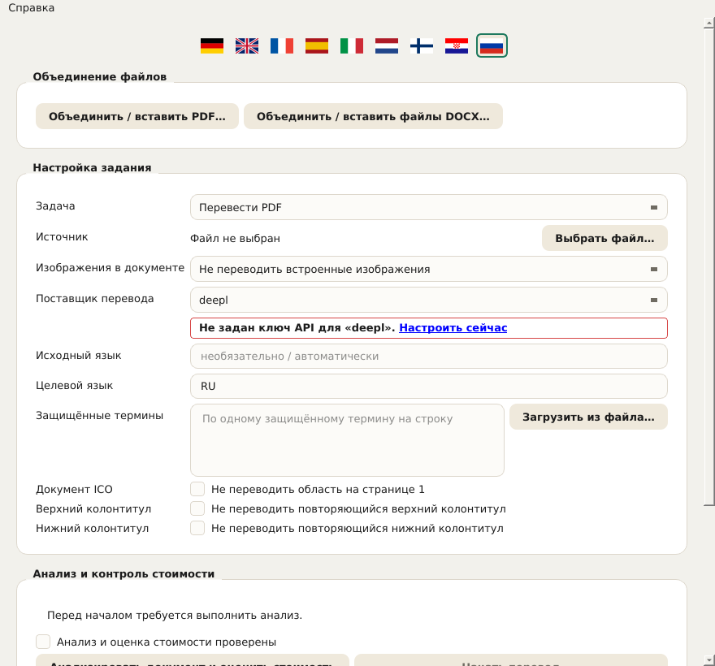
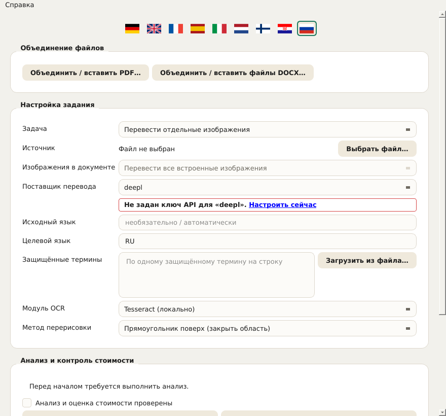
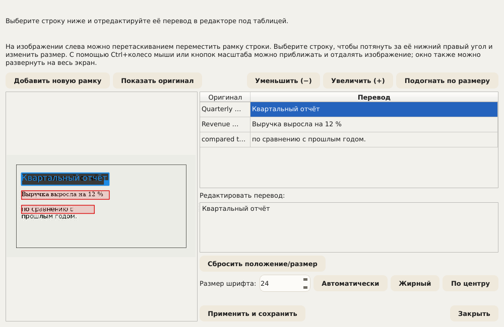
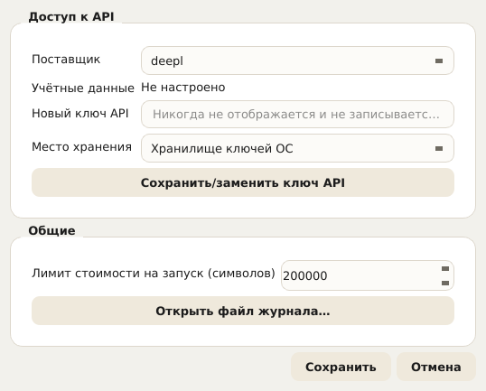
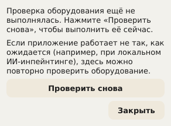

# Document Translator – Руководство пользователя

В этом руководстве описаны все элементы управления Document Translator: мастер
установки (установщик) и само приложение. Оно основано на тех же справочных
текстах, которые приложение показывает непосредственно (всплывающая
подсказка при наведении мыши и подробный текст через Справка → Что это? или
Shift+F1 с последующим щелчком по элементу). Тот, кто уже знаком с
приложением, может просто использовать этот документ как справочник.

В приложении это руководство можно в любой момент открыть через
**Справка → Руководство пользователя…** – автоматически на языке интерфейса,
выбранном в данный момент. Сообщения, появляющиеся непосредственно под полем
(например, «PaddleOCR не установлен»), также ведут сюда.

## Содержание

1. Мастер установки
2. Обзор приложения
3. Выбор документа и основные настройки
4. Работа с изображениями в документах
5. Защищённые термины
6. Исключение колонтитулов
7. Оценка стоимости и запуск перевода
8. Во время и после выполнения
9. Ручное исправление перевода
10. Объединение нескольких файлов
11. Настройки
12. Язык интерфейса
13. Проверка оборудования (GPU)
14. Обновления и сведения о версии

---

## 1. Мастер установки

Мастер установки однократно устанавливает Document Translator на этот компьютер.
Ему не нужны права администратора/root, так как всё устанавливается в личную
папку пользователя.

**Язык.** Язык, выбранный на первом экране, сразу применяется ко всем
следующим экранам мастера. Он не зависит от языка самого приложения, у
которого есть собственный выбор языка (см. главу 12).

**Онлайн или локально?** Здесь выбирается, как обрабатываются изображения в
документах:

- **Онлайн (облачный поставщик):** перевод выполняется через облачного
  поставщика (DeepL, Google, OpenAI или Grok). Для обработки изображений
  используется более простой локальный метод. Это самая быстрая и простая
  установка, и она работает на любом компьютере. Требуется собственный ключ
  API выбранного поставщика и подключение к интернету во время перевода.
- **Локально (на этой видеокарте):** в дополнение к онлайн-варианту на
  собственную видеокарту устанавливается более качественная обработка
  изображений на основе ИИ (LaMa). При этом обработка изображений полностью
  остаётся на этом компьютере. Требуется поддерживаемая видеокарта NVIDIA с
  достаточным объёмом видеопамяти (проверяется на следующем шаге);
  однократно загружается около 2–3 ГБ. Сам перевод текста в обоих режимах
  всегда выполняется через внешнего поставщика и, как обычно, оплачивается
  там за каждый перевод.

  Что конкретно даёт этот вариант, подробнее описано в главе 4 («Работа с
  изображениями в документах») – вкратце: заметно лучшее качество
  изображений, если переводимые документы содержат фотографии или другие
  сложные фоны; в остальных случаях он не обязателен.

Если проверка GPU завершается неудачей (поддерживаемая карта не найдена или
драйвер устарел), мастер предлагает два пути: **«Всё равно продолжить
локально»** (имеет смысл, если проверка ошибочно не прошла или обновление
драйвера ещё предстоит – проверку оборудования можно в любой момент
повторить в приложении, см. главу 13) или **«Переключиться на
«Онлайн»»**. Независимо от этого онлайн-поставщиков можно в любой момент
добавить в настройках приложения.

**Настройка ключей API.** Здесь можно сразу сохранить ключ API для каждого
нужного поставщика. Поставщиков, которые не отмечены, можно в любой момент
добавить позже в настройках приложения (кнопка **«Позже, в настройках»**).
Для каждого отмеченного поставщика открывается отдельный экран с полем ввода
(ввод отображается точками) и кнопкой **«Получить ключ (откроется
браузер)»**, которая открывает в браузере страницу регистрации
соответствующего поставщика – там создаётся ключ, который затем вставляется
сюда. Только кнопка **«Сохранить»** действительно сохраняет ввод. Мастер
можно завершить и без ключа; однако пока не сохранён хотя бы один ключ, ни
один перевод работать не будет.

*Примечание о безопасности при открытии браузера:* прежде чем мастер откроет
ссылку в браузере по умолчанию, целевой адрес ещё раз показывается открытым
текстом и должен быть подтверждён. Так перед открытием можно проверить, что
это действительно ожидаемый адрес.

**Назад, Далее, Отмена.** На каждом экране внизу есть одна и та же панель с
кнопками **«Назад»** (уже сделанные вводы сохраняются), **«Далее»** и
**«Отмена»**. При отмене запрашивается подтверждение; если оно дано, мастер
автоматически удаляет все созданные к этому моменту файлы – установку можно
в любой момент запустить заново. Если идёт сама установка, в редких случаях
может остаться используемый в данный момент файл; но и тогда предпринимается
попытка автоматически удалить как можно больше.

**Завершение.** В конце мастер можно либо закрыть кнопкой **«Закрыть»**, не
запуская приложение, либо сразу совместить с запуском приложения кнопкой
**«Запустить сейчас»**.

---

## 2. Обзор приложения

После установки открывается само приложение Document Translator с формой для
выполнения перевода. Следующие главы описывают работу с ним сверху вниз, в
том порядке, в котором элементы расположены в окне. Текущий номер версии
указан в строке заголовка окна.

---

## 3. Выбор документа и основные настройки

**Поле «Задача» – определяет, какой процесс перевода используется.** В
зависимости от выбора ниже отображаются только относящиеся к нему поля –
настройки OCR, например, только в режиме «Перевести отдельные изображения».
Доступны четыре варианта:

- **Перевести PDF** – один документ PDF.
- **Перевести презентацию (PowerPoint/Impress)** – один файл PPTX.
- **Перевести документ Word/Writer** – один файл DOCX.
- **Перевести отдельные изображения** – один или несколько файлов
  изображений; дополнительно показывает поля «Модуль OCR» и «Метод
  перерисовки» (см. главу 4).

**Поле «Источник» – выбирает файл для перевода.** Кнопка **«Выбрать
файл…»** открывает диалог выбора файла (в режиме изображений можно выбрать
сразу несколько файлов). Имя выбранного файла затем отображается рядом. Если
там написано «Файл не выбран», сначала нужно выбрать файл, прежде чем станет
возможен анализ стоимости.

**Поля «Исходный язык» и «Целевой язык» – два языка этого запуска.** Оба
указываются двухбуквенным кодом языка по ISO 639-1, например EN для
английского или DE для немецкого. Исходный язык должен соответствовать
фактическому языку документа, иначе поставщик перевода вернёт неверные
результаты или не вернёт их вовсе.

**Поле «Поставщик перевода» – какой облачный сервис выполняет сам перевод
текста.** Доступны четыре поставщика, у каждого свой ключ API, управляемый в
настройках (глава 11):

- **DeepL**
- **Google**
- **OpenAI**
- **Grok**

Если для выбранного поставщика нет ключа, непосредственно под полем
появляется сообщение в красной рамке со ссылкой на настройки.

---

## 4. Работа с изображениями в документах

Для этого в форме есть поле **«Изображения в документе»** с тремя
вариантами:

- **Не переводить встроенные изображения** – встроенные изображения остаются
  без изменений.
- **Выбрать изображения позже по отдельности** – в будущем должно после
  анализа стоимости показывать список, из которого можно выбрать конкретные
  изображения.
- **Перевести все встроенные изображения** – в будущем должно автоматически
  обрабатывать каждое встроенное изображение.

Важно, чтобы не возникло ложных ожиданий:

> **Текущее состояние: для PDF, PowerPoint/Impress и Word/Writer это поле
> пока НЕ влияет на результат.** Встроенные изображения в этих трёх типах
> документов на данный момент ВСЕГДА переносятся без изменений – независимо
> от того, какой из трёх вариантов выше выбран. Это не неисправность, а ещё
> не реализованная функция: описанного выше списка выбора для «Выбрать
> изображения позже по отдельности» тоже пока нет. Приложение само прямо
> указывает на это во время анализа стоимости, как только документ содержит
> встроенные изображения и не выбрано «Не переводить встроенные
> изображения». Только отдельные файлы изображений в собственном режиме
> **«Перевести отдельные изображения»** (см. ниже) уже сейчас переводятся
> полностью – это совершенно отдельный, отлаженный процесс, на который это
> ограничение не распространяется.

Поэтому в режиме изображений поле заблокировано (фиксированно установлено на
«Перевести все встроенные изображения») и не имеет там практического
значения – в этом режиме управление осуществляется через два поля «Модуль
OCR» и «Метод перерисовки» ниже.

Только в режиме «Перевести отдельные изображения» (глава 3) дополнительно
видны два поля, **«Модуль OCR»** и **«Метод перерисовки»**, показанные на
снимке экрана ниже со значениями по умолчанию (Tesseract и прямоугольник
поверх) – оба далее объясняются по отдельности:

**Поле «Модуль OCR» – распознавание текста.** Распознаёт текст на
изображениях, прежде чем он будет переведён и записан обратно. Доступны три
модуля (на снимке экрана выше выбран первый):

- **Tesseract (локально)** (по умолчанию). Работает полностью локально, без
  облачного поставщика и собственного ключа API, – но требует, чтобы само
  программное обеспечение Tesseract было установлено на этом компьютере (см.
  README.md). Распознаёт текст построчно; затем Document Translator сам
  группирует строки в абзацы.
- **Google Cloud Vision (облако, распознавание абзацев)**. Работает через
  облачный сервис Google и использует тот же ключ API, что и поставщик
  перевода «Google» (главы 3/11), – распознаёт абзацы сразу как абзацы,
  вместо того чтобы собирать их из отдельных строк, что на плотно
  заполненных текстом изображениях даёт заметно лучшие результаты, чем
  построчный подход Tesseract.
- **PaddleOCR (локально, распознавание абзацев)**. Также работает полностью
  локально, без облачного поставщика, но, как и Google Cloud Vision,
  распознаёт абзацы напрямую с помощью собственной обученной модели разметки,
  а не геометрического приближения. **Мастер установки не устанавливает
  PaddleOCR** – дополнительный необязательный пакет нужно установить
  впоследствии в среду Python приложения (список пакетов:
  requirements-paddleocr.txt в папке приложения). Если вы не хотите этого
  делать, используйте вместо него Tesseract или Google Cloud Vision.

Если выбранный в этом поле модуль недоступен на этом компьютере (программа
Tesseract не найдена, ключ API Google не сохранён или PaddleOCR не
установлен), непосредственно под полем появляется сообщение в красной рамке
со ссылкой на эту главу, и запустить перевод с этим модулем нельзя.

**Поле «Метод перерисовки» – как переведённый текст записывается обратно в
изображение.** После того как исходный текст распознан и переведён, перевод
нужно записать на его место в изображении – но сначала необходимо
восстановить фон под ним, чтобы старый текст просто не просвечивал. Это поле
предлагает для этого три метода с разным качеством и разными требованиями
(на снимке экрана выше выбран первый):

- **Прямоугольник поверх (закрыть область)** (по умолчанию). Заполняет
  область сплошным цветом (или простым градиентом, если окружение явно на
  это указывает) и пишет поверх переведённый текст. Работает всегда, без
  специального оборудования или дополнительного ПО, и поэтому используется
  по умолчанию. На однотонных или равномерных фонах (например, таблицы,
  диаграммы, информационные блоки) это почти незаметно; на настоящих
  фотографиях или текстурированных фонах область видна как заметная
  «заплатка».
- **Классический CPU-инпейнтинг (восстановление фона)**. Использует
  классический метод обработки изображений (не модель ИИ) из свободной
  библиотеки обработки изображений OpenCV, чтобы продолжить окружение вокруг
  текста, а не просто залить его одним цветом, – простые узоры или градиенты
  благодаря этому правдоподобно продолжаются до края (и немного за край)
  текстового блока. Также всегда работает локально без GPU, но, как и
  прямоугольник поверх, не заменяет вариант на основе ИИ для действительно
  сложных фотографических фонов.
- **ИИ-инпейнтинг локально (GPU, LaMa)**. Использует на локальной
  видеокарте специальную модель ИИ под названием LaMa, обученную именно для
  этой задачи, чтобы правдоподобно восстанавливать даже сложные
  фотографические фоны, – безусловно лучшее качество из трёх методов. Для
  этого требуется поддерживаемая видеокарта NVIDIA с поддержкой CUDA
  (устанавливается, только если при установке был выбран вариант «Локально»,
  см. главу 1), а при самом первом использовании загружается модель размером
  несколько сотен МБ (затем она постоянно хранится в кэше). Если PyTorch с
  поддержкой CUDA не установлен, под полем появляется сообщение в красной
  рамке. Если у видеокарты меньше видеопамяти, чем рекомендуется, вместо
  этого появляется сообщение в жёлтой рамке – метод тогда всё равно можно
  использовать, но без гарантии. Состояние оборудования можно в любой момент
  проверить с помощью проверки оборудования (глава 13).

Общее правило: для документов с простыми, однородными фонами (большинство
таблиц, диаграмм, слайдов презентаций) прямоугольника поверх или
классического CPU-инпейнтинга вполне достаточно – без GPU, без ожидания. Для
фотографий или детализированных фонов ИИ-инпейнтинг заметно оправдывает
себя. Кстати, исправленные впоследствии переводы (глава 9) можно заново
отрисовать любым из трёх методов, независимо от того, каким методом был
выполнен исходный запуск.

**Дополнительные параметры для отдельных типов документов:**

- **Поле «Документ ICO»** (флажок «Не переводить область на странице 1»)
  относится исключительно к внутреннему типу документов ICO и исключает из
  перевода область метаданных на странице 1 (в Word – область перед
  разделительной линией, в PDF – распознаваемую по опорным терминам вроде
  «Issuer Address»/«Asset Matrix») – независимо от того, найдена ли эта
  область на самом деле. Для всех остальных документов оставляйте его
  выключенным.
- **Поле «Показ рядом»** (флажок «Оригинал и перевод рядом», только Word)
  строит основной текст вместо обычного результата с сохранением макета в
  виде двухколоночной сравнительной таблицы (Оригинал | Перевод) в альбомной
  ориентации. Верхний и нижний колонтитулы остаются без изменений; таблицы,
  встроенные в основной текст, в этом представлении не отображаются.

---

## 5. Защищённые термины

В поле **«Защищённые термины»** можно ввести термины, которые должны
остаться непереведёнными, – по одному термину в строке, например названия
компаний или продуктов. Поставщик перевода оставляет эти термины
нетронутыми. Кнопкой **«Загрузить из файла…»** можно дополнительно загрузить
список из файла CSV или текстового файла (по одному термину в строке; для
CSV учитывается первый столбец); существующие записи сохраняются, дубликаты
пропускаются.

**Важно: защищается только вхождение, написанное ЗАГЛАВНЫМИ буквами.**
Введённый термин может быть написан как угодно (строчными, заглавными,
смешанно – написание в этом поле не имеет значения). Решающее значение
имеет то, как термин фактически написан в переводимом документе: из
перевода исключаются только те вхождения, которые там целиком написаны
ЗАГЛАВНЫМИ БУКВАМИ. Если тот же термин в другом месте документа написан
строчными или смешанными буквами, там он переводится как обычно.

Причина: некоторые защищённые термины (например, названия продуктов или
проектов, которые обычно всегда пишутся заглавными буквами) случайно
являются ещё и вполне обычными словами исходного языка. Если бы каждое
вхождение защищалось независимо от написания, обычное слово тоже осталось бы
непереведённым во всех остальных местах документа – и его пришлось бы
исправлять вручную. Поэтому, чтобы быть уверенным, что термин в документе
действительно защищён, следует проверить, что он там на самом деле написан
заглавными буквами, – иначе по ошибке защищается слишком мало (вхождение,
написанное строчными, остаётся незащищённым и переводится) или, при
непреднамеренных заглавных буквах в других местах документа, слишком много.

---

## 6. Исключение колонтитулов

Два поля (только для PDF) автоматически распознают повторяющийся текст и
исключают его из перевода:

- **Поле «Верхний колонтитул»** (флажок «Не переводить повторяющийся
  верхний колонтитул») – текст, который повторяется вверху большинства
  страниц одинаково (или отличается только номером страницы).
- **Поле «Нижний колонтитул»** (флажок «Не переводить повторяющийся нижний
  колонтитул») – то же для повторяющегося текста внизу страницы (например,
  строка об авторских правах, номер страницы).

Если ничего подходящего не найдено, ничего не меняется.

---

## 7. Оценка стоимости и запуск перевода

Прежде чем начнётся перевод, в разделе **«Анализ и контроль стоимости»**
нужно сначала оценить, сколько он примерно будет стоить:

1. **«Анализировать документ и оценить стоимость»** подсчитывает символы для
   перевода и оценивает примерную стоимость для выбранного поставщика, ещё
   ничего не переводя.
2. Только после этого можно установить флажок **«Анализ и оценка стоимости
   проверены»** – сознательный шаг безопасности, чтобы ни один запуск не был
   начат случайно без предварительного просмотра оценённой стоимости.
3. Только при установленном флажке кнопка **«Начать перевод»** становится
   доступной.

Если затем что-то изменить в форме (например, другой файл или другого
поставщика), анализ нужно выполнить заново.

---

## 8. Во время и после выполнения

Ход выполняемого перевода отображается в разделе **«Выполнение и
результат»**. Выполняемый запуск можно как можно быстрее остановить кнопкой
**«Отмена»** (после текущего обращения к поставщику перевода); уже
обработанные части при этом не сохраняются автоматически как полный файл – в
зависимости от формата может остаться неполный файл.

После завершения запуска доступны:

- **«Открыть папку»** – открывает файловый менеджер в целевой папке только
  что завершённого запуска.
- **«Открыть отчёт QA»** – показывает замечания автоматической проверки
  качества запуска, например фрагменты текста, которые, возможно, стоит
  проверить.
- **«Исправить перевод»** – отображается для запусков PDF и изображений с
  исправимыми фрагментами текста; позволяет целенаправленно доработать
  отдельные переведённые фрагменты, не повторяя весь запуск (подробности в
  главе 9).

---

## 9. Ручное исправление перевода

После завершённого запуска – если вообще есть исправимые фрагменты текста –
появляется кнопка **«Исправить перевод»** (см. главу 8). В зависимости от
типа документа открывается один из двух диалогов разной сложности:

- Для **запусков PDF** – диалог «Исправление перевода PDF» с таблицей
  исходного и переведённого текста для каждого текстового блока, в которой
  отдельные переводы можно непосредственно переписать.
- Для **запусков изображений** – значительно более обширный диалог
  **«Исправление перевода изображения»**, поскольку здесь должны быть
  правильными не только текст, но и его положение и размер на изображении.
  Если в запуске было переведено сразу несколько файлов, приложение сначала
  спрашивает, какой из них нужно исправить.

Диалог исправления изображения слева показывает изображение с цветной
рамкой для каждого распознанного фрагмента текста, справа – таблицу с
исходным и переведённым текстом. При выборе строки в таблице её перевод
загружается в редактор внизу для правки:

- **Правка текста.** Перевод выбранной строки можно свободно переписать в
  редакторе внизу.
- **Положение и размер.** На изображении слева рамку выбранной строки можно
  переместить перетаскиванием; за правый нижний угол можно изменить её
  размер. **«Сбросить положение/размер»** возвращает изначально
  распознанное положение.
- **«Добавить новую рамку».** Если OCR вообще не нашёл фрагмент текста, на
  изображении можно выделить новую область и вручную ввести там собственный
  текст – без нового прохода OCR.
- **Размер шрифта, Жирный, По центру.** Для каждого фрагмента можно
  переопределить автоматически определённый размер шрифта (или снова
  освободить его вариантом «Автоматически»), а также включить жирное
  начертание и выравнивание по центру.
- **Масштаб и «Показать оригинал».** С помощью Ctrl+колёсико мыши или кнопок
  масштаба можно увеличивать и уменьшать изображение; «Показать оригинал»
  ненадолго показывает необработанное исходное изображение для сравнения.
  Сам диалог также можно развернуть, чтобы было больше места.
- **Предпросмотр в реальном времени.** Во время правки изображение
  непрерывно перерисовывается фактически используемым методом перерисовки –
  то, что здесь видно, в значительной мере соответствует итоговому
  результату, а не просто грубому приближению.

**«Применить и сохранить»** заново создаёт изображение со всеми изменениями
и перезаписывает ранее переведённый выходной файл – без нового прохода OCR
и без повторного обращения к поставщику перевода, то есть без
дополнительных затрат. После этого диалог можно открывать снова сколько
угодно раз для дальнейших улучшений; каждый следующий круг основывается на
последнем сохранённом состоянии, а не снова на исходном машинном переводе.
**«Закрыть»** отменяет несохранённые изменения текущего сеанса.

> **Примечание о степени тестирования.** Функция исправления – прежде всего
> диалог исправления изображения с позиционированием, новыми рамками и
> предпросмотром в реальном времени – ещё не протестирована на 100 % и в
> отдельных случаях может содержать ошибки. Поэтому перед «Применить и
> сохранить» стоит посмотреть предпросмотр в реальном времени, а при
> нескольких кругах исправлений рекомендуется проверять результат в
> промежутках.

---

## 10. Объединение нескольких файлов

Независимо от формы перевода раздел **«Объединение файлов»** предлагает два
отдельных диалога для объединения нескольких файлов в один общий файл –
**«Объединить / вставить PDF…»** для файлов PDF и **«Объединить / вставить
файлы DOCX…»** для файлов Word. При этом ничего не переводится, файлы
только заново комбинируются. Оба диалога устроены одинаково, за
исключением одного различия в номерах страниц (см. ниже).

**Таблица исходных файлов.** Для PDF в ней два столбца:

- **Файл** – исходный файл.
- **Страницы** – необязательный выбор страниц для этого файла (пусто = весь
  файл, иначе, например, «1-3,5» или «6-» для страниц с 6-й до конца, или
  «-4» для страниц с начала до 4-й; «5-3» вставляет страницы 5, 4, 3 в этом
  обратном порядке). Добавление одного и того же файла несколько раз с
  разным выбором страниц позволяет вставить его в определённое место другого
  файла.

Для Word/DOCX столбца «Страницы» нет – в отличие от PDF, в самом формате
DOCX нет фиксированных номеров страниц, поэтому всегда объединяются целые
файлы. Тем не менее один и тот же файл и здесь можно добавить несколько раз,
чтобы вставить его в нескольких местах. При более чем 100 файлах DOCX
объединение автоматически выполняется группами (об этом затем сообщается в
строке состояния).

Порядок в таблице определяет порядок в результате. Для этого доступны
следующие кнопки:

- **«Добавить файлы…»** – открывает обычный диалог выбора одного или
  нескольких файлов.
- **«Искать в папке…»** – открывает отдельный диалог поиска, чтобы
  целенаправленно выбрать отдельные файлы из папки с большим количеством
  файлов (см. ниже).
- **«Удалить»** – удаляет выделенную строку (строки) из таблицы (сами файлы
  не затрагиваются).
- **«Вверх»** / **«Вниз»** – перемещает выделенную строку в порядке.
- **«Сортировать по имени»** / **«Сортировать по дате»** – сортирует всю
  таблицу по имени файла или по дате изменения файла на диске (последнее
  изменение, а не дата создания). Каждый щелчок переключает между порядком
  по возрастанию и по убыванию; надпись на кнопке всегда показывает, какое
  направление применит следующий щелчок.

**Поле «Целевой файл».** Кнопкой **«Сохранить как…»** задаётся, куда будет
записан объединённый файл.

**«Начать объединение» / «Отмена».** Запускает или останавливает процесс;
при «Отмена» уже записанный частичный результат сохраняется.

### Искать в папке

Диалог поиска («Поиск PDF в папке» или «Поиск файлов DOCX в папке») служит
для того, чтобы из папки с большим количеством файлов (например, 1000 и
более PDF) целенаправленно выбрать только определённые, а не искать все
вручную по одному. Найденные файлы затем можно перенести кнопкой
**«Добавить выбранные»**, и они попадут в таблицу выше.

- **Источник: «Локальная папка» или «Google Drive»** – вместо папки на этом
  компьютере можно искать и в общей папке Google Drive; найденные файлы тогда
  загружаются в выбранную папку кэша. Однократная настройка доступа к Google
  описана в файле docs/google_drive_setup.md в папке приложения.
- **Поле «Папка»** – папка для поиска, задаётся через «Выбрать папку…».
- **Флажок «Включая подпапки»** – включает в поиск также все подпапки.
- **Поле «Текст поиска»** – один или несколько поисковых терминов, которые
  можно объединять с помощью AND/OR (также && / ||) и скобок, например «Acme
  AND договор» (только файлы с обоими терминами) или «Acme OR Zenith»
  (файлы хотя бы с одним из двух). Если оставить пустым, будут найдены все
  файлы в папке.
- **Где искать** – три флажка, независимые друг от друга и свободно
  комбинируемые (должен быть отмечен хотя бы один):
  - **Формат ICO (область заголовка на странице 1)** – для PDF/Word ищет
    только в блоке метаданных ICO на странице 1 (Developer, QSI ICO, дата
    выпуска и т. д.; для DOCX – в абзацах перед разделительным элементом,
    без привязки к определённой странице).
  - **Верхний колонтитул (все страницы)** – ищет только в верхней области,
    повторяющейся на каждой странице (например, строка с названием
    компании/логотипом), – отдельная текстовая область, независимая от
    «Формат ICO».
  - **Полный текст** – ищет во всём тексте на всех страницах, включая обе
    области выше.
- **Группа «Фильтр по дате»** – необязательно, дополнительно ограничивает
  результаты диапазоном дат:
  - **Дата файла** или **Дата в документе** – берётся ли дата из самого
    файла (дата изменения) или из даты, распознанной в тексте документа. При
    «Дата в документе» можно дополнительно ограничить область: **Поле ICO
    (страница 1)**, **Верхний колонтитул (все страницы)** или **Нижний
    колонтитул (все страницы)**.
  - **Формат даты** – один или несколько предопределённых форматов **ISO
    (ГГГГ-ММ-ДД)**, **Немецкий (ДД.ММ.ГГГГ)**, **Английский (название
    месяца, например September 4, 2026)** или **Через слэш (ДД/ММ/ГГГГ)**,
    либо **Свой формат** с помощью заполнителей вроде YYYY/MM/DD/MMMM
    (всплывающая подсказка у поля показывает все заполнители с примерами).
  - **Точная дата** – переключает между одной датой (поле «Дата») и периодом
    (поля «С»/«По»).

Область результатов затем показывает количество найденных совпадений и
количество просмотренных файлов; нечитаемые файлы указываются отдельно.

---

## 11. Настройки

Кнопкой **«Настройки…»** открывается доступ к следующему:

**Доступ к API.** Сначала в поле **«Поставщик»** (DeepL, Google, OpenAI,
Grok) выбирается, к какому поставщику относятся статус, новый ключ и место
хранения ниже, – у каждого поставщика свой, отдельно хранящийся ключ.
Статус показывает, найден ли для выбранного поставщика в данный момент ключ
в хранилище ключей ОС, в переменной окружения или нигде («Не настроено»);
переменная окружения всегда имеет приоритет перед хранилищем ключей – в этом
случае диалог показывает соответствующее предупреждение. Новый ключ
вставляется в поле **«Новый ключ API»** (ввод при наборе отображается
точками) и действительно сохраняется только кнопкой **«Сохранить/заменить
ключ API»**; после этого поле ввода очищается, а статус обновляется. В
качестве **«Место хранения»** можно выбрать:

- **Хранилище ключей ОС** – рекомендуемый, постоянный вариант.
- **Переменная окружения (только эта сессия)** – действует только для
  текущего сеанса и предназначена в основном для особых случаев/поиска
  ошибок.
- **Оба варианта** – сохраняет в хранилище ключей и дополнительно
  записывает такую переменную сеанса.

**«Лимит стоимости на запуск (символов)».** Запуск, содержащий больше
символов, чем задано здесь, прерывается с сообщением, вместо того чтобы
вызвать неожиданно высокие расходы. При необходимости значение можно здесь
увеличить.

**«Открыть файл журнала…».** Открывает текущий файл журнала в программе по
умолчанию – удобно, чтобы скопировать сообщения об ошибках в отчёт об
ошибке, не делая снимок экрана.

Кнопкой **«Сохранить»** настройки применяются, **«Отмена»** их отменяет.

---

## 12. Язык интерфейса

С помощью панели флагов в главном окне можно сразу и надолго сменить язык
самого интерфейса – не путать с языками перевода в форме (глава 3). Выбор
сохраняется сразу. Доступны девять языков: Deutsch, English, Français,
Español, Italiano, Nederlands, Suomi, Hrvatski и Русский. Это руководство
доступно на тех же девяти языках; Справка → Руководство пользователя… всегда
открывает версию на языке, выбранном в данный момент.

---

## 13. Проверка оборудования (GPU)

Через **Справка → Показать/повторить проверку оборудования…** можно в любой
момент проверить, найден ли поддерживаемый GPU NVIDIA с достаточным объёмом
видеопамяти, когда проводилась последняя проверка и поддерживает ли
установленный драйвер (версия CUDA) локальный GPU-инпейнтинг. Без
подходящего GPU/драйвера локальный инпейнтинг всё равно работает – только
медленнее, на процессоре. Кнопкой **«Проверить снова»** можно повторить ту
же проверку, которую выполнял установщик, – полезно после обновления
драйвера или замены видеокарты, без переустановки приложения.

---

## 14. Обновления и сведения о версии

Если при запуске найдена более новая версия Document Translator, автоматически
появляется сообщение («Доступно обновление: …»). Щелчок по нему предлагает
установить новую версию. Через **Справка → Проверить наличие обновлений…**
проверку можно в любой момент запустить и вручную.

**Справка → О программе…** показывает установленную версию, лицензию (GNU
GPL v3) и ссылку на исходный код на GitHub.
